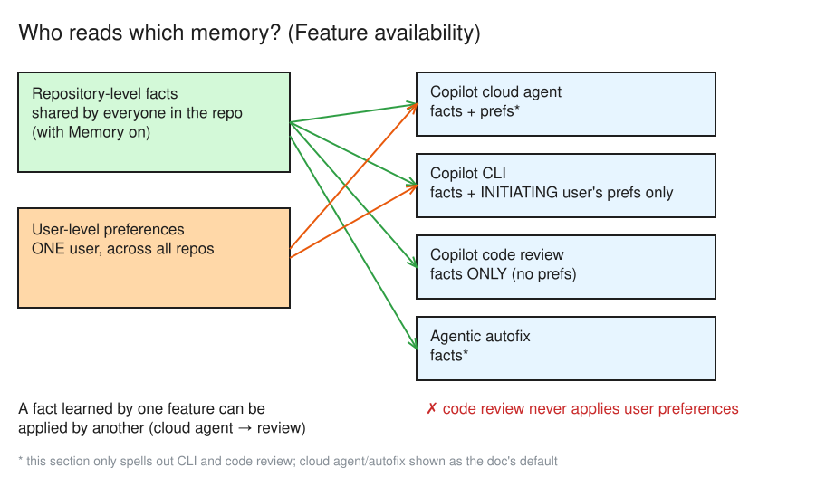
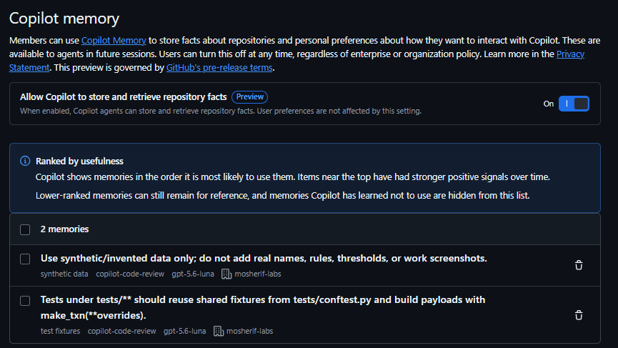

# Day 15 — What does the agent remember?

> Your agent learned a convention on Monday. Who owns that fact, where does it live, who can delete it, and when does it quietly **expire**? Today you map every kind of agent memory, then add one you fully control.

**Deliverable:** Table: memory type · where it lives · who can edit · how it expires/resets · when to use

## Bets

- **Bet A** — Copilot Memory is switched on per… (repository / user / organization only) **My guess: user** (first guess *repository*, revised to *user* during the Mission 1 reads)
  - Result: **Win** (revised bet): actual **user**: *"Copilot Memory is enabled per user, not per repository."* ([Enabling Copilot Memory](https://docs.github.com/en/copilot/concepts/agents/copilot-memory#enabling-copilot-memory)). The repo only has a page to **view and delete** its facts; there is no repo switch
- **Bet B** — A stored memory that nobody uses is auto-deleted after how many days? **My guess: 28 days**
  - Result: **Win**: actual **28 days**: *"Any stored fact or preference that goes unused is automatically deleted after 28 days."* ([Retention and validation](https://docs.github.com/en/copilot/concepts/agents/copilot-memory#retention-and-validation))

## Lessons (Mission 1 — Short-term, long-term, external)

Source: [Types of memories](https://docs.github.com/en/copilot/concepts/agents/copilot-memory#types-of-memories)

- **Repository-level facts**: coding conventions, architectural decisions, build commands, project rules. Shared with **everyone who uses Copilot Memory in that repo**
- **User-level preferences**: stated or implied personal preferences. Apply to **that user only, across all their repos**. On Business/Enterprise plans, **admins** can view and delete them too
- Rule: *facts stay with the repo, preferences follow the person*

Source: [Feature availability](https://docs.github.com/en/copilot/concepts/agents/copilot-memory#feature-availability)

- Used by **Copilot cloud agent, Copilot code review, Copilot CLI and agentic autofix**; a fact learned by one feature can be applied by another
- **Copilot CLI**: repository facts **+ the initiating user's** preferences (not "facts only", not everyone's)
- **Code review**: repository facts **only**, never user preferences

*Editable source: [d15-memory-who-reads.excalidraw](./img/d15-memory-who-reads.excalidraw)*

Source: [Retention and validation](https://docs.github.com/en/copilot/concepts/agents/copilot-memory#retention-and-validation)

- Unused fact or preference → **auto-deleted after 28 days**
- The timer **may reset** each time Copilot successfully **validates and uses** the entry (use it or lose it; never permanent)
- Facts can come from PRs **closed without merging**: they stay **inert** unless the current codebase still backs them up

Source: [Repository-level facts](https://docs.github.com/en/copilot/concepts/agents/copilot-memory#repository-level-facts)

- Created only from actions by users with **write access** **and** Copilot Memory enabled
- Stored **with citations** to the supporting code; checked against the **current branch** before use (stale citation → not used)
- Usable only in operations on the **same repository**; **repository owners** can review and manually delete them

**Mission 1 win:** four features read Memory (cloud agent, code review, CLI, agentic autofix); unused entries expire after **28 days**

## Lessons (Mission 2 — Switch it on)

Source: [Enabling Copilot Memory](https://docs.github.com/en/copilot/concepts/agents/copilot-memory#enabling-copilot-memory)

- Enabled **per user, not per repository**; once on, it applies in every repo where that user uses Copilot
- **Individual plans**: on by default. **Org/enterprise plans**: an admin enables the policy first, then users can **opt out**
- Exam trap: "enable Memory on the repo". No repo switch exists; the repo only has a place to **view and delete** facts

Source: [Disabling or enabling Copilot Memory](https://docs.github.com/en/copilot/how-tos/use-copilot-agents/copilot-memory/manage-for-yourself#disabling-or-enabling-copilot-memory)

- Profile picture → **Copilot settings** → under *Features*, **Copilot Memory** → dropdown → **Enabled** / **Disabled**
- **My setup (2026-10-14):** Copilot Memory was **already Enabled**. Access comes from **Copilot Business via my org**, so the org's Memory policy is on and I haven't opted out (on Business, the admin switch comes first)

**Mission 2 win:** Memory is on, and it's a **user** switch, not a repo one

## Lessons (Mission 3 — Long-term memory you write yourself)

Source: [Types of custom instructions](https://docs.github.com/en/copilot/concepts/prompting/response-customization#types-of-custom-instructions)

- Three levels: **personal** (you, Copilot Chat on GitHub.com) · **repository** · **organization**
- Repository kinds: **repo-wide** `.github/copilot-instructions.md` · **path-specific** `.github/instructions/NAME.instructions.md` (`applyTo` glob) · **agent** `AGENTS.md` / `CLAUDE.md` / `GEMINI.md`
- Agent instruction files are *"currently not supported by all Copilot features"*
- Organization instructions: set by **org owners** only, on **Copilot Business/Enterprise**; supported in Chat, code review and cloud agent on GitHub.com

Source: [Precedence of custom instructions](https://docs.github.com/en/copilot/concepts/prompting/response-customization#precedence-of-custom-instructions)

- *"Personal instructions take the highest priority. Repository instructions come next, and then organization instructions are prioritized last."*
- Inside the repo tier: **path-specific → repo-wide → agent (`AGENTS.md`)**: the narrowest rule wins
- **All** relevant sets are still sent to Copilot: precedence is priority, **not exclusion**. Avoid conflicting instructions

Source: [Creating custom instructions](https://docs.github.com/en/copilot/how-tos/configure-custom-instructions/add-repository-instructions#creating-custom-instructions)

- Repo-wide: `.github/copilot-instructions.md`. Path-specific: `.github/instructions/NAME.instructions.md` with frontmatter `applyTo: "**/*.py"`
- *"When Copilot is working, the nearest AGENTS.md file in the directory tree will take precedence."* (`app/screening/AGENTS.md` beats the root one for `app/screening/rules.py`)

### Three buckets

- **Short-term** (the session's context window): gone when the session ends; nothing carries over unless it's written somewhere
- **Long-term** (Copilot Memory + instruction files + `AGENTS.md`): instruction files and `AGENTS.md` go through **PR review**; Copilot Memory facts **don't** (you can only view/delete them after the fact)
- **External** (repo files, issues, MCP-backed stores): an auditor trusts **versioned repo files** (e.g. ADRs) most: reviewed, with history in git

**Mission 3 win:** any memory fits one of three buckets, and I can say who edits it

## Mission 4 — Scope, expire, prune, reset

Source: [GH-600 study guide → Skills measured](https://learn.microsoft.com/en-us/credentials/certifications/resources/study-guides/gh-600#skills-measured) (*Manage memory, state, and execution 10–15%* → *Implement agent memory strategies*)

- **Choose** between short-term, long-term and external memory
- **Scope** agent memory to task-relevant information
- **Define** memory expiration, pruning and reset rules
- Next sub-skill (Mission 7 target): *capture task progress and decisions as durable artifacts*; resume without diverging from prior decisions

### Scoping rules

1. **Scope:** path-specific instructions (`applyTo: "app/screening/**"`) hold rules that are only true for that area (screening thresholds, sanctions-list handling); repo-wide keeps build/test/style for everyone
   - Tip: the instruction should **point to** where a threshold lives (config/ADR), not copy the number, or it goes stale silently
2. **Expiry:** instruction files never expire; they live until a human edits them in a PR, so **review them on a schedule**. Copilot Memory is the opposite: 28 days unused → gone
3. **Prune/reset:** a wrong **repo fact** is deleted by **repo owners**; a wrong **preference** by **the user** (plus admins on Business/Enterprise)

**Mission 4 win:** three rules I'd defend in a design review

## Mission 5 — Task log (which feature ran each task)

| # | Task | Feature | PR / session |
|---|---|---|---|
| 1 | Add `GET /alerts/{id}/history` endpoint with tests | Copilot cloud agent (issue assigned to Copilot) | [#75](https://github.com/mosherif-labs/github-labs/issues/75) |
| 2 | Rename `REVIEW_THRESHOLD` → `RISK_SCORE_REVIEW_THRESHOLD` and update every caller | Copilot cloud agent (issue assigned to Copilot) | [#77](https://github.com/mosherif-labs/github-labs/issues/77) |
| 3 | Reject duplicate `reference` in `POST /transactions/screen` + `/screen/bulk` with 409 (replaces the plan's negative-amount task: `Field(gt=0)` already did it) | Copilot CLI (local, branch `d15/duplicate-reference`) | [PR #79](https://github.com/mosherif-labs/github-labs/pull/79); tests green |
| 4 | Copilot code review on the CLI PR | Copilot code review (repo facts only, no preferences) | [PR #79](https://github.com/mosherif-labs/github-labs/pull/79) |

**Mission 5 win:** 4 tasks across 3 Copilot features (cloud agent, CLI, code review)

## Mission 6 — Inspect and delete

Source: [Viewing and deleting repository-level facts](https://docs.github.com/en/copilot/how-tos/use-copilot-agents/copilot-memory/manage-for-yourself#viewing-and-deleting-repository-level-facts)

- Repo **Settings** → *Code, planning, and automation* → **Copilot** → **Memory** (repo owners review/delete facts)

What the page showed (2026-10-14, minutes after the tasks):
- **2 facts**, both learned by **copilot-code-review** (from PR #79), none yet from the cloud agent runs
  1. *Use synthetic/invented data only; do not add real names, rules, thresholds, or work screenshots*: already in `.github/copilot-instructions.md` and `AGENTS.md`
  2. *Tests under tests/** should reuse shared fixtures from tests/conftest.py and build payloads with make_txn(**overrides)*: already in `.github/instructions/tests.instructions.md`
- List is **ranked by usefulness**; memories Copilot has learned not to use are **hidden**
- ⚠️ **UI vs docs:** the page has a repo toggle **"Allow Copilot to store and retrieve repository facts" (Preview)**, On. The docs ([Enabling](https://docs.github.com/en/copilot/concepts/agents/copilot-memory#enabling-copilot-memory), [admin how-to](https://docs.github.com/en/copilot/how-tos/use-copilot-agents/copilot-memory/manage-as-administrator)) don't mention it. **For the exam, answer from the docs: enabled per user**
- **Citations aren't visible:** the docs say facts are *"stored with citations pointing to the code that supports them"* ([Repository-level facts](https://docs.github.com/en/copilot/concepts/agents/copilot-memory#repository-level-facts)), but the Memory page shows only the fact, tags (topic · learned by · model · org) and a delete button; clicking a fact shows nothing. So a reviewer **can't see what code backs a fact**, only Copilot checks it, another reason auditable rules belong in repo files

**Deleted:** the *synthetic data only* fact. **Why:** it duplicates reviewed instruction files (`.github/copilot-instructions.md`, `AGENTS.md`); the file is the source of truth

> **Why this matters at a bank:** Copilot Memory facts are **not** reviewed in a PR. Anything an auditor should see goes in files in the repo (Mission 7)

**Mission 6 win:** saw real memories (and that citations aren't shown) and deleted one

## Mission 7 — `docs/decisions/` (ADRs)

- Created `docs/decisions/0000-template.md` (Status · Date · Context · Decision · Consequences) and `0001-record-decisions-as-adrs.md` (**Accepted**)
- `AGENTS.md` → Rules: *"Read `docs/decisions/` before changing behaviour; never contradict an Accepted ADR without a new ADR."*
- Why ADRs beat Memory for decisions: an unused fact **expires after 28 days**; an ADR lives in git until a **reviewed PR** changes it
- New ADRs open as **Proposed**, flip to **Accepted** when the PR is approved; a replaced one becomes **Superseded by NNNN**

**Mission 7 win:** a reviewed, versioned memory store the agent is pointed at

## Deliverable — Memory table

Built closed-book (Mission 8), 9/9.

| Memory type | Where it lives | Who can edit | How it expires / resets | When to use |
|---|---|---|---|---|
| Session context (short-term) | The context window of one session | Nobody directly; steered by prompting | Gone when the session ends | The task at hand |
| Copilot Memory: repo facts (long-term) | Stored by GitHub per repo, with citations (not shown in the UI) | Created from work by users with **write access** + Memory on; **repo owners** review/delete | Deleted after **28 days unused**; timer may reset on validated use | Conventions Copilot picks up on its own |
| Copilot Memory: user preferences (long-term) | Per user, across repos | The **user** views/deletes; **admins** too on Business/Enterprise | **28 days unused** | Personal working style |
| `.github/copilot-instructions.md` (long-term) | In the repo | Anyone who can merge a PR (reviewed) | Never expires; changes only via PR | Whole-repo rules: build, test, style |
| `.github/instructions/NAME.instructions.md` (long-term) | In the repo, scoped by `applyTo` glob | Anyone who can merge a PR | Never expires | Rules true only for one area (`tests/**`, `app/screening/**`) |
| `AGENTS.md` (long-term) | In the repo; **nearest one in the tree wins** | Anyone who can merge a PR | Never expires | Agent setup/test/run + rules; not supported by every Copilot feature |
| `docs/decisions/` ADRs (external) | In the repo, versioned in git | Anyone who can merge a PR (reviewed) | Never expires; replaced by a new ADR (*Superseded*) | Durable decisions an auditor must find |
| Issues (external) | On GitHub, per repo | Triage/write access (authors for their own) | Never expire; closed, not deleted | Task contracts, progress, handoffs |
| MCP-backed store (external) | Outside GitHub, wherever the server writes | Whoever controls that server/store | That store's own rules (GitHub doesn't expire it) | Data that lives in another system (e.g. sanctions lists) |

Answer key check (plan's reveal): ✓ repo facts (owners review/delete, 28 days, timer may reset) · ✓ preferences (user; admins on Business/Enterprise can also **export**/delete) · ✓ instruction files and ADRs never expire on their own

**Mission 8 win:** the table exists and the Copilot Memory rows match the docs

## Reflection

- **Which memory would I trust for a regulator?** An Accepted ADR in docs/decisions/: reviewed PR, author/approver and history in git.
- **Where must the authoritative threshold live?** In code/config (`app/rules.py`) behind CODEOWNERS, with an ADR recording why 50 and who approved it; Copilot Memory and instructions only point there. Gap found: CODEOWNERS covers `app/screening.py` but **not** `app/rules.py`, where the threshold actually lives. **Fixed:** added `/app/rules.py @sheriffMoose` to `CODEOWNERS` in the Day 15 PR.
- **What surprised me?** Citations are stored but I can't see them on the repo Memory page, so a reviewer can't check what code backs a fact.
