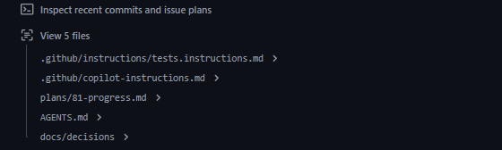

# Day 16 — Durable state: three sessions, zero déjà vu

> One big task, three sessions, three Copilot surfaces (VS Code agent → Copilot CLI → cloud agent). The only thing they share is a markdown file. Can session 3 pick up **without repeating a step or undoing a decision**?

**Deliverable:** Progress file history (`plans/<issue>-progress.md`) showing no repeated steps

## Bets

- **Bet A** — How many steps/decisions from S1–S2 will S3 repeat or reverse, even with the progress file? **My guess: 1**
  - Result: **Miss** (exact needed): actual **0 repeats + 0 reversals**. S3 (`7a01a20`) kept the unrecorded 409, didn't touch S1's model or S2's endpoint. But it **locked in a drift**: the issue's `reason` never reached the audit event, and S3 wrote *"no additional history fields are needed"* into Decided. Zero repeats ≠ correct result
- **Bet B** — At roughly what % of the token limit does Copilot CLI auto-compress history? **My guess: 50%**
  - Result: **Miss**: actual **~80%**: Copilot *"starts compressing your history in the background when your conversation approaches 80%"* of the token limit. If static context (system messages, tool definitions) already fills ~75%+, it waits until ~90%; if usage hits ~95% before background compaction finishes, it blocks until done ([Context management](https://docs.github.com/en/copilot/how-tos/copilot-cli/use-copilot-cli/overview#context-management))

## Lessons (Mission 1 — Progress and decisions as artifacts)

Source: [Researching, planning, and iterating before opening a pull request](https://docs.github.com/en/copilot/tutorials/cloud-agent/get-the-best-results#researching-planning-and-iterating-before-opening-a-pull-request)

- The cloud agent can **research the repo, create an implementation plan, and iterate on a branch** *before* any PR exists
- Why: understand the codebase first, agree on an approach before code is written, review the diff before opening a PR

Source: [Review session logs](https://docs.github.com/en/copilot/how-tos/copilot-on-github/use-copilot-agents/manage-and-track-agents#review-session-logs)

- *"Session logs show Copilot's internal reasoning and the tools it used to understand your repository, make changes, and validate its work."*
- Copilot runs in its own ephemeral dev environment, so it can run tests and linters there

Source: [Trace commits to session logs](https://docs.github.com/en/copilot/how-tos/copilot-on-github/use-copilot-agents/manage-and-track-agents#trace-commits-to-session-logs)

- Cloud agent commits are **authored by Copilot**, with the person who started the task as **co-author**
- Each commit message **links to the session logs**, so a reviewer can trace *why* a change was made

**Key idea: logs are evidence, not state.** A new session never reads yesterday's log. The durable state it *does* read is the repo, so the progress file lives in the repo.

| What | Where it lives | Read by the next session? |
|---|---|---|
| Progress (Done / Decided / Next) | `plans/<issue>-progress.md` in the repo | ✅ yes, if told to (`AGENTS.md`) |
| Reasoning + tool calls | Session logs | ❌ no, humans read these for review/audit |
| Who changed what | Commits (Copilot author + you co-author, link to log) | Only the code, not the reasoning |

- ⚠️ Check-question slip: I first picked *"yesterday's session log"* as what a new session reads. Wrong: logs are for humans (review/audit); the next session reads **repo files**. Analogy: log = audit trail, progress file = case file.
- A decision that must survive (e.g. disposition enum `CLEARED / ESCALATED / SAR_FILED`) goes in **Decided**, committed to the branch

## Setup (Mission 2 — One big task, three slices)

- Issue [#81](https://github.com/mosherif-labs/github-labs/issues/81): **Disposition override**, a QA reviewer changes a closed alert's disposition, audited
  - Changed from the plan's "disposition model + endpoint" because `app/` already had `Disposition`, `POST /alerts/{id}/close` and `/history`
- Branch `feat/81-disposition`, draft PR [#82](https://github.com/mosherif-labs/github-labs/pull/82)
- Progress file: `plans/81-progress.md` (Done / Decided / Next)
- `AGENTS.md` rule: read the progress file before working on an issue; update Done / Decided / Next at the end
- Slices: **S1** model (VS Code agent) · **S2** `PATCH /alerts/{id}/disposition` + validation (Copilot CLI) · **S3** audit trail + tests (cloud agent via `@copilot` on PR #82)

## Session 1 — VS Code agent (Mission 3)

- Prompt: *"Work on S1 of `plans/81-progress.md` only."* (deliberately no "update the file": the `AGENTS.md` rule had to do that)
- Read `plans/81-progress.md` **first**, before touching code ✅
- Stayed in scope: only `app/models.py` + `tests/test_alerts.py` (no endpoint) ✅; tests green
- Added `DispositionChangeIn` (disposition, reviewer, reason), `AlertEventType.DISPOSITION_CHANGED`, optional `from_disposition` / `to_disposition` on `AlertHistoryEvent`
- File updated: Done = S1 · Decided = *from/to optional because `AlertHistoryEvent` serves many event types* · Next starts at S2
- 🔍 Gap to watch: issue wants the audit event to carry **reason**, but `AlertHistoryEvent` has no `reason` field yet. A later session must add it (not a reversal, but Done doesn't flag it)
- Done entry has no commit sha (the template asked for one): the agent can't know a sha before the commit exists

## Lessons (Mission 4 — How the CLI resumes)

Source: [Resume an interactive session](https://docs.github.com/en/copilot/how-tos/copilot-cli/use-copilot-cli/overview#resume-an-interactive-session)

- `--resume` (launch option) or `/resume` (slash command): **pick** a past interactive session and continue with its saved context
- `copilot --continue`: no picker, reopens the **most recently closed local** session
- The CLI can also pull a cloud agent session started on GitHub into your local environment

Source: [Context management](https://docs.github.com/en/copilot/how-tos/copilot-cli/use-copilot-cli/overview#context-management)

- `/context` = visual overview of token usage · `/compact` = manually compress history · `/usage` = session stats (AI credits, duration, lines edited, tokens per model)
- Auto-compression: background, at **~80%** of the token limit → **~90%** if static context is already ~75%+ → at **~95%** it blocks until compaction finishes

**Twist: why not just `--resume`?** `--resume` / `--continue` restore a **local CLI** session only. S1 ran in VS Code, S3 runs in the cloud. The only thing all three surfaces can read is the **repo**, so S2 starts **fresh** from the progress file on purpose.

## Session 2 — Copilot CLI (Mission 5)

- Fresh `copilot` session from the progress file (no `--resume`); commit `d4ce506`
- Added `PATCH /alerts/{id}/disposition`: 404 unknown · 409 if alert not closed · **409** if disposition unchanged · 422 via `DispositionChangeIn`; endpoint tests + README row
- Decided unchanged ✅ · stayed in S2 ✅ · Done honestly says *"no history event yet"*
- `/context` midway: **under 25%** of the token limit (far from the ~80% auto-compression point)
- ⚠️ Commit message kept the literal `<issue>` placeholder
- 🔍 **Unrecorded decision**: 409 (not 422) for a no-op change was chosen in code but **not written to Decided**, so nothing tells S3 it's intentional
- 🔍 **Drift**: Next for S3 says *"reviewer, from/to"*; the issue's **reason** dropped out
- ⚠️ Risk-check slip: I said the risk was *S3 redoes the endpoint*. Wrong: the endpoint is in **Done**, which guards against repeats. The real risk is a **reversal**: an unrecorded choice looks like a bug, and **Decided** is the only thing that guards choices. Rule: *Done stops repeats, Decided stops reversals*

## Session 3 — Cloud agent (Mission 6)

Sources: [Asking Copilot to make changes](https://docs.github.com/en/copilot/how-tos/use-copilot-agents/cloud-agent/use-cloud-agent-on-github#asking-copilot-to-make-changes) · [Using comments to iterate on a pull request](https://docs.github.com/en/copilot/tutorials/cloud-agent/get-the-best-results#using-comments-to-iterate-on-a-pull-request)

- `@copilot` works on **any** PR, including ones you opened yourself; only comments from people with **write access** trigger it
- By default it pushes commits **directly to the PR's branch** (ask in the comment for a separate PR instead)
- Batch feedback with **Start a review** so Copilot works on the whole review at once, not comment by comment

Run:
- Comment on PR [#82](https://github.com/mosherif-labs/github-labs/pull/82): *"@copilot Read `plans/81-progress.md` and do S3 only. Don't repeat Done or reverse Decided."* (progress file left **unpatched** on purpose: the 409 choice and `reason` drift were not fixed before S3)
- Setup ran first (`setup-uv`, custom setup steps, tests once, MCP servers), then *"Inspect recent commits and issue plans"*, then it viewed `tests.instructions.md`, `copilot-instructions.md`, **`plans/81-progress.md`**, `AGENTS.md`, `docs/decisions` before writing code
- Session title came from the PR title (*"Working on progress file and AGENTS.md rule"*, the first commit's headline via `gh pr create --fill`)

- ❌ **Attempt 1 changed nothing.** It ran ~1 min, read the file, then replied: *"Read `plans/81-progress.md`. It records S1 and S2 as done … S3 … as next; no changes were requested in the comment."* No commits
  - The comment rendered as `plans/-progress.md`: the literal `<issue>` placeholder was eaten by Markdown as an HTML tag (same placeholder slip as the S2 commit message)
  - It read the request as *"look at the file"*, not *"make changes"*. Lesson: the progress file says **what** to do, but the trigger comment must clearly say **do it and push**. Durable state doesn't replace a clear instruction
- My `/context` + notes commit wasn't pushed before S3 either, so the agent saw the pre-`/context` progress file (no effect on S3's content)

## Audit (Mission 7)

`git log -p --follow -- plans/81-progress.md` → 4 versions: `4fac9a5` (template) · `b5b4a93` S1 · `d4ce506` + `3be9d7c` S2 · `7a01a20` S3 (`copilot-swe-agent[bot]`)

| Check | S3 result |
|---|---|
| Repeats (redid Done) | **0**: model and endpoint untouched; only added the history append + 1 test |
| Reversals (undid Decided / S1–S2 choice) | **0**: kept from/to optional; kept the **unrecorded** 409 for a no-op change |
| Drift | ⚠️ `reason` (in the issue) was never stored on the history event. S1 left it out, S2's Next dropped it, S3 **made it official** in Decided: *"no additional history fields are needed"* |

- Bet A guess 1 → actual 0 (miss). The real failure wasn't a repeat or reversal: it was a requirement that silently fell out of **Next**
- The file did its job for *Done* (no repeats) and *Decided* (no reversals, even of an unrecorded choice). It can't protect what never got written into it
- In AML terms: an override audit event with no **reason** is an examiner finding: who changed it is recorded, but not why
- **My format fix:** add an **Acceptance** section copied from the issue; sessions tick it, never edit it (written to `plans/81-progress.md` → Audit)

## Reflection

- **Which field did the most work to stop repeats?** **Done**: S3 saw S1 and S2 listed and didn't redo the model or endpoint. (Decided is what stopped reversals.)
- **Making Decided defensible to an examiner:**
  - Each entry: **who** (human, or agent + session-log link), **when**, **why**
  - Decided changes land only through a **reviewed PR** (CODEOWNERS on `plans/`)
  - **Append-only**: supersede with a new entry, never edit; git history is the trail
  - Each decision **traces to an acceptance criterion** in the issue. That's the one that would have caught the dropped `reason`
