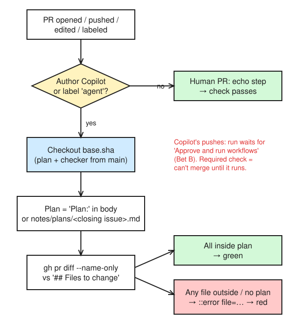

# Day 17 — Drift, conflicting & stale context: catch it with a check, not by eye

> Plant a **stale** rule and a **conflicting** rule, watch three Copilot surfaces trip over them, then build a CI check that fails the moment an agent wanders outside its approved plan.

**Deliverable:** this note + the `plan-scope` check merged and required on `main`

## Bets

- **Bet A** — `AGENTS.md` says one thing, a path-specific `.instructions.md` says the opposite for the same file. What does Copilot get? **My guess: both, and the outcome isn't guaranteed**
  - Result: **Win**: the docs say all relevant instruction sets are sent (path-specific ranks higher) and to avoid conflicts, so the outcome isn't guaranteed. Observed: all 3 surfaces went 422, but only because the edits were outside `app/routers/**` and the codebase already used 422 ([Precedence](https://docs.github.com/en/copilot/concepts/prompting/response-customization#precedence-of-custom-instructions))
- **Bet B** — Will the new plan-scope workflow run on its own when the cloud agent pushes to its PR? **My guess: no (workflows need approval to run)**
  - Result: **Win**: no. CI on Copilot's PR #85 sat at **`action_required`**: *"GitHub Actions workflows will not run automatically when Copilot pushes changes to a pull request"*; someone with write access clicks **Approve and run workflows** ([Troubleshooting cloud agent](https://docs.github.com/en/copilot/how-tos/use-copilot-agents/cloud-agent/troubleshoot-cloud-agent#my-github-actions-workflows-are-not-running-when-copilot-pushes)). Consequence: a required `plan-scope` check can't be skipped, but it also won't go green or red until a human approves the run

## Lessons (Mission 1 — Who reads what, and who wins)

Source: [Precedence of custom instructions](https://docs.github.com/en/copilot/concepts/prompting/response-customization#precedence-of-custom-instructions)

- Order, highest first: **personal** → **repository** (path-specific → repository-wide → agent files like `AGENTS.md`) → **organization**
- **All** relevant instruction sets are still sent to Copilot. Priority tells the model which to favour; it doesn't filter anything out
- The docs' advice: *"Whenever possible, try to avoid providing conflicting sets of instructions."*
- ✅ Check: personal says tabs, `AGENTS.md` says spaces → both are sent, personal ranks higher. A conflict gets **sent** to the model, not **resolved** before it

Already studied on Day 1 (Bet A miss), Day 7 (diagram below) and Day 15. Today was a closed-book recall: **3/3**.

*Editable source: [d07-precedence.excalidraw](img/d07-precedence.excalidraw). Mnemonic: **me → my path → my repo → my AGENTS.md → my org***

Sources: [Path-specific instructions](https://docs.github.com/en/copilot/how-tos/configure-custom-instructions/add-repository-instructions#creating-path-specific-custom-instructions) · [Support: GitHub.com](https://docs.github.com/en/copilot/reference/custom-instructions-support#githubcom) · [Support: Copilot CLI](https://docs.github.com/en/copilot/reference/custom-instructions-support#copilot-cli)

- `applyTo` takes a glob (`"app/api/**"`, comma-separate several). Path-specific match + repo-wide file → **both** are used
- `excludeAgent: "code-review"` or `"cloud-agent"` hides the file from that one agent; omit it and both use it
- Who reads what:

| Surface | Repo-wide | Path-specific | Agent files | Personal | Org |
|---|---|---|---|---|---|
| Cloud agent | ✅ | ✅ | `AGENTS.md` / `CLAUDE.md` / `GEMINI.md` | | ✅ |
| Code review | ✅ | ✅ | `AGENTS.md` **only** | | |
| Copilot CLI | ✅ | ✅ | ✅ | ✅ home-dir files | |

- **Shared state across tools:** the repo files are the one thing VS Code, the CLI and the cloud agent all read. A rule that lives only in one tool's settings is a conflict waiting to happen

## Observed (Mission 2)

| Surface | 400 or 422? | Used stale 0–10 score? | Mentioned the conflict? |
|---|---|---|---|
| VS Code agent mode | **422** (Pydantic `pattern=r"^[A-Z]{4}$"` on `TransactionIn`, test asserts 422) | No | **Yes**, mentioned the conflict, then went 422 |
| Copilot CLI (`claude-sonnet-5.5`) | **422** (same `pattern` on `TransactionIn`; 3 tests: valid → 201, omitted → 201 + `None`, `sala`/`SAL`/`SALAR`/`SA1A` → 422) | No | **No**, silent |
| Cloud agent (issue #84 → draft PR #85) | **422** (`app/models.py` +1, `tests/test_transactions.py` +14; tests assert 201 / 422) | No | **No**, silent (PR body says nothing) |

Prompt (same on every surface): *Add an optional `purpose_code` field (exactly 4 uppercase letters, e.g. `SALA`) to `TransactionIn` for `POST /transactions/screen`, and reject a malformed one, with a test.*

- Guide adapted to this repo: API folder is `app/routers/` (not `app/api/`), so `applyTo: "app/routers/**"`; stale rule flipped to *"floats 0.0–1.0"* because the code uses `risk_score: int` 0–100; `counterparty_country` doesn't exist, so the prompt adds `purpose_code`
- Planted in PR **#83**
- 🔍 VS Code: `api.instructions.md` was **not** in *Used N references*. The edit landed in `app/models.py` + `tests/`, outside `app/routers/**`, so the `applyTo` glob never matched. It still knew about the conflict (likely by opening the file because `AGENTS.md` points at `.github/instructions/`). Lesson: **`applyTo` matches the files being edited, not the endpoint you name in the prompt**
- 🔍 CLI: loaded `tests.instructions.md` (it edited `tests/`, so that `applyTo` matched) but **never** `api.instructions.md`, same reason as VS Code. Grepped the existing tests for `422` and copied the pattern. Self-corrected 200 → 201 after `pytest` failed. Said it *didn't* read `plans/` or `docs/decisions/` even though `AGENTS.md` says to read the ADRs before changing behaviour: an `AGENTS.md` rule ignored
- 🔍 Cloud agent: same two files, so again outside `app/routers/**`. Even the `issue-triage` agentic workflow's comment on #84 predicted *"malformed values rejected (422)"*. CI on #85 sat at **`action_required`** until approved (preview of Bet B)
- **Verdict:** 3/3 surfaces → 422, 0/3 used the stale float rule, 1/3 (VS Code) mentioned the conflict. The conflict didn't produce *different* answers here because the 400 file never matched; the stale rule was harmless only because nothing touched scores. Silence is the danger: 2/3 surfaces gave no hint that two rules disagree
- Existing tests already assert `== 422`, so the codebase itself votes for 422

## Stale context (Mission 3)

Source: [Retention and validation](https://docs.github.com/en/copilot/concepts/agents/copilot-memory#retention-and-validation) (Day 15 recall: **2/2**)

| | Copilot Memory | `AGENTS.md` / instruction files |
|---|---|---|
| Checked against code before use? | ✅ citations checked against the **current branch**; stale → not used | ❌ never |
| Expires? | ✅ unused **28 days** → deleted | ❌ lives until a human edits it in a PR |

**What makes a stale `AGENTS.md` line get noticed (my picks):**
1. **CODEOWNERS on instruction files**: today only `/.github/` is owned; `/AGENTS.md` isn't, which is how PR #83 slipped a stale rule in unreviewed. Add `/AGENTS.md` (and any nested `AGENTS.md`)
2. **Each rule links the ADR that justifies it**: a rule with no ADR is suspect; superseding an ADR flags the rules that cite it
3. **Scheduled review**: e.g. a monthly issue to re-read every instruction file against the code
- Not picked today, but it's my own Day 15 tip and the one that would have **prevented** today's stale rule: a rule should **point to** where a value lives (`RiskScore` in `app/models.py`), not copy the value (`0.0–1.0`)

## The plan-scope check (Missions 4–6)

Sources: [`pull_request` event](https://docs.github.com/en/actions/reference/workflows-and-actions/events-that-trigger-workflows#pull_request) · [GitHub CLI in workflows](https://docs.github.com/en/actions/how-tos/write-workflows/choose-what-workflows-do/use-github-cli) · [Workflows not running when Copilot pushes](https://docs.github.com/en/copilot/how-tos/use-copilot-agents/cloud-agent/troubleshoot-cloud-agent#my-github-actions-workflows-are-not-running-when-copilot-pushes)

**What the check needs to know (M4):**
- Trigger: `pull_request` defaults to `opened`, `synchronize`, `reopened`; I added `edited` (PR body gets a `Plan:` line) and `labeled` (the `agent` label)
- On `pull_request`, `GITHUB_REF` is the merge ref `refs/pull/<n>/merge`, so a default checkout = the PR's code **plus** main. No run at all while the PR has a merge conflict
- Every step that runs `gh` needs `GH_TOKEN: ${{ secrets.GITHUB_TOKEN }}`
- Copilot's pushes don't run workflows until **Approve and run workflows** (Bet B)

*Editable source: [d17-plan-scope.excalidraw](img/d17-plan-scope.excalidraw)*

**How it works (M5, merged in PR #86, required on `main` in the `main` ruleset):**

| Piece | What it does | Why |
|---|---|---|
| `IS_AGENT` | author `Copilot` **or** label `agent` | Human PRs only run the echo step → pass |
| `checkout ref: base.sha` | reads the plan **and** the checker from `main` | An agent can't loosen its own plan in its PR |
| `gh pr diff --name-only` | the changed files | The thing to police |
| `closingIssuesReferences` | `Fixes #84` → `notes/plans/84.md` | No `Plan:` line needed when the PR closes an issue |
| `PR_BODY` via `env` | never pasted into `run:` | Script injection: PR body is untrusted input |
| `::error file=…::` | annotates the file in the PR | Drift shows up on the diff, not in a log |

- Plans live in `notes/plans/<issue>.md` (Day 4); progress files stay in `plans/`
- Known hole: the **workflow YAML** still comes from the PR, so an agent PR could weaken it. Mitigation: CODEOWNERS on `/.github/` (already there) + required review
- Self-test (local): plan `notes/plans/84.md` with `app/models.py` + `tests/test_transactions.py` → those two = `2/2 … exit 0`; add `README.md` → `::error file=README.md::README.md is not in the approved plan notes/plans/84.md` + `exit 1`

**Catch drift (M6):** reused Copilot's PR **#85** (closes #84) instead of a new bait issue, to save premium requests. Plan PR **#87** puts `notes/plans/84.md` on `main`
- In-plan run after #89 (README reverted, `5636d46`, only the 2 planned files): **green** ✅ (run 39138720676)
- Out-of-plan push (`README.md` added to Copilot's branch, `dd9b443`): run went **red, but for the wrong reason**: `exit code 2`, no `::error file=` annotation. My push ran with no approval needed (human push); Copilot's own pushes on #85 had sat at `action_required`
- 🐛 **Root cause: `pull_request.base.sha` is frozen.** For #85 it's `0584a63`, main when Copilot opened the PR 3 days earlier, which has neither `scripts/check_plan_scope.py` nor `notes/plans/84.md`, so `python3` couldn't open the script. Fix in PR **#89**: check out `base.ref` (main's current tip). Lesson: a check that reads policy from main must read **main now**, not main as of PR open. It failed **closed** (red), which is the safe direction
- Re-trigger by removing + re-adding the `agent` label: run sat at **`action_required`** even though *I* added the label. On a Copilot-authored PR, label/edit events still wait for **Approve and run workflows**; only my own **push** ran straight away
- Red run: the first drift run (`dd9b443`, `README.md` added) went red (exit 2, base.sha bug above). With the fixed checker the same file list gives `::error file=README.md::README.md is not in the approved plan notes/plans/84.md` / `2/3 changed files are inside notes/plans/84.md` / exit 1 (local self-test). Stopped there; #85 closed unmerged, #84 closed as not planned

### Mission 5: build it

**Rule:** an **agent** PR (author `Copilot`, or label `agent`) must stay inside an approved plan **on `main`**: `Plan: notes/plans/<issue>.md` in the PR body, or else `notes/plans/<issue>.md` for the issue the PR closes. Only files under `## Files to change` (plus `plans/*-progress.md`) may change.

- Files: [`.github/workflows/plan-scope.yml`](../.github/workflows/plan-scope.yml) · [`scripts/check_plan_scope.py`](../scripts/check_plan_scope.py) · PR **#86** (`ci/d17-plan-scope`)
- Adapted to this repo: approved plans live in `notes/plans/` (moved in `804f5f2`), so the default path is `notes/plans/<issue>.md` and the `Plan:` line accepts `plans/…` or `notes/plans/…`
- Author login: REST shows PR #85's author as `Copilot` (`gh api repos/{owner}/{repo}/pulls/85 --jq .user.login`); `gh pr list` shows it as `app/copilot-swe-agent`
- `agent` label created for PRs you open on behalf of a local agent

Local self-test (`PR_BODY` / `ISSUE` set by hand, plan `notes/plans/29.md`):

| Case | Output | Exit |
|---|---|---|
| `app/routers/transactions.py` + `README.md` | `::error file=README.md::README.md is not in the approved plan notes/plans/29.md` · 1/2 inside | 1 |
| 2 planned files + `plans/29-progress.md` | 3/3 inside | 0 |
| No `Plan:` line, PR closes #29 | 3/3 inside (fallback found the plan) | 0 |
| PR closes #84 (no plan) | `::error::Agent PR has no approved plan on main (looked for notes/plans/84.md)` | 1 |

PR #86 (human PR): `plan-scope` **pass in 2s** (echo step only), `test` pass, CodeQL pass.

**Why it checks out `base.sha`:** on `pull_request` the default checkout is the PR's merge commit, so the agent could edit its own plan or the checker. Reading both from `main` makes such an edit just one more out-of-plan file. **What it can't stop:** the workflow YAML itself runs from the PR, so an agent could weaken it → Day 25 puts `.github/workflows/` under CODEOWNERS.

- ✍️ Why must `plan-scope` be added as a required check only *after* #86 merges?
  - 📖 Reference: [Available rules for rulesets → Require status checks to pass before merging](https://docs.github.com/en/repositories/configuring-branches-and-merges-in-your-repository/managing-rulesets/available-rules-for-rulesets#require-status-checks-to-pass-before-merging)
  - 
- ✍️ An agent PR adds `plan-scope.yml` to its diff. What does the check say, and why is that the right outcome?
  - 
- ✍️ What would break if `PR_BODY` were pasted straight into `run:` as `${{ github.event.pull_request.body }}`?
  - 

## Fix (Mission 7) — PR #88

| Rule | Home now | Owner |
|---|---|---|
| Validation → 422, field rules in Pydantic models | `.github/instructions/api.instructions.md`, `applyTo: "app/routers/**,app/models.py"` | CODEOWNERS `/.github/` |
| Risk scores | **No copied range.** The instruction points to `risk_score` in `app/models.py` and `app/rules.py` | CODEOWNERS `app/rules.py` |
| Setup, tests, `infra/`, progress files, ADRs | `AGENTS.md` (points to `.github/instructions/` for API rules) | CODEOWNERS `/AGENTS.md` (new) |

- Stale `0.0–1.0` rule deleted; the 400 rule replaced; `AGENTS.md` no longer restates API rules
- `applyTo` widened to `app/models.py` because that's where all 3 surfaces actually edited
- **Detect drift next time:** signal = an agent PR touching files its plan doesn't list → `plan-scope` goes red. For instruction drift: CODEOWNERS review on every instruction file + rules that point to code instead of copying values
- Rerun on one surface after #88: skipped (ran out of time)

## Reflection

- _Not answered yet: (1) which surface handled the conflict worst, and why? (2) besides a file list, what else should a plan-scope check enforce for a screening-rule change?_

## PRs today

#83 plant · #84/#85 cloud agent run (closed) · #86 plan-scope check · #87 plan for #84 · #88 one source of truth · #89 `base.ref` fix · this notes PR
