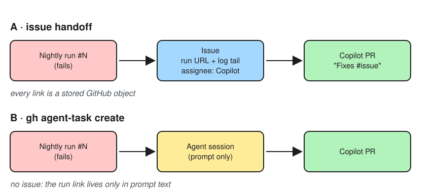
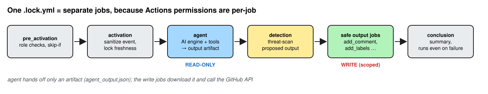
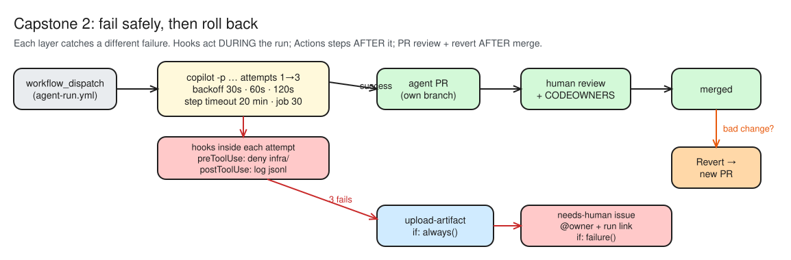
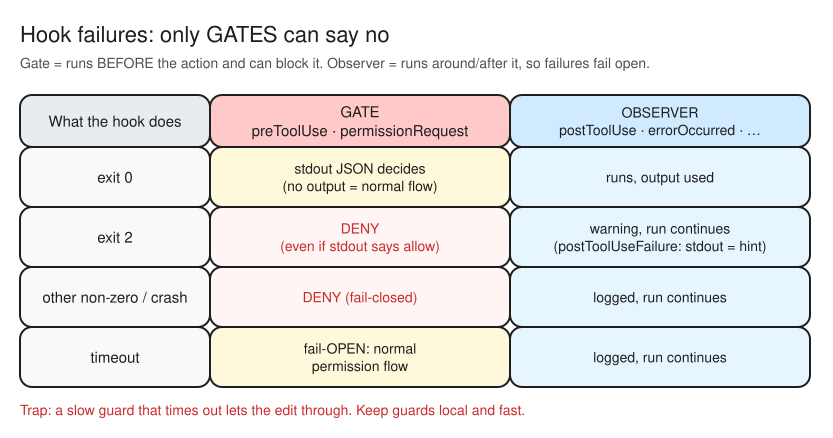

# GH-600 Weeks 1–2 — my notes (bundle for NotebookLM)


---

<!-- source: notes/gap-log.md -->

# GH-600 gap log

Every objective I miss (a quiz question, a lab step or a setting that didn't work) gets a row here. Tracking lives in the **"GH-600 objectives"** issue, where each objective is labelled `red`, `amber` or `green`. Move an objective to `amber` or `red` in that issue when it lands here.

Synthetic data only: no real names, rules, thresholds or screenshots from work.

| date | objective | why I missed it | doc link |
|---|---|---|---|
| 2026-10-02 | Required reviews on `main` (Domain 6 controls) | Assumed the ruleset required 1 approval; "Require a pull request" was ticked but **Required approvals = 0** under *additional settings*, so no review was ever enforced. Raised to 1 to test, then deliberately back to 0 (solo repo; no second reviewer) | [Docs — Available rules for rulesets](https://docs.github.com/en/repositories/configuring-branches-and-merges-in-your-repository/managing-rulesets/available-rules-for-rulesets#require-a-pull-request-before-merging) |
| 2026-10-04 | 1.3 Define success criteria (W1 quiz Q6, sure → ✗; re-quiz 2/2 ✓) | Said `copilot-instructions.md`. Instructions only **ask** the agent; success criteria must be **enforced by the system** as required status checks that block merge. Same guidance-vs-enforcement split as the planner's tools | [Learn — task contract](https://learn.microsoft.com/en-us/training/modules/design-agent-architecture-integration/3-inputs-outputs-success-criteria#example-task-contract-vulnerability-remediation) |
| 2026-10-04 | 2.3 Validate agent plans (W1 quiz Q11, sure → ✗; re-quiz 2/2 ✓) | Picked "no `infra/` in Files to change". A plan that silently **swaps the task** passes that check; only "every file is justified by the issue" (checklist §2) catches it. Validate the plan against the **request**, not just a deny-list | [Learn — Separate planning, reasoning, and execution](https://learn.microsoft.com/en-us/training/modules/design-agent-architecture-integration/4-plan-reason-execution) · [`plan-checklist.md`](plan-checklist.md) §2 |
| 2026-10-04 | 3.2 Inspectable artifacts (W1 quiz Q17, sure → ✗; re-quiz 2/2 ✓) | Said "only the PR description". Each Copilot **commit message links to its session logs**, and commits are authored by Copilot with the requester as **co-author**. ⚠️ My Day 5 evidence: the *raw* commit message on #26 had no link (see `d05-controls.md` Mission 3); for the exam, answer with the docs | [GitHub Docs — Trace commits to session logs](https://docs.github.com/en/copilot/how-tos/copilot-on-github/use-copilot-agents/manage-and-track-agents#trace-commits-to-session-logs) |
| 2026-10-04 | Instruction-file precedence (W1 know-cold #1, ✗; retest 2 ✓) | Said personal > organization > repository. Correct: **personal > repository (path-specific > repo-wide > `AGENTS.md`) > organization**; all relevant sets are still sent. Narrow beats broad | [GitHub Docs — Precedence of custom instructions](https://docs.github.com/en/copilot/concepts/prompting/response-customization#precedence-of-custom-instructions) |
| 2026-10-05 | 2.x CLI tool restriction (D8 Mission 2 check, ✗; re-test 1 ✓) | Said `--excluded-tools` wins when both are given. Docs: the CLI *"will apply the allowlist specified by `--available-tools` and ignore the denylist specified by `--excluded-tools`"*. Don't carry over "deny wins" from the permission layer: in the **availability** layer the allowlist wins | [Docs — Restricting the choice of tools](https://docs.github.com/en/copilot/how-tos/copilot-cli/use-copilot-cli/allowing-tools#restricting-the-choice-of-tools-available-to-the-ai-model) |
| 2026-10-05 | 2.x CLI persisted permissions (D8 Mission 2 check, ✗; re-test ✓) | Said interactive approvals live only in session memory. They are **saved to `permissions-config.json`** in the config dir, scoped to the location; only **command-line flags** are session-only. Reset with `/reset-allowed-tools` | [Docs — Persisted permissions](https://docs.github.com/en/copilot/how-tos/copilot-cli/use-copilot-cli/allowing-tools#persisted-permissions) |
| 2026-10-05 | 2.x Tool approval per surface (D8 Mission 2 check, 4/4 ✗; re-test 4/4 ✓) | Mixed the surfaces: used CLI answers (`--allow-tool`, `/reset-allowed-tools`) for VS Code, thought CLI approvals die with the session, and that someone approves the cloud agent. Map: **CLI** = flags + `permissions-config.json` + `/reset-allowed-tools` · **VS Code** = Allow dropdown + `chat.tools.terminal.autoApprove` + *Chat: Reset Tool Confirmations* · **cloud agent** = no prompt, profile `tools:` is the gate (see `d08-three-surfaces.svg`) | [VS Code — Tool approval](https://code.visualstudio.com/docs/copilot/chat/chat-tools#tool-approval) · [Docs — Persisted permissions](https://docs.github.com/en/copilot/how-tos/copilot-cli/use-copilot-cli/allowing-tools#persisted-permissions) |
| 2026-10-05 | Custom agent profile locations + filenames (D8 Mission 3 check, 2/2 ✗; re-test 2/2 ✓) | Said org-wide agents live in *Org settings > Copilot > Agents*: they're **files** in the org's `.github` or `.github-private` repo (enterprise: `.github-private` of a designated org). Picked `docs_writer.v2.agent.md` as invalid: `.` and `_` are allowed; a **space** is not | [Docs — Creating a custom agent profile](https://docs.github.com/en/copilot/how-tos/copilot-on-github/customize-copilot/customize-cloud-agent/create-custom-agents#creating-a-custom-agent-profile-in-a-repository-on-github) |
| 2026-10-05 | `web` on the cloud agent (D8 Mission 4 observation, ✗) | Said the tester fetched the release-notes page. Session log: *"the release-notes site could not be fetched from this environment"*; it worked around it via FastAPI's GitHub release entry. `web` is **not applicable** to the cloud agent | [Docs — Tool aliases](https://docs.github.com/en/copilot/reference/custom-agents-configuration#tool-aliases) · [`img/d08-tester-51-session.jpg`](img/d08-tester-51-session.jpg) |
| 2026-10-06 | Cloud-agent MCP secret location (D9 Bet B, ✗) | Said *Actions secret*. Agents secrets are a **separate type** from Actions; only ones named `COPILOT_MCP_*` reach the MCP config (and they are not exposed as normal env vars). The `copilot` environment was migrated into Agents secrets | [Docs — Naming requirements](https://docs.github.com/en/copilot/how-tos/copilot-on-github/customize-copilot/customize-cloud-agent/configure-secrets-and-variables#naming-requirements-for-secrets-and-variables) |
| 2026-10-06 | MCP config precedence (D9 Mission 8, closed-book, ✗) | Said the agent profile wins when the same server name appears at several levels. Processing order is out-of-the-box → custom agent → **repository settings last**, and each level can override the previous one, so repository settings win | [Docs — MCP server configurations](https://docs.github.com/en/copilot/reference/custom-agents-configuration#mcp-server-configurations) |
| 2026-10-08 | Registry-only enforcement surfaces (D10 Bet A, ✗) | Said *Registry only* is enforced for the **cloud agent**. The *Supported surfaces* table gives enforcement versions for CLI, VS Code, Visual Studio, JetBrains, Eclipse and Xcode only; the cloud agent row is empty. Cloud-agent MCP is gated by repo settings + agent profiles, not the registry policy | [Docs — Supported surfaces](https://docs.github.com/en/copilot/reference/enterprise-administrators/mcp-private-registry-enforcement#supported-surfaces) |
| 2026-10-08 | `managed-settings.json` allowlist evaluation (D10 Mission 2 checks, 2/2 ✗; re-test 1 ✓) | Treated `allowedMcpServers` as "also allowed" and only checked the deny list. Once an allow list exists, a server that matches **no** allow entry is blocked (guest list), and deny still wins on top. `serverCommand` must match exactly (`@1.2.0` ≠ `@latest`) | [Docs — Configure the enterprise allowlist](https://docs.github.com/en/copilot/how-tos/administer-copilot/manage-mcp-usage/configure-enterprise-allowlist) |
| 2026-10-08 | MCP registry policy tie-breakers (D10 Mission 3 check, ✗; re-test ✓) | Said org *Registry only* beats enterprise *Allow all* because "stricter always wins". Order is **scope → strictness → recency**: a parent enterprise overrides its org first; strictness only decides between equal scopes | [Docs — Policy resolution for users with multiple seats](https://docs.github.com/en/copilot/reference/enterprise-administrators/mcp-private-registry-enforcement#policy-resolution-for-users-with-multiple-seats) |
| 2026-10-08 | Who sets the repo MCP config (D10 Mission 6, ✗; re-test ✓) | Said *org owners only*. It's **repo admins** (org owners only because they're admin everywhere). So the cloud agent's MCP gate is repo-level: a single-repo admin can add a server and no org/enterprise MCP policy applies | [Docs — MCP and Copilot cloud agent](https://docs.github.com/en/copilot/concepts/agents/cloud-agent/mcp-and-cloud-agent#setting-up-mcp-servers-in-a-repository) |
| 2026-10-08 | Evidence for cloud-agent MCP control (D10 Mission 6 check, ✗; re-test ✓) | Said *both lanes* for a cloud-agent-only question. Registry/allowlist policies don't reach the cloud agent, so evidence must come from the repo MCP JSON (repo admins) + agent profiles behind CODEOWNERS. Lane 1 (Registry only / managed-settings + min client version) answers the *developer laptop* question | [Docs — Supported surfaces](https://docs.github.com/en/copilot/reference/enterprise-administrators/mcp-private-registry-enforcement#supported-surfaces) · [`img/d10-mcp-governance.svg`](img/d10-mcp-governance.svg) |
| 2026-10-08 | Cloud-agent MCP: where to look (D10 Mission 7 closed-book Q2, ✗; **repeat** of the Bet A / Mission 6 lane mix-up) | Said enterprise `managed-settings.json`. For the cloud agent look in **Lane 2**: repo **Settings → Copilot → MCP servers** + `mcp-servers:` in `.github/agents/*.agent.md`. Rule: pick the lane by **where the server runs** | [Docs — MCP and Copilot cloud agent](https://docs.github.com/en/copilot/concepts/agents/cloud-agent/mcp-and-cloud-agent#setting-up-mcp-servers-in-a-repository) · [`img/d10-mcp-governance.svg`](img/d10-mcp-governance.svg) |
| 2026-10-09 | Setup-step failure (D11 Bet A, ✗; picked it again in the post-read recall check; re-test ✓) | Said a non-zero setup step **aborts the session**. Copilot **skips the remaining setup steps** and starts working with the environment as it is: no abort, no retry, no clean fallback. The risk is a silently half-built environment, so check the `Copilot Setup Steps` Actions run is green | [Docs — Setup steps](https://docs.github.com/en/copilot/how-tos/copilot-on-github/customize-copilot/customize-cloud-agent/customize-the-agent-environment#customizing-copilots-development-environment-with-copilot-setup-steps) · [`img/d11-setup-steps-failure.svg`](img/d11-setup-steps-failure.svg) |
| 2026-10-09 | Cloud-agent runner OS (D11 Mission 1 check, ✗; re-test ✓) | Said *any GitHub-hosted runner*. Only **Ubuntu x64** and **Windows 64-bit** runners are compatible; no macOS/ARM | [Docs — Larger runners](https://docs.github.com/en/copilot/how-tos/copilot-on-github/customize-copilot/customize-cloud-agent/customize-the-agent-environment#upgrading-to-larger-github-hosted-github-actions-runners) · [`img/d11-runners-firewall.svg`](img/d11-runners-firewall.svg) |
| 2026-10-09 | Self-hosted runners vs firewall (D11 Mission 1 check, ✗; re-test ✓) | Said *add the runner host to the allowlist*. The integrated firewall is **not compatible** with self-hosted runners (or Windows): you must **disable** it and use your own network controls. Use ephemeral, single-use runners (ARC) | [Docs — Self-hosted runners](https://docs.github.com/en/copilot/how-tos/copilot-on-github/customize-copilot/customize-cloud-agent/customize-the-agent-environment#using-self-hosted-github-actions-runners) · [`img/d11-runners-firewall.svg`](img/d11-runners-firewall.svg) |
| 2026-10-09 | Firewall scope (D11 Bet B, ✗) | Said the firewall covers **both** MCP server processes and setup steps. It covers **neither**: only processes the agent starts via its **Bash tool**. So a malicious dependency installed in setup steps, or an MCP server, can reach any host | [Docs — Firewall limitations](https://docs.github.com/en/copilot/how-tos/copilot-on-github/customize-copilot/customize-the-firewall#limitations) · [`img/d11-firewall-scope.svg`](img/d11-firewall-scope.svg) |
| 2026-10-09 | Firewall custom allowlist domain entry (D11 Mission 2 check, ✗; re-test ✓) | Said `packages.contoso.corp` allows any `*.contoso.corp` host. A domain entry allows **itself and its subdomains** (anything below it, e.g. `eu.prod.packages.contoso.corp`), never siblings (`artifacts.contoso.corp`) or the parent (`contoso.corp`). A URL entry is narrower still: scheme + host + path prefix | [Docs — Managing the custom allowlist](https://docs.github.com/en/copilot/how-tos/copilot-on-github/customize-copilot/customize-the-firewall#managing-the-custom-allowlist) |
| 2026-10-12 | Hook timeout (D13 Mission 1 check, ✗) | Said a `preToolUse` guard that **times out** denies the call. Timeouts are **always fail-open** (even admin policy hooks): the call skips the guard and goes through the **normal permission flow**. Only a crash / non-zero exit is fail-closed; HTTP hooks are fail-open too. Rule: keep guards local and fast, never rely on the timeout to block | [Docs — Hooks reference: preToolUse](https://docs.github.com/en/copilot/reference/hooks-reference#pretooluse--pretooluse) |
| 2026-10-12 | Exit 2 on a gate hook (D13 Mission 1 check, ✗) | Said `preToolUse` printing `allow` + exit `2` is just a warning. Exit `2` is a warning only on most events; on **`preToolUse` / `permissionRequest` it's a deny, even if stdout says `allow`** (exit code beats stdout). On `postToolUseFailure`, stdout is appended to the failure the agent sees | [Docs — Exit codes for command hooks](https://docs.github.com/en/copilot/reference/hooks-reference#exit-codes-for-command-hooks) |
| 2026-10-12 | Observer hook failure (D13 Mission 1 re-tests, ✗ ✗ incl. `sessionStart` exit 1; sort check ✓; same root as the exit-2 miss) | Said a `postToolUse` hook exiting `1` denies the next call. Only **gate** events (`preToolUse`, `permissionRequest`) can block; on every other event a non-zero exit is **logged and the run continues** (fail-open). Test: *is it `preToolUse` or `permissionRequest`?* No → can't block. A broken `sessionStart` means the session runs without what it set up | [Docs — Exit codes for command hooks](https://docs.github.com/en/copilot/reference/hooks-reference#exit-codes-for-command-hooks) · [`img/d13-hook-failures.svg`](img/d13-hook-failures.svg) |
| 2026-10-12 | Guard matcher tool names (D13 Mission 1 check, ✗; re-test half: right outcome, wrong mechanism) | Picked `view` only (reads, can't write). A guard against writes under `infra/` must match **`create|edit|bash`**: `bash` writes too (`echo >`, `sed -i`, `rm`). Its command-text check leaks (`cd infra && rm main.tf`), so back the hook with a ruleset / CODEOWNERS on `infra/`. The `matcher` filters **before** the script: a tool not in it never reaches the guard at all (not "runs and allows") | [Docs — Tool names for hook matching](https://docs.github.com/en/copilot/reference/hooks-reference#tool-names-for-hook-matching) |
| 2026-10-13 | Cloud agent hook output (D13 Bet B, ✗) | Said a cloud agent `postToolUse` log file ends up as an **Actions artifact**. It's **gone**: the cloud agent filesystem is ephemeral and nothing uploads it. Keep hook output with an `http` hook, or run Copilot CLI in your own workflow + `actions/upload-artifact`. Also: in cloud agent `ask` = deny, `permissionRequest` has no effect | [Docs — Cloud agent execution environment](https://docs.github.com/en/copilot/reference/hooks-reference#cloud-agent-execution-environment) |


---

<!-- source: notes/d01-artifacts.md -->

# Day 1: Cloud agent run artifacts

> GH-600 · Week 1 · Day 1: *Hand the agent an issue (and read its rulebook)*

## Bets

| Bet | My guess | Actual | Result |
|---|---|---|---|
| **A**: Path-specific (`tests/**`) says *use fixtures*; repo-wide says *no fixtures*. What happens? | Only the path-specific file is sent | Both are sent; path-specific has higher priority | ❌ miss |
| **B**: Max execution time of one cloud agent session (minutes) | 5 | 59 (hard limit) | ❌ miss |

## SDLC fit

Which SDLC steps should go to an agent? *Agents propose; humans and policy accept.*

| ✅ Good for agents (scoped, testable, easy to verify) | ❌ Not for agents (judgment, high stakes, hard to undo) |
|---|---|
| **Well-scoped fixes**: a bug with clear repro steps and acceptance criteria | **Ambiguous product decisions**: open-ended tasks with no clear "done" |
| **Tests**: raising coverage on existing behaviour | **Cross-repo changes**: the agent can only change one repo per task |
| **Refactors / docs / dependency bumps**: small tech debt, README, Dependabot PRs | **Irreversible ops / production-critical**: deployments, infra, CI workflows, security/PII/auth |

**Screening-service example (good):** add input validation to `POST /transactions/screen` and tests for each `/alerts/{id}/close` disposition. Both are narrow, and CI proves them right or wrong.

**Screening-service example (not):** changing the alert threshold (score ≥ 50) or rule weights in `app/screening.py`, or touching `infra/` / `ci.yml`. That's compliance policy and platform risk, so a human decides and the agent can only write tests around it.

*Sources: [GitHub Docs: Choosing the right type of tasks](https://docs.github.com/en/copilot/tutorials/cloud-agent/get-the-best-results#choosing-the-right-type-of-tasks-to-give-to-copilot) · [MS Learn: Mapping SDLC stages to GitHub artifacts](https://learn.microsoft.com/en-us/training/modules/design-agent-architecture-integration/2-agent-responsibilities#mapping-sdlc-stages-to-github-artifacts)*

## Artifacts

Mission 5 issue: *Add input validation to POST /transactions/screen*. The agent ran **twice** (see timeline).

| Artifact | Link | Where does it live? |
|---|---|---|
| Issue | [#4](https://github.com/mosherif-labs/github-labs/issues/4) *(check the number)* | GitHub **Issues**: the task definition, linked to the PR |
| Branch | `copilot/add-input-validation-to-post-transactions-screen-again` (deleted on merge; see the [PR](https://github.com/mosherif-labs/github-labs/pull/6)) | **Git refs**: the agent's single `copilot/*` branch for the task |
| Commits | [489a683 Initial plan](https://github.com/mosherif-labs/github-labs/commit/489a683) · [8354245 Validate transaction screening inputs](https://github.com/mosherif-labs/github-labs/commit/8354245) · [af85d35 Keep screening fixture country valid](https://github.com/mosherif-labs/github-labs/commit/af85d35) | **Git history** on that branch. Author `copilot-swe-agent[bot]`, co-authored by me (the assigner) |
| Pull request | [#6](https://github.com/mosherif-labs/github-labs/pull/6), merged as [a455262](https://github.com/mosherif-labs/github-labs/commit/a455262) | GitHub **Pull requests**: the one PR per task, where human review happens |
| Session log | [Agent task / session](https://github.com/mosherif-labs/github-labs/tasks/268af309-5ea9-4f9d-8215-3f573269dc0f?session_id=0fb01dd0-e692-4192-91f6-54a787e28661) | **Agents tab / session view**: reasoning, tool calls, test runs. Not in git |
| Actions run (agent) | [Running Copilot cloud agent](https://github.com/mosherif-labs/github-labs/actions/runs/36617632233) (15:12) | **Actions**: the agent's ephemeral environment runs as an Actions workflow |
| Actions run (CI `test`) | [❌ failed on 8354245](https://github.com/mosherif-labs/github-labs/actions/runs/36617836323) (15:14:37), then [✅ passed on af85d35](https://github.com/mosherif-labs/github-labs/actions/runs/36617878006) (15:14:58) | **Actions / PR Checks**: my `ci.yml` validating the agent's change |
| Other runs on PR #6 | [Code scanning AI findings](https://github.com/mosherif-labs/github-labs/actions/runs/36617883171) · [Copilot Code Review](https://github.com/mosherif-labs/github-labs/actions/runs/36618611387) · [CI on main after merge](https://github.com/mosherif-labs/github-labs/actions/runs/36618887798) | **Actions**: GitHub's own security and review agents, also running on Actions |

### Timeline (EDT, from git)

| Time | Event |
|---|---|
| 15:04 | I commit the instruction files on `rules/d01` ([fed1da7](https://github.com/mosherif-labs/github-labs/commit/fed1da7)) |
| 15:07 | **First agent run starts**: [PR #5](https://github.com/mosherif-labs/github-labs/pull/5), branch `copilot/add-input-validation-to-post-transactions-screen` |
| 15:12 | [PR #3](https://github.com/mosherif-labs/github-labs/pull/3) merged, so the instruction files reach `main` |
| 15:12 | **Second agent run starts**: PR #6, branch `…-again` |
| 15:14 | Agent pushes `8354245` (validation). **CI fails**: the old `"zz"` country in `test_screening.py` is now invalid |
| 15:14 | Agent pushes `af85d35` (fixture `"ZZ"`). **CI passes** |
| 15:21 | Copilot Code Review runs on PR #6 |
| 15:23 | I merge PR #6 |

**Lesson:** run 1 started *before* the rules were on `main`, so they weren't in the `main` branch it started from. Merge the rulebook first, then assign.

## Reflection

- What did the agent do that I didn't expect from the instructions I gave it?
- Financial-crime angle: which of today's artifacts would an auditor ask for first if an agent changed a screening rule?


---

<!-- source: notes/d02-antipatterns.md -->

# Day 2 — The one-liner vs the contract

## Bets

- **Bet A** — Which PR touches more files? **My guess: Vague one-liner**
  - Result: **Miss** — actual: *About the same* (2 files each)

## Evidence (Mission 6)

| | Vague — PR #10 (issue #9 "make alerts better") | Templated — PR #12 (issue #11) |
|---|---|---|
| What it built | Blocked notes on closed alerts (409) — Copilot picked its own problem | `min_risk_score` filter on `GET /alerts` — exactly what was asked |
| Files changed | 2 (`app/routers/alerts.py`, `tests/test_alerts.py`) | 2 (same two files) |
| Lines | +9 / -0 | +51 / -1 |
| Tests added | 1 | 5 (threshold, boundary ==, >100, <0, combined filters) |
| Out-of-scope files touched | None | None (`screening.py`, `models.py`, `infra/`, deps untouched) |
| Plan commit | Yes ("Initial plan") | Yes ("Initial plan") |
| Description vs diff | Matches the diff, but can't be checked against intent — the issue had none | Matches the diff; every acceptance criterion traceable |
| Test suite (local run) | 40 passed | 44 passed |

**Key observation:** the vague issue did *not* cause scope creep — it caused **scope substitution**. Copilot chose a small, plausible, well-tested change that solved *a* problem, not *our* problem. With no acceptance criteria there is nothing to review it against.

## Anti-pattern → template field (Mission 7)

### Observed in PR #10 (vague) and prevented in PR #12 (templated)

| Anti-pattern observed | What happened in #10 | Template field that prevented it in #12 |
|---|---|---|
| Vague scope → **scope substitution** | Copilot picked its own problem (notes on closed alerts) | **Context** + **Expected output** |
| No acceptance criteria | Nothing to review the PR against; "better" can't be verified | **Acceptance criteria** |
| Thin tests | 1 test, for a change nobody asked for | **Test expectations** (named cases → 5 tests, incl. boundary and 422s) |
| Unbounded blast radius (risk, not observed) | Happened to stay small, but nothing stopped it touching `screening.py` or `infra/` | **Out of scope** + file list in **Inputs** |

### What a template can NOT prevent — and what does

| Anti-pattern | Why a template can't stop it | Control that does |
|---|---|---|
| Too many tools | Tool access is set in repo config, not in the issue | Allowlist specific **read-only** MCP tools in the cloud agent's MCP config instead of `*`: the agent uses configured tools autonomously, without asking for approval ([GitHub Docs](https://docs.github.com/en/copilot/how-tos/copilot-on-github/customize-copilot/customize-cloud-agent/extend-cloud-agent-with-mcp)) |
| Agent grading its own work | The agent's own tests and summary are what "passed" | Independent checks it didn't write (required CI status checks, CodeQL) + **CODEOWNERS / required human review**; "CI passed" is necessary, not sufficient ([Learn](https://learn.microsoft.com/en-us/training/modules/design-agent-architecture-integration/3-inputs-outputs-success-criteria#example-task-contract-vulnerability-remediation)) |
| Auto-merge without review ("blind trust") | Merge policy lives on the branch, not the issue | Ruleset requiring a PR + approvals + status checks on `main`; CODEOWNERS; risk-based approvals ([Learn](https://learn.microsoft.com/en-us/training/modules/foundations-agentic-ai/5-identify-risks-traceability#common-risks-and-anti-patterns)) |
| Hidden reasoning | The issue says *what*, not how the agent decided | Require a plan in the PR (PR template), link workflow runs, record decisions in PR comments ([Learn](https://learn.microsoft.com/en-us/training/modules/foundations-agentic-ai/5-identify-risks-traceability#common-risks-and-anti-patterns)) |

**Takeaway:** the issue form controls **what the agent is asked to do**. Repo settings (tools, rulesets, CODEOWNERS, PR template) control **what it's allowed to do and how its work gets accepted**. You need both.


---

<!-- source: notes/d03-agents.md -->

# Day 3 — The planner who can't pick up a pen

## Bets

- **Bet A** — What does `tools: []` do in an agent profile? **My guess: Disables all tools**
  - Result: **Hit** — actual: *Disables all tools* ([GitHub Docs](https://docs.github.com/en/copilot/reference/custom-agents-configuration#tools))
- **Bet B** — The read-only planner is told **"just fix it"**. What happens? **My guess: It says it can't, and returns a plan**
  - Result: **Hit (mostly)** — actual: *It returned a full six-section plan and made no edit, but it never said it can't; it silently ignored "just fix it"*


## Lessons (Mission 1 — Anatomy of an agent profile)

- Profiles live in `.github/agents/NAME.agent.md`; the prompt body can be up to **30,000 characters** ([GitHub Docs](https://docs.github.com/en/copilot/reference/custom-agents-configuration))
- **Only `description` is required.** Optional: `name`, `target` (`vscode` / `github-copilot`, default both), `tools` (default all), `model`, `disable-model-invocation` (default `false`), `user-invocable` (default `true`), `mcp-servers`, `metadata` ([YAML frontmatter properties](https://docs.github.com/en/copilot/reference/custom-agents-configuration#yaml-frontmatter-properties))
- `infer` is **retired** → use `disable-model-invocation` **and** `user-invocable` *(correction: the plan names only `disable-model-invocation`)*
- `tools`: omitted or `["*"]` → all tools · a list → only those (unknown names silently ignored) · `[]` → **no tools** · MCP: `server/tool` or `server/*` ([Tools](https://docs.github.com/en/copilot/reference/custom-agents-configuration#tools))
- Aliases: `read` · `edit` · `search` · `execute` (`shell`/`Bash`/`powershell`) · `agent` · `web` · `todo` — **`web` and `todo` don't apply to the cloud agent** ([Tool aliases](https://docs.github.com/en/copilot/reference/custom-agents-configuration#tool-aliases))
- Mnemonic: **D-N-T-T-M + two switches** (Description, Name, Target, Tools, Model + `disable-model-invocation` / `user-invocable`)

## Why split planning from execution (Mission 2)

Source: [Learn — Separate planning, reasoning, and execution](https://learn.microsoft.com/en-us/training/modules/design-agent-architecture-integration/4-plan-reason-execution)

- **Planning** = what and why (PR description / issue comment) · **Execution** = concrete changes (commits) · **Validation** = evidence against success criteria (checks, scans, reviews)
- Four enforcement mechanisms: **read-only planning agent**, **explicit handoff** after approval, **tool gating** in orchestrators, **plan mode**
- Plan-first for high-risk work (workflows, infra, auth, production) → in this repo, any screening rule or threshold change

> "Treat 'instructions not to edit' as guidance; treat tool allowlists and gates as enforcement."

1. **Reviewable intent** — A plan shows *what* and *why* before any diff exists, so a reviewer checks the approach, not just the final code.
2. **Cheaper correction** — Fixing a wrong step in a plan costs a sentence; fixing it after execution costs a reverted PR and a rerun.
3. **Least privilege for the planning step** — Planning only needs `read` + `search`; without `edit`/`execute` the planner *can't* change anything, whatever the prompt says.

## Lessons (Mission 3 — The planner)

- `planner.agent.md` has `tools: ["read", "search"]` only: no `edit`, no `execute` → it **can't** write files or run commands (enforcement)
- The six-section plan shape and "do not modify any file" live in the prompt body → the model is **asked** (guidance)
- Twist: the docs' own *Implementation planner* example has `edit` so it can save plans as markdown. Mine can't write `plans/<issue>.md`, so tomorrow the plan has to reach the PR another way

## Lessons (Mission 4 — The implementer)

| Agent | Tools | Enforced by tools | Only asked by instructions |
|---|---|---|---|
| `planner` | `read`, `search` | Can't edit files or run commands | Six-section plan shape; "don't modify files" |
| `implementer` | `read`, `edit`, `execute` | — (it *can* edit any file) | Only the approved plan; only listed files; never `infra/` |

- The implementer's scope limits are **guidance**: `edit` works on any file. What catches drift is the plan-to-diff review in the PR, plus CI
- No `search` on purpose (per the plan); add it only if the agent struggles to find files

## Lessons (Mission 5 — Making the agents selectable)

Source: [GitHub Docs — Using custom agents](https://docs.github.com/en/copilot/how-tos/copilot-on-github/customize-copilot/customize-cloud-agent/create-custom-agents#using-custom-agents)

- A profile is only available after it's **merged into the default branch** (PR `agents/d03` → `main`)
- Pick the agent from the dropdown in the **agents panel / agents tab**, or when **assigning an issue** to Copilot; in Copilot CLI use `/agent`
- Org-level agents live in the org's `.github` or `.github-private` repo; a **repo-level agent with the same name overrides** the org one

## "Just fix it" (Mission 6)

- **Prompt:** "In `app/models.py`, `NoteIn.author` and `AssignIn.assignee` accept whitespace-only strings like `"   "`. Just fix it." (agent: **planner**, model: GPT-6 Luna, 0.3 AI credits)
- **Session log tools:** read/view only. It never *tried* `edit` or a shell
- **Edit / commit / branch / PR:** none
- **What it said:** no refusal. It went straight to the plan, even though its instructions say to reply "I only plan" first → the prompt body was only partly obeyed (**guidance**)
- **Drift spotted:** "Files to change" used absolute runner paths (`/home/runner/work/github-labs/github-labs/app/models.py`) instead of repo-relative ones → tighten the profile before M7


**Tools or words?** This run can't fully tell: it never attempted an edit, so the missing `edit` tool was never tested. What it *does* show: the words steered it to plan, and it still skipped one of the words' rules. The tool allowlist is the part that holds even when the words don't.

## Plan runs

Required shape: **Goal · Files to change · Steps (numbered) · Tests to add · Risks · Out of scope**

| Run | Task | Exact structure? | What drifted | Profile change |
|---|---|---|---|---|
| 0 | Whitespace fix, M6 "just fix it" (pre-tightening) | ❌ | Absolute runner paths in *Files to change* (`/home/runner/work/...`); instruction conflict meant no "I only plan" line | Repo-relative paths required; "just fix it" rule rewritten so it no longer clashes with "no text before Goal" → **count restarted** |
| 1 | Whitespace-only `NoteIn.author` / `AssignIn.assignee` → 422 ([screenshot](img/d03-plan-run1.png)) | ✅ | Nothing: six headings in order, `app/models.py` + `tests/test_alerts.py`, numbered steps, `infra/` out of scope | — |
| 2 | Optional `limit` (1–100) on `GET /alerts` ([screenshot](img/d03-plan-run2.png)) | ✅ | Nothing: six headings, repo-relative paths, 4 named tests incl. both bounds, `infra/` out of scope | — |
| 3 | Duplicate watchlist names (case-insensitive, trimmed) → 409 ([screenshot](img/d03-plan-run3.png)) | ✅ | Structure exact. Minor content drift: *Tests to add* opens with a sentence and ends with a "run the full suite" bullet (a step, not a test) | None needed for structure. Optional: "Tests to add = test names only" |

**Observation:** Run 1 ran on GPT-6 Sol (4.2 AI credits) and showed GitHub's **plan-mode** panel ("Plan ready for review" → *Approve plan and start work* / *Exit plan mode*); Run 2 ran on GPT-6 Luna (0.3 credits). Same six-section shape from both models, which points to the profile rather than the model driving the shape (assuming **planner** was selected in each run). The approve button is mechanism #4 (**plan mode**) from Mission 2 in the real UI.

**Result: 3 plans in the exact structure, in a row ✅**

Run 3 stood out on risk: it kept the duplicate check and insert under one `store.lock` (no race), noted that one `WATCHLIST_NAME` hit already scores 70 ≥ review threshold 50 (so decisions don't change), and put `RULES`, thresholds and `_normalise` explicitly out of scope. That's the plan a reviewer can approve *before* any code exists.


---

<!-- source: notes/d04-plan-gate.md -->

# Day 4 — No green light, no code

> Today a plan has to earn a merge before any implementer is called. By tonight you can show a plan that was **rejected and never reached execution**.

**Deliverable:** `plans/` with one approved and one rejected plan · `notes/plan-checklist.md` · `plan-approved` gate (workflow or documented manual gate)

## Bets

- **Bet A** — The label-check workflow runs on `issues: assigned`. When Copilot is assigned without `plan-approved`, does the workflow **stop Copilot from starting**? **My guess: No, it only comments; the session still starts**
  - Result: **Hit** — actual: the comment posted **and** the implementer session started anyway. A workflow on `issues: assigned` reacts *after* the assignment: it can signal, not lock


## Lessons (Mission 1 — Plan-first vs plan + execution)

Source: [Learn — Separate planning, reasoning, and execution](https://learn.microsoft.com/en-us/training/modules/design-agent-architecture-integration/4-plan-reason-execution#option-a-plan-first-pull-request)

| | Option A: plan-first PR | Option B: plan + execution |
|---|---|---|
| What the PR holds | **Only the plan**, no code | Plan in the PR description **plus** commits |
| When humans validate | **Before** any code is written | Code first; validation still required **before merge** |
| Where the risk sits | Reduced early exposure | Earlier exposure: wrong/unneeded code to review and reject, more reviewer effort, plan/code drift |
| Use when | High-risk or hard to reverse, intent alignment critical, strict separation wanted | Speed matters, low-risk / easily reversible, reviewers OK judging plan + code together |

- The choice is **not whether** work is reviewed (it always is) but **when** code is allowed relative to human validation
- Either option is safe *if* GitHub protections are configured; Option B's risk lives in the proposal stage, not after merge
- Decision rule: plan-first for **workflows, infra, auth, production** → in this repo: screening rules, thresholds, `infra/`, `.github/workflows/`

Source: [Learn — Pull requests are architectural control points](https://learn.microsoft.com/en-us/training/modules/design-agent-architecture-integration/5-pull-request-governance-controls#pull-requests-are-architectural-control-points)

- Safe flow: agent creates branch → opens PR **with plan** → **required reviews** validate approach → **required checks** run → merge only when **both** pass

**When is plan-first worth the extra step?** When the change is **high-risk or hard to reverse**: screening rules, thresholds, workflows, `infra/`, auth. Then I want to review intent before any code exists; low-risk fixes can go plan + execution.

## Lessons (Mission 2 — Turning "please plan" into a guarantee)

Source: [Learn — PR template that requires a structured plan](https://learn.microsoft.com/en-us/training/modules/design-agent-architecture-integration/5-pull-request-governance-controls#implementation-pr-template-that-requires-a-structured-plan)

- Template **Plan** section: Goal · Scope (paths/files) · Steps · Success criteria (verifiable) · Risks + mitigations · **Rollback / escalation plan**; plus **Evidence** (workflow runs, scan results) and a review checklist
- A template only *asks*. A plan-gate workflow marked as a **required status check** (ruleset / branch protection) turns "include a plan" into a **system guarantee**
- Learn also notes GitHub can require **explicit approval before workflows run** on agent-generated changes

> ⚠️ **Correction — don't copy the Learn plan-gate as-is.** Its script checks that `Github/pull_request_template.md` exists in the checkout. That proves the *template* exists (and the real path is `.github/…`), not that *this PR* contains a plan. A useful gate checks the PR's **changed files** for `plans/<issue>.md`.

Source: [Learn — Using CODEOWNERS to ensure safety](https://learn.microsoft.com/en-us/training/modules/design-agent-architecture-integration/5-pull-request-governance-controls#using-codeowners-to-ensure-safety)

- CODEOWNERS routes `/security/`, `/.github/workflows/`, `/infra/` to the right team; **only blocks merges when combined with required review**
- An agent that can bypass checks or merge without review is a **workflow design failure**, not a model problem

- Tried Learn's template as `.github/pull_request_template.md`, then **dropped it**: its Plan section duplicates `plans/<issue>.md` (and in a different shape), and a template is only **guidance** until a required check verifies it

**Three enforcement points:** ① required review ② required status check ③ CODEOWNERS (+ required review)

**My plan template vs Learn's:** mine has *Tests to add* and *Out of scope*; Learn's has *Success criteria*, *Rollback / escalation* and *Evidence*. Decision → adopt all three: **Success criteria** (verifiable), **Rollback / escalation**, and **Evidence to attach** (the plan names the evidence; the *implementation* PR attaches it, since no runs exist before code). Planner goes from 6 → 9 sections: Goal · Files to change · Steps · Tests to add · Success criteria · Risks · Rollback / escalation · Evidence to attach · Out of scope

## Mission 3 — Plan checklist

→ [`notes/plan-checklist.md`](plan-checklist.md)

## Mission 4 — Plan lands in a PR

- Route chosen: **(a) keep the planner read-only**; I copy its plan into `plans/<issue>.md` and open the PR myself → least privilege stays a *guarantee*
- Issue: **#18** — `[agent] Filter alerts by transaction_id`
- Planner run: **GPT-5.6 Luna**, 0.2 AI credits
- Plan PR: **#19** (`plans/18.md` only, no code)
- First nine-section run (planner merged in **#17**): all nine headings in order, repo-relative paths, `infra/` + `app/screening.py` + thresholds out of scope
- Side effect: running the planner left a branch `copilot/issue-18-plan` with **no commits**. A read-only agent still gets a session branch, it just can't put anything on it

## Mission 5 — The `plan-approved` label gate

Sources: [GitHub Docs — Commenting on an issue when a label is added](https://docs.github.com/en/actions/tutorials/manage-your-work/add-comments-with-labels#creating-the-workflow) · [Events that trigger workflows — `issues`](https://docs.github.com/en/actions/reference/workflows-and-actions/events-that-trigger-workflows#issues) · [Expressions — `contains`](https://docs.github.com/en/actions/reference/workflows-and-actions/expressions#contains)

- Docs' pattern: `on: issues: types: [labeled]` + job `if: github.event.label.name == '…'` + `permissions: issues: write` + `gh issue comment "$NUMBER" --body "$BODY"` with `GH_TOKEN: ${{ secrets.GITHUB_TOKEN }}`
- `issues` activity types include `assigned`, `unassigned`, `labeled`, `unlabeled`; the workflow runs from the **default branch** → `plan-gate.yml` must be **merged to `main`** before it fires
- `contains(github.event.issue.labels.*.name, 'plan-approved')` — the `*` object filter collects every label's `name`
- Label created: `plan-approved` ✅ · Workflow merged to `main` in **#17** (with the nine-section planner + CODEOWNERS) ✅
- Assignee check: the custom agent I pick (**implementer**) is not a separate user; the assignee is always the Copilot bot (shown as `copilot-swe-agent` on the issue). Copilot-only condition:
  `contains(fromJSON('["Copilot","copilot-swe-agent"]'), github.event.assignee.login)` ☐ (a `.github/` change → its own PR)
- Approved run (label present): Plan gate job **skipped**, no comment ✅

## Mission 6 — Approved path end to end

- Assigned the **implementer** to #18 *without* the label → comment posted ✅ · session started anyway ✅ (then unassigned). That session didn't stop at a branch: it opened a full implementation, **PR #20**, which I closed **unmerged**


- **Why it can't block:** the `issues: assigned` event fires *after* the assignment has happened, and the workflow has no hook into Copilot's session start. A comment is a **signal**; the real locks are the ones on the *merge* side (required review, required checks, CODEOWNERS) and on *who can assign* Copilot
- Plan PR reviewed against the checklist → merged **#19** → `plan-approved` added → implementer assigned → implementation PR **#21** ([agent session](https://github.com/mosherif-labs/github-labs/tasks/1c137061-9347-4fe9-9898-e7f6e4c595a))
- #21 finished as a **draft** with no checks: workflows don't run on Copilot's pushes until someone clicks **Approve and run workflows** ([GitHub Docs](https://docs.github.com/en/copilot/how-tos/use-copilot-agents/cloud-agent/review-copilot-prs)); my approval of a Copilot PR wouldn't count toward required approvals → approved workflows, CI green, marked ready, **merged** ✅
- Did the implementation diff match the plan's *Files to change*? **Yes**: `app/routers/alerts.py` (+3) and `tests/test_alerts.py` (+35), with exactly the three test names from the plan

## Mission 7 — Rejected on purpose

- Bad plan: issue **#22** `[agent] Add deployment config for github-labs` (Out of scope left empty on purpose) → `plans/22.md` → PR **#23**
- **Twist: the planner didn't touch `infra/`; it swapped the task.** Asked for a Dockerfile under `infra/`, it returned a polished nine-section plan to add `store.lock` to read endpoints in three routers, without a word about the swap. Its rule "Always include `infra/` in Out of scope" (guidance) clashed with the issue, and it resolved the conflict by **silently substituting a task it was allowed to do**
- Why that's worse than an `infra/` plan: a reviewer skimming only for *"is `infra/` in Files to change?"* would **pass** it. The line that caught it is §2 *"every file is justified by the issue"*: none of the six files is
- Checklist lines cited: **§2** (no file justified by the issue; contradicts the issue's Expected output) and **§4** (the real request is `infra/` = Reject, human-only per `infra/README.md`)
- Requested changes citing §2 + §4 → PR #23 closed **unmerged**; implementer **never assigned** ✅ · `plans/22.md` kept with a **REJECTED** header and the reason

## Parking lot

- Planner rule to add (own `.github/` PR): *"If the issue needs changes your rules forbid (e.g. `infra/`), output only `## Goal` stating that, and stop. Never plan a different task."*

## Done when

- [x] `plans/` holds one approved (`18.md`) and one rejected (`22.md`) plan
- [x] `notes/plan-checklist.md` exists
- [x] The `plan-approved` gate exists: workflow comments "plan not approved" (#18), skips when labelled
- [x] **I can show a rejected plan that never reached execution** (#22 → PR #23)

## Reflection

- Which checklist line caught the most? Which one would I drop because it never fires? **§2 "every file is justified by the issue"** caught the most: it's the only line that spotted the #22 task swap. Drop **none** yet; two plans is too small a sample to call a line dead
- Financial-crime angle: could a merged plan PR count as change-management approval? **Yes, with evidence attached**: the linked issue (request), the merged plan PR with a **named approver who isn't the requester** (Copilot-PR approvals by the requester don't count anyway), the checklist verdict, the implementation PR linked back to the plan, CI run, and a diff-matches-plan check. The rejected path is evidence too: #22/#23 shows the control *stopping* a change, which auditors ask for as often as approvals


---

<!-- source: notes/plan-checklist.md -->

# Plan checklist — github-labs

Apply to every `plans/<issue>.md` before approving its PR. Target: **3½ minutes per plan**.
Any **Reject** line fails the plan; any **Escalate** line needs a second reviewer before `plan-approved`.

## 1. Completeness (30 s)

- [ ] All nine sections present, in order, as `##` headings: **Goal · Files to change · Steps · Tests to add · Success criteria · Risks · Rollback / escalation · Evidence to attach · Out of scope**
- [ ] No text before `## Goal` or after `## Out of scope`
- [ ] Steps are numbered and each is small enough to review on its own
- [ ] File paths are repo-relative (`app/models.py`, never `/home/runner/...`)

## 2. Scope check against the issue (60 s)

- [ ] Every file in *Files to change* is justified by the issue's Context / Expected output
- [ ] Nothing in the plan contradicts the issue's *Out of scope*
- [ ] `infra/` is listed under *Out of scope* — **Reject** if it appears in *Files to change*
- [ ] No "while I'm here" extras (refactors, renames, dependency bumps) the issue didn't ask for

## 3. Test coverage (45 s)

- [ ] Every behaviour change has at least one named test under `tests/`
- [ ] Edge cases from the issue's *Test expectations* / *Acceptance criteria* are covered (bounds, empty / whitespace input, duplicates)
- [ ] *Tests to add* lists tests, not steps ("run the full suite" is a step)

## 4. Risk flags (45 s)

| Touches… | Action |
|---|---|
| `infra/` | **Reject** |
| `.github/workflows/`, `.github/agents/`, CODEOWNERS | **Reject** (change it by hand, plan-first, in its own PR) |
| Auth, tokens, secrets, `SECURITY.md` | **Reject** |
| Data deletion or bulk changes in `app/store.py` | **Escalate** |
| Screening `RULES`, scores or decision thresholds in `app/screening.py` | **Escalate** — changes who gets flagged; *Risks* must say how decisions change |
| Real customer / transaction data in examples | **Reject** — synthetic data only |

- [ ] *Risks* names the effect on screening results / alert behaviour (or says "none" and why)

## 5. Success, rollback, evidence (30 s)

Added from [Learn — PR template that requires a structured plan](https://learn.microsoft.com/en-us/training/modules/design-agent-architecture-integration/5-pull-request-governance-controls#implementation-pr-template-that-requires-a-structured-plan).

- [ ] *Success criteria* are verifiable (a request → expected status/result, CI green), not "works correctly"
- [ ] *Rollback / escalation* says how to undo (revert the PR? data to restore?) and who decides if screening results change
- [ ] *Evidence to attach* names what the implementation PR must show (CI run, test output, before/after decision counts for rule changes)

## Verdict

- **Approve** → merge the plan PR → add label `plan-approved` → assign the implementer
- **Request changes** → cite the checklist line(s) by number
- **Reject** → close the PR unmerged, keep the file in `plans/` with `> **REJECTED** — <reason, checklist line>` at the top, never assign the implementer

## Manual gate (fallback if `plan-gate.yml` isn't merged)

The implementer is assigned **only** when the issue has `plan-approved` **and** its `plans/<issue>.md` PR is merged. Checked by: the reviewer, before assigning.


---

<!-- source: notes/d05-controls.md -->

# Day 5 — Poke every fence (and keep the receipts)

> Five questions about Copilot's built-in controls. You probably half-know the answers. Today each one gets **a screenshot or a link**, not a memory.

**Deliverable:** `notes/d05-controls.md`: one line per control (Q1–Q5), each with a screenshot/link · Learn module 1 finished

## Bets

- **Bet A**: Branch prefix Copilot pushes to when it starts from an issue. **My guess: `copilot/`**
  - Result: **Hit**: actual `copilot/` → PR #26 pushed to `copilot/add-get-alerts-id-notes`. Docs: *"a new `copilot/` branch is created for Copilot, and the agent can only push to that branch"* ([Risks and mitigations](https://docs.github.com/en/copilot/concepts/agents/cloud-agent/risks-and-mitigations#copilot-cloud-agent-can-push-code-changes-to-your-repository))
- **Bet B**: I assigned the issue. Can **my** approval satisfy the ruleset's 1 required approval on Copilot's PR? **My guess: No**
  - Result: **Hit**: actual **No**. After my approval the merge box shows *"1 approval"* but also *"Changes reviewed — **No applicable reviews submitted by reviewers with write access**"*. Docs: *"your approval of a Copilot pull request won't count toward the required number"* ([Review Copilot output](https://docs.github.com/en/copilot/how-tos/copilot-on-github/use-copilot-agents/review-copilot-output))

## Mission 1 — Autonomy ladder

Source: [Learn — Autonomy must be designed, not assumed](https://learn.microsoft.com/en-us/training/modules/design-agent-architecture-integration/6-reliable-workflows#autonomy-must-be-designed-not-assumed)

| Rung | `github-labs` change | Learn risk tier → why |
|---|---|---|
| 1. Suggest only | Screening `RULES` / score thresholds in `app/screening.py`; anything in `infra/` or `.github/workflows/` | **High / Critical**: CODEOWNERS + multiple reviews + stricter rulesets; for deploys and secrets, *agent prepares but can't execute* (environment approvals). Here: read-only planner → plan-first PR → a human writes the change |
| 2. Draft PR | Bulk or data-deleting changes in `app/store.py` | **Medium → High**: `src/`, but checklist §4 says *Escalate*. Copilot's draft PR is where it stops: plan-first, a second reviewer, workflows approved by hand |
| 3. PR with checks (+ review) | New endpoint in `app/routers/` + tests (e.g. `GET /alerts/{id}/notes`) | **Medium** (`src/`): PR required + required checks (`test`) + ≥1 review |
| 4. Auto-merge on low risk | `README.md`, `notes/`, typo/formatting fixes | **Low** (`docs/`, formatting): automerge once required checks pass |


*Source: [`img/d05-autonomy-ladder.excalidraw`](img/d05-autonomy-ladder.excalidraw), open it in excalidraw.com to edit*

- Autonomy is set **by policy per path, not per agent**: the same Copilot gets four different leashes depending on what it touches
- Critical tier control = **environments with required reviewers**: a job targeting `environment: production` **pauses until approval**
- Learn rates dependency bumps **Medium**, not Low, so Dependabot PRs sit on rung 3, not 4

## Mission 2 — Inspectable artifacts, cheap intervention

Sources: [Learn — Traceability and observability](https://learn.microsoft.com/en-us/training/modules/foundations-agentic-ai/5-identify-risks-traceability#traceability-and-observability) · [Docs — Trace commits to session logs](https://docs.github.com/en/copilot/how-tos/copilot-on-github/use-copilot-agents/manage-and-track-agents#trace-commits-to-session-logs) · [Docs — Steer an agent session](https://docs.github.com/en/copilot/how-tos/copilot-on-github/use-copilot-agents/manage-and-track-agents#steer-an-agent-session)

**Where the trail lives** (Learn): PRs + commit history · review comments + approvals · workflow runs + uploaded artifacts · code scanning · secret scanning + push protection events · org audit log

**Minimum audit trail**, checked against Day 4's implementation PR **#21**:

| Learn's minimum | #21 |
|---|---|
| Stated goal | Issue #18 |
| Inspectable plan | `plans/18.md`, merged in #19 |
| Bounded changeset | `copilot/add-filter-alerts-by-transaction-id-again`, 2 files |
| Automated evidence | CI `test` run (after *Approve and run workflows*) |
| Human judgment | My review, plus the checklist verdict on the plan |
| Clear outcome | Merged as 2e485ae |

**Trace + intervene** (GitHub Docs):

- Commits are **authored by Copilot**, with **the person who started the task as co-author**; each commit message **links to the session logs**; commits are **signed → "Verified"**
- **Steer** without stopping: agents page → session → prompt box **below the session log** → Enter. Copilot applies it **after finishing its current tool call**. **Each steering message consumes AI credits**. Not available for third-party agents
- **Stop session** (session log viewer) ends the Actions run and **keeps the commits already pushed**
- Two cheap interventions without blocking delivery: **steer** (redirect) or **stop** (cut losses, keep work)

## Mission 3 — Test task

- Issue: **#25** `[agent] Add GET /alerts/{id}/notes` (Agent task form) · labelled `plan-approved` first, since a rung-3 change doesn't need plan-first and the label keeps the Day 4 gate quiet
- Agent: the **default Copilot agent**. *implementer* would stop with no approved plan in `plans/`, and *planner* can't push
- PR: **#26** (draft, `[WIP]`), opened about a minute after assignment


**What's on the branch** (fetched after session 1 finished; times UTC):

| Commit | Time | Author | Message | From |
|---|---|---|---|---|
| `3b26c37` | 12:21:31 | copilot-swe-agent[bot] | Initial plan | session 1 |
| `7c70263` | 12:23:16 | copilot-swe-agent[bot] | Add alert notes listing endpoint | session 1 |
| `b6d8f61` | 12:24:00 | copilot-swe-agent[bot] | Test unknown alert notes response | session 1, **after the prompt-box steer** |

- Session 1 result: `list(alert.notes)` = **insertion order**, plus tests for empty, ordering, closed and **404 unknown id**; 51 tests pass; **1.1 AI credits** in total (it was 0.8 when I steered, so the steer cost about 0.3) ([screenshot](img/d05-q5-session1-done.png))
- Session 2 (from the PR comment) pushed **after** session 1 finished: `40b0dce` 12:26:20 *Sort alert notes newest first* (parent `b6d8f61`), so the sessions ran **one after the other on the branch, with no conflict**. It changed `list(alert.notes)` → `sorted(..., key=created_at, reverse=True)` and renamed the ordering test to `test_list_alert_notes_returns_newest_first`, then **replied on the PR comment** with the commit SHA
- Final branch: 4 commits; tests: empty list · 404 unknown id · newest first · closed alert
- Commits are authored by `copilot-swe-agent[bot]` with a **`Co-authored-by: sheriffMoose`** trailer ✅ and carry a `gpgsig` signature ✅ (Verified)
- ⚠️ **Docs vs evidence:** the raw commit message has **no session-log link**, only the subject and the co-author trailer. Check whether the GitHub UI shows a link on the commit page before trusting the docs line *"each commit message links to the session logs"*

## Controls (Q1–Q5)

| # | Control | Answer | Evidence | Evidence or memory? |
|---|---|---|---|---|
| Q1 | Branch prefix | `copilot/` (PR #26 → `copilot/add-get-alerts-id-notes`); pushes to **one branch only**; on an existing PR it pushes to that PR's branch | [screenshot](img/d05-pr26-branch-mergebox-steer.png) · [Docs](https://docs.github.com/en/copilot/concepts/agents/cloud-agent/risks-and-mitigations#copilot-cloud-agent-can-push-code-changes-to-your-repository) | ✅ evidence |
| Q2 | Workflow runs on Copilot's PR | **Not automatically**: the merge box shows *"1 workflow awaiting approval"* + **Approve workflows to run**; the required `test` check is stuck at *Waiting for status*. **But CodeQL ran by itself** (3 green checks): that's Copilot's built-in security validation, not my workflows. After **Approve workflows to run**, `test` passed → *All checks have passed (4)* | [before](img/d05-pr26-branch-mergebox-steer.png) · [after](img/d05-q2-q4-mergebox-after-workflows.png) · [Docs](https://docs.github.com/en/copilot/how-tos/copilot-on-github/use-copilot-agents/review-copilot-output#manage-github-actions-workflow-runs) | ✅ evidence |
| Q3 | Assigner's approval | **Doesn't count.** The merge box shows *1 approval*, yet *"No applicable reviews submitted by reviewers with write access"*: I'm the assigner (and co-author), so my approval is ignored. ⚠️ **Caveat:** the ruleset had **Required approvals = 0** ([screenshot](img/d05-q3-ruleset-required-approvals-0.png)), so #26 was mergeable anyway ([merge box](img/d05-q2-q4-mergebox-after-workflows.png)): the control was **never enforced**. **Re-tested with Required approvals = 1:** *Review required* + **Merging is blocked**: *"At least 1 approving review is required by reviewers with write access. **Approvals from users that collaborated with the coding agent on changes will not satisfy review requirements.**"* My approval still shows (*1 approval*) but doesn't count. The rule covers anyone who **collaborated** with the agent, not just the assigner | [blocked with 1 required](img/d05-q3-merge-blocked-approvals-1.png) · [screenshot](img/d05-q3-self-approval-mergebox.png) · [Docs](https://docs.github.com/en/copilot/how-tos/copilot-on-github/use-copilot-agents/review-copilot-output) · [Risks](https://docs.github.com/en/copilot/concepts/agents/cloud-agent/risks-and-mitigations) | ✅ evidence |
| Q4 | Ruleset / bypass actor | **My `main` ruleset doesn't block Copilot.** Ruleset `main` (Active) targets only the **default branch**, with *Restrict deletions* + *Require a pull request* + *Require status checks*; the bypass list is empty. Copilot only ever pushes to `copilot/*`, which no rule targets, and it opens a PR, which is exactly what the rules require. **Bypass experiment:** added Copilot as a bypass actor → **nothing changed** on #26: still *Review required / Merging is blocked*. A bypass exempts **the actor** (Copilot's own pushes and PRs); it never lets *me* merge, and Copilot doesn't merge. You only need it when a rule stops Copilot from **creating or updating its branch** (e.g. *Restrict creations/updates* or author-restricted rules matching `copilot/**`). **Removed again** ✅ (bypass list empty) | [bypass list before](img/d05-q4-ruleset-before-bypass.png) · [rules](img/d05-q4-ruleset-rules.png) · [Docs](https://docs.github.com/en/copilot/concepts/agents/cloud-agent/about-cloud-agent#limitations-in-copilot-cloud-agents-compatibility-with-other-features) | ✅ evidence (before); after = observed, no screenshot |
| Q5 | Steering mid-task | **`@copilot` PR comment → a NEW session**, not a steer: 👀 reaction, then *"Copilot started work on behalf of sheriffMoose"*; the agents page shows **two active sessions on #26** ("New task", started now · "Implementing GET /alerts/{id}/notes…", 1 min earlier). **Session prompt box → a real steer, same session**: the message shows up inline in the log and the agent continues *Progress update: Plan unknown alert notes test → Edit `tests/test_alerts.py` → Run full test suite → secret scanning → review*, all in the same log with no new session. The box placeholder reads *"Steer active session while agent is working"*, with **Stop** next to Send. Session counter: GPT-6 Luna · 0.8 AI credits | [PR timeline](img/d05-pr26-branch-mergebox-steer.png) · [agents page](img/d05-q5-pr-comment-new-session.png) · [prompt-box steer](img/d05-q5-prompt-box-steer.png) | ✅ evidence |

## Mission 8 — Learn module 1

Sources: [Learn — GitHub as the control plane](https://learn.microsoft.com/en-us/training/modules/foundations-agentic-ai/4-describe-github-system-record-control-plane#github-as-the-control-plane) · [Learn — The contributor model](https://learn.microsoft.com/en-us/training/modules/foundations-agentic-ai/6-apply-contributor-model-agent-generated-work#the-contributor-model)

**System of record vs control plane**

- **System of record** = where work is *stored and inspectable*: repos/branches, commits/PRs, issues (intent), workflow runs + artifacts (evidence), review history (decisions)
- **Control plane** = where work is *enforced*. Six controls:

| Control | Enforces | Today's evidence |
|---|---|---|
| Pull requests | Changes proposed before merge | Copilot can only deliver via PR #26 on `copilot/*` |
| Required reviews | Human approval gate | Q3: blocked at 1, my collaborator approval ignored |
| Required status checks | CI evidence before merge | `test` (Required) waited for *Approve workflows to run* |
| CODEOWNERS | Review routing by path | Not exercised (#26 touched no owned path) |
| Rulesets / branch protection | Central branch policy | Q4: `main` ruleset; bypass list = actors exempted |
| Environments | Approvals for deploys/secrets | Not used yet (rung 1 / Critical tier) |

- > *"The supervision model works everywhere; **enforcement requires the controls to be turned on**."* That's exactly today's Required approvals = 0 finding: the control existed in name only
- *"What the agent can do"* often reduces to **what the workflow token and tool credentials can do** → least-privilege `GITHUB_TOKEN`, permissions per job
- Built-in guardrail named in Learn: **Approve and run workflows** for agent PRs (= Q2)

**Contributor model**: judge agent PRs by the workflow's standards, not by the novelty of the author. Avoid **excessive suspicion** ("AI wrote it") *and* **excessive trust** ("automation produced it")

Rubric applied to **#26**:

| Rubric | #26 |
|---|---|
| Intent | ✅ Issue #25 contract; plan in the PR (rung 3, no plan-first) |
| Scope | ✅ `app/routers/alerts.py` + `tests/test_alerts.py` only |
| Evidence | ✅ `test` + CodeQL green after workflow approval; 4 commits, session logs |
| Ownership | ➖ no CODEOWNERS path touched |
| Policy | ⚠️ ruleset satisfied only because approvals = 0 |
| Fallback | ✅ one revertable merge; no data or infra change |

Good = **understandable · bounded · reviewable · policy-compliant · reconstructable**

## Solo-repo decision: how #26 merged

- Chose to **set Required approvals back to 0** and merge #26 myself
- Trade-off vs a break-glass bypass: a bypass is **per merge** and shows up in the audit trail as a bypass; dropping the count to 0 **turns the control off for every PR** until I raise it again, and the merge looks like a normal one
- Why it's acceptable *here*: a solo learning repo with synthetic data, where one human can't be an independent reviewer of anything. Why it wouldn't be at the bank: it removes the *human judgment* step from Learn's minimum audit trail for **all** changes, not just this one
- Real fix for a team repo: keep 1 (or more) and add a second reviewer, with CODEOWNERS on `app/screening.py`, `infra/`, `.github/`

## Parking lot

- Ruleset finding: **Required approvals was 0** on `main`, so every PR I "needed a review" on since Day 1 (including Copilot's #21) could have merged with none. Day 4's note *"my approval wouldn't count toward required approvals"* was true and irrelevant. Raised to 1 to prove Q3, then **back to 0** so a solo repo can merge (see *Solo-repo decision*)
- New ruleset option (Preview): **Require an additional approval for unattributed Copilot pull requests**, *"When Copilot opens a pull request without a human collaborator, require one more approving review if a non-zero approval count is required."* It's ticked (Docs: **enabled by default** for new and existing rulesets — [Available rules](https://docs.github.com/en/repositories/configuring-branches-and-merges-in-your-repository/managing-rulesets/available-rules-for-rulesets#require-a-pull-request-before-merging)), but with 0 required it does nothing. *Unattributed* = Copilot opened the PR under its own app identity, e.g. prompted from a shared channel or thread. #26 is *attributed* ("sheriffMoose with Copilot"), so it wouldn't apply there anyway. Matches the Risks doc line *"one more approval is required"* when Copilot opens a PR under its own identity
- Related option worth knowing: **Require approval of the most recent reviewable push** (approval by someone other than the last pusher)

## Done when

- [x] `notes/d05-controls.md` has one line per control (Q1–Q5), each with a screenshot/link
- [x] **Every answer is backed by evidence, not memory** (Q4 *after* state observed without a screenshot)
- [x] Copilot is no longer a bypass actor on the `main` ruleset
- [x] Learn module 1 (Foundations of Agentic AI in GitHub) finished

## Reflection

- Which control surprised me, compared with my bet?
- Financial-crime angle: which rung of the autonomy ladder would a change to a sanctions-screening threshold sit on, and which of today's controls would enforce it?


---

<!-- source: notes/w01-capstone.md -->

# Day 6 — Capstone 1: plan → approve → execute, three times

> Three real issues go through the whole pipeline you built this week, with a stopwatch running. Where does the time go, and **where did you have to step in?**

**Deliverable:** 3 merged PRs, each linking its approved plan · this file with timings and interventions · Learn module 2 finished


*Source: [`img/d06-pipeline.excalidraw`](img/d06-pipeline.excalidraw), open it in excalidraw.com to edit*

## Bets

- **Bet A**: Averaged over the 3 issues, which stage takes the **most wall-clock time**? (Planner run · My plan review · Implementer run · My PR review + merge) **My guess: My PR review + merge**
  - Result: **Miss**: actual **My plan review** (7.7 min avg) > PR review (5.5) > planner (3.1) > implementer (2.4). The plan review is where every real catch happened (3 of 3 plans changed), and it includes the manual copy-to-PR step
- **Bet B**: Total interventions (steer, fix a plan, request changes) across the 3 issues. **My guess: 4** (win if within ±2)
  - Result: **Hit**: actual **5** (3 plan fixes, 1 planner rerun, 1 `@copilot` evidence round). Not counted: branch updates before merge, and evidence I added myself at review

## Timings

Clock rules: **start** when you click *Assign* / open the PR, **stop** when the stage's output is ready for the next stage (plan PR open · plan merged + `plan-approved` · implementer PR marked ready · PR merged). Minutes, rounded.

**PR review + merge** is timed from when I **start reviewing** (#32: queued 17:42 → review started 18:24 UTC = 42 min queue), not from when the PR became ready: following the plan, PRs wait until Missions 6–7, and that queue time isn't review effort. Queue time noted separately.

| # | Issue | Planner run | Plan review | Implementer run | PR review + merge | Total | Interventions (what + why) |
|---|---|---|---|---|---|---|---|
| 1 | [#29](https://github.com/mosherif-labs/github-labs/issues/29) new endpoint | 1.0 (run 57 s, [screenshot](img/d06-i1-planner-run.png)) | 10.2 (incl. agent-identity detour + manual copy) | 2.5 (run 2 m 19 s, [screenshot](img/d06-i1-implementer-run.png)) | 5.1 (queued 42 min first) | **18.8** | 2: plan §3 upper bound · PR evidence `@copilot` |
| 2 | [#27](https://github.com/mosherif-labs/github-labs/issues/27) refactor | 7.2 (failed run 1 m 1 s + rerun 53 s, [screenshot](img/d06-i2-planner-run.png)) | 6.1 | 2.3 (session 2 m 5 s) | 8.0 (update branch, CI, evidence + §4 comment, merge hand-off) | **23.6** | 2: planner rerun · plan §3/§4 pin all values |
| 3 | [#28](https://github.com/mosherif-labs/github-labs/issues/28) test coverage | 1.0 (session 56 s) | 6.8 | 2.5 (session 1 m 53 s) | 3.4 (overlapped with #37) | **13.7** | 1: plan §3 drop duplicate tests |
| | **Average** | **3.1** | **7.7** | **2.4** | **5.5** | **18.7** | **Total: 5** |

Source: issue and PR timelines via the GitHub REST API (UTC). Stage boundaries: **planner** = Copilot assigned → session finished · **plan review** = session finished → implementer assigned (includes copying the plan, checklist review, fix commit, plan PR, merge, label) · **implementer** = assigned → review requested · **PR review** = I start reviewing → merged (queue time excluded).

| Stage | Agent time (sum of runs) | Human / wall-clock time (avg) |
|---|---|---|
| Planner | 57 s · 1 m 54 s · 56 s | 3.1 min, of which #27's failure + recovery is 6 min |
| Implementer | 2 m 19 s · 2 m 5 s · 1 m 53 s | 2.4 min |
| Plan review | none | **7.7 min** |
| PR review | 1 m (one evidence round) | 5.5 min |

Intervention log (one line each, so the reasons don't get squeezed into the table):

| # | Issue | Stage | What I did (steer / edit plan / request changes / `@copilot` comment / rerun) | Why |
|---|---|---|---|---|
| 1 | #29 | Plan review | Added `test_screen_bulk_accepts_100_transactions` to *Tests to add* (commit on `plans/29`), with a PR comment citing §3 | Plan tested 101 → 422 but never that 100 is accepted: an off-by-one (`max_length=99`) would pass every planned test |
| 2 | #27 | Planner run | Re-ran the planner unchanged (closed the WIP draft, unassigned + reassigned Copilot with `planner`, empty prompt) | Session failed after 1 m 1 s: "Failed to get a valid PR summary after 3 attempts", no plan in the log. Learn safe iteration: rerun once; same failure twice → escalate ([screenshot](img/d06-i2-planner-error.png)) |
| 3 | #27 | Plan review | Commit `410ad41` on `plans/27`: test pins **all six** moved definitions; *Risks* names the `watchlist.py` caller and states "no effect on decisions" + proof; rollback records the unmet second-reviewer rule | §3 + §4 Escalate: plan pinned only `RULES` + `RISK_SCORE_REVIEW_THRESHOLD`; existing tests use 7600.10 / 8000 / 9000, so a silently changed `LARGE_AMOUNT` would pass every test |
| 4 | #28 | Plan review | Commit on `plans/28`: dropped 4 planned tests that duplicate existing ones (listed as "already covered"), split the 3-letter country test per field, implementer lists `xfail` bugs in the PR (it can't open issues) | §3: 5 of 11 planned tests already existed; `test_same_high_risk_country_on_both_sides_counts_once` reused an **existing name** in the same module, which would silently replace the original. My issue draft caused part of it; the planner (read + search) didn't check either |
| 5 | #29 / PR #32 | PR review | `@copilot` comment: add the CI run link + pytest output from the plan's *Evidence to attach* | PR description had neither; `implementer.agent.md` only knows the old six sections, so *Evidence to attach* isn't enforced |

## Mission 1 — Three issues

Agent-task form fields: Context · Inputs · Expected output · Acceptance criteria · Out of scope · Test expectations. Synthetic data only.

<details>
<summary><b>Issue 1 draft — new endpoint: <code>POST /transactions/screen/bulk</code></b></summary>

- **Title:** `[agent] Add POST /transactions/screen/bulk`
- **Context:** Analysts replay batches of synthetic transactions; today each needs its own `POST /transactions/screen` call.
- **Inputs:** `app/routers/transactions.py` (`screen_transaction`), `app/models.py` (`TransactionIn`, `ScreeningResult`), `app/screening.py` (`screen`).
- **Expected output:** `POST /transactions/screen/bulk` takes `{"transactions": [TransactionIn, ...]}` (1–100 items) and returns `201` with a list of `ScreeningResult` in input order; each item is stored and raises an alert exactly as the single endpoint does.
- **Acceptance criteria:** empty list → `422`; 101 items → `422`; one invalid item → `422` and **nothing stored**; results reuse `screen()` (no duplicated rule logic); `GET /transactions/{id}` works for every returned id.
- **Out of scope:** changes to `RULES`, scores or thresholds; the single-transaction endpoint; `infra/`; `.github/`.
- **Test expectations:** tests in `tests/test_transactions.py` for: 3-item batch (one review, two clear) → correct decisions + 1 alert; order preserved; empty → 422; 101 → 422; one bad item → 422 and store unchanged.
</details>

<details>
<summary><b>Issue 2 draft — refactor: move rules into <code>app/rules.py</code></b></summary>

- **Title:** `[agent] Move screening rule definitions into app/rules.py`
- **Context:** `app/screening.py` mixes rule definitions (thresholds, `RULES`, scores) with the matching logic, so a threshold change and a logic change land in the same file and review.
- **Inputs:** `app/screening.py`, `tests/test_screening.py`.
- **Expected output:** `HIGH_RISK_COUNTRIES`, `LARGE_AMOUNT`, `ROUND_AMOUNT_STEP`, `NAME_MATCH_THRESHOLD`, `RISK_SCORE_REVIEW_THRESHOLD`, `RULES` move **unchanged** to `app/rules.py`; `app/screening.py` imports them. Pure move: no value, score or behaviour changes.
- **Acceptance criteria:** every constant has the same value; all existing tests pass unmodified; `screen()` signature unchanged; no other callers change.
- **Out of scope:** changing any threshold, score or rule; renaming rules; `infra/`; `.github/`.
- **Test expectations:** a new test asserting `app.rules` exposes the same rule ids/scores as before (`WATCHLIST_NAME 70`, `HIGH_RISK_COUNTRY 40`, `LARGE_AMOUNT 20`, `ROUND_AMOUNT 10`) and `RISK_SCORE_REVIEW_THRESHOLD == 50`.
- ⚠️ Checklist §4: touches screening rules in `app/screening.py` → **Escalate**. *Risks* must say decisions don't change and how that's proven (same tests, same scores). Solo repo: note how you handled the second reviewer.
</details>

<details>
<summary><b>Issue 3 draft — test coverage: amount + country validation edges</b></summary>

- **Title:** `[agent] Add edge-case tests for amount and country validation`
- **Context:** `TransactionIn` validates amount (`> 0`, 2 decimal places), currency (`^[A-Z]{3}$`) and countries (`^[A-Z]{2}$`), and the rules fire at `LARGE_AMOUNT = 7500` and multiples of `1000`, but the boundaries aren't all tested.
- **Inputs:** `app/models.py`, `app/screening.py`, `tests/test_transactions.py`, `tests/test_screening.py`.
- **Expected output:** tests only. No changes under `app/`.
- **Acceptance criteria:** amount `0` and negative → 422; `0.001` (3 dp) → 422; `7499.99` → no `LARGE_AMOUNT`; `7500.00` → `LARGE_AMOUNT`; `1000` → `ROUND_AMOUNT`, `999.99` → none; lowercase / 3-letter country (`xq`, `XQZ`) → 422; high-risk country on beneficiary only still hits `HIGH_RISK_COUNTRY`, same country on both sides → one hit.
- **Out of scope:** any change under `app/`; `infra/`; `.github/`. If a test exposes a bug, **mark it `xfail` and open a new issue**, don't fix it here.
- **Test expectations:** each acceptance line is its own named test (parametrize allowed).
</details>

## Missions 2–5 — Plan → review → implementer

Issues (created 2026-10-03): **#29** endpoint · **#27** refactor · **#28** test coverage. Pipeline order follows the plan (endpoint first), not issue numbers.

Flow per issue (Day 4): assign **planner** → `plans/<issue>.md` in a PR → [`plan-checklist.md`](plan-checklist.md) (target 3½ min) → merge + `plan-approved` → assign **implementer** pointing at the plan.

| Issue | Plan PR | Checklist verdict (lines cited) | Plan merged | Implementer PR | Notes |
|---|---|---|---|---|---|
| 1 | [#31](https://github.com/mosherif-labs/github-labs/pull/31) (`plans/29`) | Request changes §3: 100-item upper bound untested → fixed in `d3720e2`; §4 nit: *Risks* doesn't state "no effect on decisions" in words (accepted) | ✅ `f765a99` + `plan-approved` | [#32](https://github.com/mosherif-labs/github-labs/pull/32) on `copilot/add-post-transactions-screen-bulk-again` | Planner's own draft PR [#30](https://github.com/mosherif-labs/github-labs/pull/30) is an empty shell (`Initial plan` only), to close unmerged |
| 2 | [#36](https://github.com/mosherif-labs/github-labs/pull/36) (`plans/27`: `4b12576` planner + `410ad41` fix) | **Escalate** (§4 screening rules). Request changes §3 + §4: pin all six values, name `watchlist.py` caller, state decision impact. Second reviewer: documented, not met (solo repo) | ✅ `f8a5aa1` + `plan-approved` | [#37](https://github.com/mosherif-labs/github-labs/pull/37) | Planner's log: `Using "planner" (planner 05645a5f…)` = the `main` commit the agent file was loaded from |
| 3 | [#39](https://github.com/mosherif-labs/github-labs/pull/39) (`plans/28`: `498a364` planner + `d547afe` fix) | Request changes §3: duplicated / shadowed existing tests. Checklist gap: no line for "doesn't duplicate an existing test" | ✅ `9a5fdf8` + `plan-approved` | [#40](https://github.com/mosherif-labs/github-labs/pull/40) |  |

## Missions 6–7 — PR review + merge

**Did intervention 3 matter? Mutation check on #37** (local copy of the PR, `uv run pytest`):

| `app/rules.py` | Full suite | Without `test_rules_constants_unchanged` |
|---|---|---|
| As in the PR (`LARGE_AMOUNT = 7500`) | 52 passed | 51 passed |
| `LARGE_AMOUNT = 7000` (silent value change) | **1 failed**, 51 passed | **51 passed**: the change goes unnoticed |

Without the plan fix, the planner's original test would have let a screening-threshold change through a "pure move" refactor.

Check each implementer PR against its plan: *Files to change* = files in the diff? *Tests to add* = tests in the diff? Plan linked in the description? CI green?

| PR | Files match plan | Tests match plan | Plan linked | CI | `@copilot` fix rounds | How the 1-approval rule was satisfied | Merged as |
|---|---|---|---|---|---|---|---|
| 1 [#32](https://github.com/mosherif-labs/github-labs/pull/32) | ✅ exactly the 3 planned files | ✅ all 6 planned tests, incl. the §3 fix `test_screen_bulk_accepts_100_transactions` | ✅ "Implements the [approved plan]" → `plans/29.md` ([screenshot](img/d06-i1-pr32-description.png)) | ✅ 3/3; Evidence added: "CI: run #54, attempt 2 — passed. Pytest output: `57 passed`" (51 + 6 ✅). ⚠️ run named, **not linked** | 1 (evidence only: 1 m 0 s session, **no new commits**, diff unchanged) | No counting approval (my approval doesn't count on a Copilot PR I started; merge box: "No applicable reviews submitted by reviewers with write access"). Unblocked after **Update branch** (`51361b9`, merged `main` in): the branch was behind `main` by #33/#36/#39, so the real blocker was most likely *require branches up to date*, with Required approvals still 0 | `a25afee` |
| 2 [#37](https://github.com/mosherif-labs/github-labs/pull/37) | ✅ `rules.py` (new), `screening.py`, `test_screening.py` | ✅ `test_rules_constants_unchanged` pins all six | ✅ links `plans/27.md` | ✅ `test` + CodeQL on updated head `c105775`; evidence (CI link + mutation check) **added to the description at review**, no agent round | 0 | No counting approval (Required approvals = 0; mine wouldn't count on a Copilot PR I started). Update branch first. Review written as a COMMENT review, merged by me; §4 second reviewer: not met, documented | `c4a3a03` |
| 3 [#40](https://github.com/mosherif-labs/github-labs/pull/40) | ✅ only the 2 test files, no `app/` | ✅ exactly the 8 planned tests; no duplicate names; no `xfail` (no bugs found) | ✅ links `plans/28.md` | ✅ `test` + CodeQL on updated head `edc020b`; evidence (CI link + local 59 passed) **added at review**, no agent round | 0 | No counting approval (Required approvals = 0; mine wouldn't count on a Copilot PR I started). Update branch first. Review written as a COMMENT review, merged by me (updated twice: after #32 and after #37) | `51de93c` |

## Mission 8 — Learn module 2

Sources: [Build reliable workflows — Outputs are workflow contracts](https://learn.microsoft.com/en-us/training/modules/design-agent-architecture-integration/6-reliable-workflows#outputs-are-workflow-contracts-step-outputs-vs-job-outputs-vs-env) · [Control and operate agents — Minimum observability set](https://learn.microsoft.com/en-us/training/modules/design-agent-architecture-integration/7-agent-operations-controls#minimum-observability-set) · [Control and operate agents — Tools, MCP and secrets](https://learn.microsoft.com/en-us/training/modules/design-agent-architecture-integration/7-agent-operations-controls#how-to-control-tools-mcp-integrations-and-secrets-safely)

**Outputs are workflow contracts** (through *Safe triggering and defensive gating*)

- Step outputs → same job (`$GITHUB_OUTPUT`, `steps.<id>.outputs`); job outputs → across jobs via `needs.<job>.outputs`; env vars configure runtime, not structured data flow
- Contexts: `github.*` event metadata, `vars.*` shared config, `env.*` job-level variables
- Defensive gating: job-level `if: github.event_name == 'pull_request'` so PR-only steps don't run on other triggers
- My note:

**Minimum observability set** (through *Safe iteration policy*)

- Minimum set: structured plan · bounded PR + commits · workflow run links for required checks · uploaded artifacts · review outcomes
- Safe iteration: agent may revise and rerun after a failed check; **same required check fails twice → escalate** to a human with what failed, what was tried, evidence and next step
- My note:

**Controlling tools, MCP and secrets**

- Agent profiles give three boundaries: **capability** (allowed tools), **visibility** (user-selectable or not), **delegation** (which subagents, which handoffs)
- Read-only tools for planning/review agents; changes to tool allowlists are governance-sensitive
- No secrets in instruction files, committed config or plain workflow YAML; the agent runtime has its own secret boundary
- My note:

*Skipped: How hooks enforce guardrails and audit logging, back in Week 2 Day 6 (Capstone 2).*

- [x] Module assessment / Knowledge Check passed

## Mission 9 — Write-up

**Totals per stage, per issue:** see *Timings*. Slowest stage on average: **plan review, 7.7 min** (PR review 5.5 · planner 3.1 · implementer 2.4). Agent runs were 1–2.3 min each; every stage that took longer was human time.

**Every intervention: where, what, why:** see *Intervention log* (5). Pattern:

- **4 of 5 interventions happened before any code existed**: 3 plan fixes + 1 planner rerun. Each plan fix was cheap (one commit to `plans/<issue>.md`) and each one changed what got built.
- **Every plan needed a test fix, never a scope fix.** The planners stayed in scope (no `infra/`, no extras), but their *Tests to add* missed something each time: an untested upper bound (#29), values that could change silently (#27), tests that already existed (#28). §3 of the checklist did most of the work.
- **The one agent failure cost more than all successful runs together**: #27's planner failed on the PR-summary step, and diagnosing + resetting took ~6 min vs. under 1 min per normal run.
- **Proof that review mattered (#37 mutation check):** with the planner's original test, `LARGE_AMOUNT = 7000` passes all 51 existing tests. A screening-threshold change would have merged as a "pure refactor" with every check green.

**Minimum observability set vs each merged PR**

| Learn's minimum | #32 (bulk endpoint) | #37 (rules refactor) | #40 (edge-case tests) |
|---|---|---|---|
| Structured plan | ✅ `plans/29.md`, merged in #31, linked | ✅ `plans/27.md`, merged in #36, linked | ✅ `plans/28.md`, merged in #39, linked |
| Bounded PR + commits | ✅ 3 planned files; signed Copilot commits | ✅ 3 planned files | ✅ 2 test files only |
| Workflow run links for required checks | ⚠️ agent wrote "run #54, attempt 2", **no link** | ✅ link added **by me** at review | ✅ link added **by me** at review |
| Uploaded artifacts | ❌ none (CI uploads nothing) | ❌ none | ❌ none |
| Review outcomes | ⚠️ comment-only; no approval counts | ⚠️ comment review; §4 second reviewer not met | ⚠️ comment review |

What's missing:

- **Run links come from the human, not the agent.** The implementer never attached evidence on its own (its instructions still know only six plan sections), and when asked it named the run instead of linking it.
- **No uploaded artifacts anywhere.** `ci.yml` doesn't upload the pytest report, so "test output" exists only inside the job log, which expires. Nothing durable to show an auditor later.
- **Review outcomes don't gate anything.** Required approvals = 0, my approval doesn't count on Copilot PRs I start, and merges were unblocked by *Update branch*, not by a review. The §4 second-reviewer rule for screening rules exists only on paper.
- **Fix rounds escape the agent boundary.** `@copilot` PR comments run `without custom agent`, so the implementer's file-scope rules don't apply after the first run.
- **Which agent ran is only in the Actions log** (`Using "planner" (planner <main sha>) with tools: read, search`), not in the session UI or the PR.

**One change to the pipeline before Capstone 2:** ✅ chosen → update `implementer.agent.md` to the **nine-section plan** and make *Evidence to attach* a hard rule (link the CI run for the head commit, quote the pytest summary), plus have `ci.yml` **upload the pytest report as an artifact**. That one PR closes three of the four observability gaps above (run links, artifacts, evidence) at the agent and workflow level instead of relying on me at review. Done by hand, plan-first, in its own PR (checklist §4: `.github/agents/` and workflows).

Alternatives considered: a workflow that writes the plan PR (removes the manual copy step), a check that fix-round diffs stay within *Files to change*, a real approval gate on screening-rule paths. Kept in the parking lot.

## Parking lot

- Break 1 skipped (13:50): went straight into issue 2
- Break 2 skipped (14:22): went straight into PR reviews
- Merge order check (local simulation on `main` `9a5fdf8`): #32 → #37 → #40 merge **cleanly**, combined suite **66 passed** (51 + 6 + 1 + 8)
- Checklist gap (add after the capstone): §3 *No planned test duplicates or shadows an existing test name*

- Planner → plan PR is **manual** (I copy the plan into `plans/<issue>.md`). Candidate fix before Capstone 2: keep the planner read-only and let a workflow write the file + open the PR (agent tool allowlists are governance-sensitive)
- Why the implementer reads `plans/<issue>.md` and not the issue: the merged file is the **reviewed, versioned** plan; issue text can be edited after approval with no review or check. Possible tightening: the approval comment names the exact file + commit SHA
- `plan-gate.yml` runs **twice per assignment**: every Copilot assign on #29 produced two `assigned` events (Copilot + me), before approval (runs #7–#8, two "plan not approved" comments) and after (#9–#10, both **skipped** ✅ gate works). Fix: run the job only when `github.event.assignee.login` is Copilot's login

  

  

  - **Fixed mid-capstone** and merged before #27 was assigned, on branch `gate/copilot-only` (`c4250d6`): `if: github.event.assignee.login == 'Copilot' && !contains(…'plan-approved')`. Login confirmed from the *Show assignee* step: `Copilot` / `sheriffMoose`. Only removes the duplicate comment; doesn't change any stage timing

    

    

  - Verified on #27: still **two runs** (the `issues: assigned` trigger can't filter by assignee), but only the Copilot one (#11) runs the job and comments; the human one (#12) is **skipped**

    

- Planner session on #29 doesn't show the agent's name in its header, and Copilot still auto-titles it "Implementing…" and opens a draft `[WIP]` PR (#30) with an empty `Initial plan` commit. Hard to confirm which agent ran from the UI alone

  

  - **Answer:** the Actions run log for the session (*Running Copilot cloud agent* → `copilot` job → *Processing Request*) states it: `Using "planner" (…) with tools: read, search` and `Additional custom agents available: implementer, planner`. That's the audit-grade record of which agent and which tool allowlist ran

    

- **`@copilot` PR comments run *without* the custom agent.** The fix round on #32 logged `action=fix-pr-comment` → `Proceeding without custom agent.` (implementer and planner listed as available, neither used). So every PR-review fix round runs as the default agent, outside the implementer's rules (*change only files in the plan*, *stop if no approved plan*). The plan-first boundary holds for the first run only. For Capstone 2: re-check fix-round diffs against the plan's *Files to change*, or find how to pin the agent for follow-ups

  

- `implementer.agent.md` still says the plan has **six sections**; the planner has produced **nine** since Day 4 (Success criteria, Rollback / escalation, Evidence to attach aren't enforced at implementation). Fix by hand in its own PR after the capstone

## Done when

- [x] **3 merged PRs**, each linking its approved plan
- [x] `notes/w01-capstone.md` has timings per stage and every intervention with its reason
- [x] Learn module 2 (Designing Agent Architecture and SDLC Integration) finished

## Reflection

- **Which stage would I automate next, and which must stay human?** Automate the **plan PR** (a workflow writes `plans/<issue>.md` and opens the PR, so the planner stays read-only); keep the **plan review** human, because every real catch today happened there (3 of 3 plans changed).
- **Financial-crime angle: which moment would have been a reportable control failure?** The **`@copilot` fix rounds running outside the agent boundary**: the session log says `Proceeding without custom agent`, so the implementer's file-scope rule (*change only files in the approved plan*) silently stops applying after the first run. On a real screening service that's an unapproved change path into production code: a review-comment fix could touch screening rules with no plan behind it, and only the human PR review would stand between it and `main`.


---

<!-- source: notes/w01-quiz.md -->

# Day 7 — Boss Fight: Week 1 review

> Twenty questions you write yourself, answered with the docs shut. The gate: **every Domain 1 bullet amber or green** before Week 2 hands the agent real tools.

**Deliverable:** 20 self-quiz questions on Domain 1 answered closed-book · every Domain 1 bullet rated red/amber/green in the **GH-600 objectives** issue · [`gap-log.md`](gap-log.md) updated


*Source: [`img/d07-domain1-map.excalidraw`](img/d07-domain1-map.excalidraw), open it in excalidraw.com to edit*

## Questions (Mission 2)

Source: [Study guide GH-600 — Skills measured](https://learn.microsoft.com/en-us/credentials/certifications/resources/study-guides/gh-600#skills-measured), *Prepare agent architecture and SDLC processes (15–20%)* only. 2 per bullet, written from the docs and this week's notes. Answers are in the **Answer key** at the very bottom.

### Integrate agents into the SDLC

**1.1 Identify steps for agents to perform**

- **Q1.** Your team wants to hand `github-labs` work to Copilot cloud agent. Which task is the **best fit** for the agent?
  - A. Raise the alert threshold in `app/screening.py` from 50 to 60
  - B. Rename the `alert_id` field across this repo and two consumer repos
  - C. Add tests for each `/alerts/{id}/close` disposition
  - D. Update `ci.yml` to deploy to production on merge
- **Q2.** Under *agents propose; humans and policy accept*, which SDLC stage is **usually restricted** for agents and gated by environment approvals?
  - A. Deployment
  - B. Planning
  - C. Validation
  - D. Implementation

**1.2 Identify and mitigate common anti-patterns in agents**

- **Q3.** An issue says only *"make alerts better"*. Copilot's PR blocks notes on closed alerts: small, tested, and nobody asked for it. Which anti-pattern is this, and what prevents it?
  - A. Scope creep; restrict the agent's tools
  - B. Hidden reasoning; enable session logs
  - C. Vague scope (the agent picks its own problem); an issue template with context, expected output and acceptance criteria
  - D. Too many tools; an MCP allowlist
- **Q4.** A reviewer merges an agent PR because *"CI passed"*, but the only tests that ran were the ones the agent wrote. Which control **best** mitigates this?
  - A. Independent required status checks it didn't author (CI, CodeQL) plus CODEOWNERS with required review
  - B. Switch to a stronger model
  - C. Ask the agent to write more tests
  - D. Add *"be careful"* to `AGENTS.md`

**1.3 Define inputs, outputs, and success criteria for agents**

- **Q5.** In Learn's *vulnerability remediation* task contract, which item belongs under **Inputs**?
  - A. Rollback/escalation path recorded
  - B. A PR containing a structured plan and bounded changeset
  - C. Repository scope (`src/` allowed, `infra/` restricted) and constraints (no workflow changes, no secrets)
  - D. Required checks pass (build/test/lint)
- **Q6.** Where should an agent task's success criteria be **enforced**?
  - A. In `.github/copilot-instructions.md`
  - B. In the agent's PR summary
  - C. As required status checks (rulesets / branch protection) that block merge until they pass
  - D. In the agent's final self-review step

### Define boundaries between planning, reasoning, and action

**2.1 Configure agent planning to be distinct from agent execution**

- **Q7.** You need a planner agent that **cannot** change files whatever the prompt says, but can still read the code. Which profile does it?
  - A. `disable-model-invocation: true`
  - B. `tools: []` plus *"only plan"* in the body
  - C. Body says *"Never edit files"*, `tools` omitted
  - D. `tools: ["read", "search"]`
- **Q8.** An agent profile **omits** the `tools` property. What can the agent use?
  - A. Only MCP tools
  - B. No tools
  - C. All available tools
  - D. Read-only tools

**2.2 Configure an agent to output a structured plan**

- **Q9.** A PR template asks every agent PR for a Plan section. What turns *"include a plan"* into a **guarantee**?
  - A. Labelling the PR `plan`
  - B. CODEOWNERS on the template file
  - C. A workflow that verifies the plan, set as a **required status check** in a ruleset
  - D. Adding *"always fill the template"* to the agent profile
- **Q10.** Which is **not** a section of the Plan in Learn's structured-plan PR template?
  - A. Model and token budget
  - B. Success criteria (verifiable)
  - C. Rollback / escalation plan
  - D. Risks and mitigations

**2.3 Validate agent plans**

- **Q11.** Asked for a Dockerfile under `infra/`, the planner returns a polished nine-section plan adding locks to three routers, with no mention of `infra/`. Which validation rule catches it?
  - A. `infra/` must not appear in *Files to change*
  - B. Every file in the plan is justified by the issue
  - C. All nine headings are present in order
  - D. CI passes on the plan PR
- **Q12.** When is a **plan-first PR** (plan only, no code) the better choice over plan + execution?
  - A. When speed matters most
  - B. A change to screening thresholds, workflows or `infra/`
  - C. A dependency bump with green CI
  - D. A low-risk docs fix

**2.4 Prevent agent action until the agent checked and approved**

- **Q13.** A workflow on `issues: assigned` comments *"plan not approved"* when the `plan-approved` label is missing. Copilot is assigned without the label. What happens?
  - A. The session starts anyway; the workflow can only signal after the fact
  - B. The workflow cancels Copilot's Actions run
  - C. The label is added automatically
  - D. The agent session is blocked
- **Q14.** Copilot opens a PR and your CI **doesn't run**. Why, and what do you do?
  - A. Workflows don't run automatically on Copilot's pushes; a user with write access clicks **Approve and run workflows**
  - B. Copilot disables Actions; re-enable them in settings
  - C. The `copilot/` branch prefix is excluded; rename the branch
  - D. The ruleset blocks bots; add a bypass

### Configure observability and control for autonomous agents

**3.1 Plan and implement the degree of agent autonomy, including guardrails**

- **Q15.** Under Learn's autonomy tiers, an agent change to `.github/workflows/` should get:
  - A. CODEOWNERS + multiple reviews + stricter rulesets
  - B. Automerge after required checks
  - C. No review; environments catch it later
  - D. PR + checks + at least 1 review
- **Q16.** Your `main` ruleset only allows specific commit authors and blocks Copilot cloud agent. The documented fix?
  - A. Convert the ruleset into a branch protection rule
  - B. Give Copilot admin access
  - C. Delete the ruleset
  - D. Add Copilot as a **bypass actor** in the ruleset

**3.2 Configure agent to produce inspectable artifacts within standard development tooling**

- **Q17.** An auditor asks how a Copilot commit links back to the agent's reasoning. What's true?
  - A. Only the org audit log records it
  - B. Each commit message links to the session logs; Copilot authors it with the requester as co-author
  - C. Only the PR description has it
  - D. It isn't recorded
- **Q18.** Which is **not** part of Learn's minimum audit trail for agent work?
  - A. A bounded changeset
  - B. The model's full hidden chain-of-thought transcript
  - C. A clear outcome (merge, revert or escalation)
  - D. An inspectable plan

**3.3 Configure human intervention for autonomous agents without slowing delivery**

- **Q19.** Mid-session you notice the agent should also return 404 for unknown ids. Fastest documented way to correct it **without stopping** it?
  - A. Stop the session and reassign the issue
  - B. Close the PR and open a new issue
  - C. Edit the issue body
  - D. Type a follow-up in the session's prompt box (steering; costs AI credits)
- **Q20.** Solo dev, ruleset needs 1 approval. You asked Copilot for the PR, then approve it yourself. What happens?
  - A. It counts after re-running workflows
  - B. Your approval counts and it merges
  - C. It doesn't count: the person who asked Copilot can't approve its PR; you need another reviewer or a bypass
  - D. It counts if you're in CODEOWNERS

## Score (Missions 3–4)

Answer on paper in 20 min with the key hidden, then fill this in. Confidence: **sure / guessed / blank**.

| Q | Bullet | My answer | Key | Confidence | ✓/✗ |
|---|---|---|---|---|---|
| 1 | 1.1 | C | C | sure | ✓ |
| 2 | 1.1 | A | A | sure | ✓ |
| 3 | 1.2 | C | C | sure | ✓ |
| 4 | 1.2 | A | A | sure | ✓ |
| 5 | 1.3 | C | C | sure | ✓ |
| 6 | 1.3 | A | C | sure | ✗ |
| 7 | 2.1 | D | D | sure | ✓ |
| 8 | 2.1 | C | C | sure | ✓ |
| 9 | 2.2 | C | C | sure | ✓ |
| 10 | 2.2 | A | A | sure | ✓ |
| 11 | 2.3 | A | B | sure | ✗ |
| 12 | 2.3 | B | B | sure | ✓ |
| 13 | 2.4 | A | A | sure | ✓ |
| 14 | 2.4 | A | A | sure | ✓ |
| 15 | 3.1 | A | A | sure | ✓ |
| 16 | 3.1 | D | D | sure | ✓ |
| 17 | 3.2 | C | B | sure | ✗ |
| 18 | 3.2 | B | B | sure | ✓ |
| 19 | 3.3 | D | D | sure | ✓ |
| 20 | 3.3 | C | C | sure | ✓ |
| | | | | **Score** | **17/20** |

Every ✗ or *guessed* → one row in [`gap-log.md`](gap-log.md).

## Know cold (Mission 4)

Answered closed-book (multiple choice), then checked against the docs. **2/3.**

1. **Instruction-file precedence** — ✗ I said *personal > organization > repository*. Correct: **personal > repository (path-specific > repo-wide > `AGENTS.md`) > organization**, and **all** relevant sets still reach the model; precedence only decides conflicts
   - Check: [Precedence of custom instructions](https://docs.github.com/en/copilot/concepts/prompting/response-customization#precedence-of-custom-instructions)

   

   *Retest: ✗ (picked org) → explained via Spring config overrides (most specific wins; orgs **enforce** with rulesets/policies, not instructions) → retest 2 ✓*

   *Source: [`img/d07-precedence.excalidraw`](img/d07-precedence.excalidraw). Mnemonic: **me → my path → my repo → my AGENTS.md → my org** (narrow beats broad)*
2. **Custom instructions vs custom agents vs skills** — ✓ Instructions = **always-on context** · custom agents = **specialized Copilot** with its own prompt, tools, model, MCP servers in `.github/agents/*.agent.md` · skills = **folders** of instructions, scripts and resources loaded **only when relevant** (project: `.github/skills`, `.claude/skills`, `.agents/skills`; personal: `~/.copilot/skills`, `~/.agents/skills`)
   - Check: [About agent skills](https://docs.github.com/en/copilot/concepts/agents/about-agent-skills#about-agent-skills)
3. **Human checkpoints without approving every step** — ✓ **Gate by risk, not by step**: plan-first review only for high-risk paths · required checks instead of manual approvals for low risk · CODEOWNERS routes `infra/` + workflows · environments pause only critical jobs · steer (session prompt box / `@copilot`) instead of stopping
   - Check: Day 4 [`plan-checklist.md`](plan-checklist.md) · Day 6 [`w01-capstone.md`](w01-capstone.md) · [Learn — autonomy must be designed](https://learn.microsoft.com/en-us/training/modules/design-agent-architecture-integration/6-reliable-workflows#autonomy-must-be-designed-not-assumed)

## Domain 1 ratings (Mission 5)

Mirror of the **GH-600 objectives** issue. **Green** = configured it this week + have the evidence · **Amber** = understand it, evidence thin · **Red** = couldn't answer the quiz questions on it.

| # | Bullet | Rating | Evidence |
|---|---|---|---|
| 1.1 | Identify steps for agents to perform | 🟢 green | [`d01-artifacts.md`](d01-artifacts.md) · [`w01-capstone.md`](w01-capstone.md) |
| 1.2 | Identify and mitigate common anti-patterns | 🟢 green | [`d02-antipatterns.md`](d02-antipatterns.md) |
| 1.3 | Inputs, outputs, success criteria | 🟢 green (Q6 ✗ → re-quiz 2/2) | [`d02-antipatterns.md`](d02-antipatterns.md) (template fields) |
| 2.1 | Planning distinct from execution | 🟢 green | [`d03-agents.md`](d03-agents.md) |
| 2.2 | Structured plan output | 🟢 green | [`d03-agents.md`](d03-agents.md) · [`plans/`](plans/) |
| 2.3 | Validate agent plans | 🟢 green (Q11 ✗ → re-quiz 2/2) | [`plan-checklist.md`](plan-checklist.md) |
| 2.4 | No action until checked + approved | 🟢 green | [`d04-plan-gate.md`](d04-plan-gate.md) |
| 3.1 | Degree of autonomy + guardrails | 🟢 green (`d05-controls.md` restored) | [`d05-controls.md`](d05-controls.md) |
| 3.2 | Inspectable artifacts | 🟢 green (Q17 ✗ → re-quiz 2/2) | [`d01-artifacts.md`](d01-artifacts.md) · [`w01-capstone.md`](w01-capstone.md) |
| 3.3 | Human intervention without slowing delivery | 🟢 green | [`w01-capstone.md`](w01-capstone.md) |

## Amber re-quiz

Six new questions (2 per amber bullet), aimed at the misconception behind each miss. **6/6 → all three green.**

| Bullet | Question | Answer | ✓ | Doc |
|---|---|---|---|---|
| 1.3 | PR summary says "criteria met", ruleset has no checks: what enforces success? | Make the test/lint workflow a **required status check** | ✓ | [Learn — task contract](https://learn.microsoft.com/en-us/training/modules/design-agent-architecture-integration/3-inputs-outputs-success-criteria#example-task-contract-vulnerability-remediation) |
| 1.3 | "Rollback/escalation path recorded" sits under…? | **Success criteria** | ✓ | [Learn — task contract](https://learn.microsoft.com/en-us/training/modules/design-agent-architecture-integration/3-inputs-outputs-success-criteria#example-task-contract-vulnerability-remediation) |
| 2.3 | Pagination plan also "tidies" `app/screening.py`; `infra/` out of scope, nine headings | **Reject**: file not justified by the issue (and high-risk) | ✓ | [`plan-checklist.md`](plan-checklist.md) §2 |
| 2.3 | What validates a plan before any code in plan-first? | **Human review of the plan PR + merge/label** as the go-ahead | ✓ | [Learn — plan-first PR](https://learn.microsoft.com/en-us/training/modules/design-agent-architecture-integration/4-plan-reason-execution#option-a-plan-first-pull-request) |
| 3.2 | Where are the agent's reasoning, tool calls and test runs? | **Session logs** (Agents tab / session view) | ✓ | [Docs — manage and track agents](https://docs.github.com/en/copilot/how-tos/copilot-on-github/use-copilot-agents/manage-and-track-agents) |
| 3.2 | Where does the agent's ephemeral environment show up? | **GitHub Actions** workflow run | ✓ | [`d01-artifacts.md`](d01-artifacts.md) · [MS Learn — SDLC artifacts](https://learn.microsoft.com/en-us/training/modules/design-agent-architecture-integration/2-agent-responsibilities#mapping-sdlc-stages-to-github-artifacts) |

## Reds → ambers (Mission 7)

For each red: doc section from the gap log · smallest exercise redone · new rating.

> **Gate:** all Domain 1 bullets amber or green before Week 2. A surviving red gets Monday time before Day 8; fallback is moving GH-600 from Sun Oct 25 to Sun Nov 1.

| Bullet | Exercise redone | New rating |
|---|---|---|
| — | No reds: gate passed | — |

## Done when

- [x] 20 self-quiz questions on Domain 1 written from the study-guide bullets and answered closed-book
- [x] Every Domain 1 bullet rated red/amber/green in the objectives issue
- [x] `notes/gap-log.md` updated
- [x] Know cold: instruction-file precedence; custom instructions vs custom agents vs skills; human checkpoints without approving every step
- [x] **Gate: all Domain 1 bullets amber or green**

## Reflection

- What's the one Week 1 idea I'll still know in 6 months?
  - **Gate by risk, not by step**: autonomy is set per path. Automerge docs, plan-first + checklist for thresholds, `infra/` and workflows
- Financial-crime angle: which Week 1 control would I propose first to my own team, and who would object?
  - **Read-only planner agent** (`tools: ["read", "search"]`): the planner *can't* change screening code whatever the prompt says. Objection: developers ("just let it fix it")
- What should Week 2 do differently?
  - **Re-quiz misses the next day**: turn every gap-log row into a flashcard and re-test the next morning

<br><br><br><br><br><br><br><br><br><br>

---

## Answer key

*Don't scroll here until Mission 4.*

| Q | Answer | Why (one line) | Doc link |
|---|---|---|---|
| 1 | **C** | Narrow, testable, easy to verify. Thresholds = compliance policy, deploy-on-merge = CI/production risk, cross-repo = one repo per task | [doc](https://docs.github.com/en/copilot/tutorials/cloud-agent/get-the-best-results#choosing-the-right-type-of-tasks-to-give-to-copilot) |
| 2 | **A** | Deployment maps to environments + deployment approvals; agents draft plans, open PRs and iterate on checks | [doc](https://learn.microsoft.com/en-us/training/modules/design-agent-architecture-integration/2-agent-responsibilities#mapping-sdlc-stages-to-github-artifacts) |
| 3 | **C** | Day 2: vague scope caused *scope substitution*, not creep; template fields are the fix | [doc](https://learn.microsoft.com/en-us/training/modules/foundations-agentic-ai/5-identify-risks-traceability#common-risks-and-anti-patterns) |
| 4 | **A** | Agents don't grade their own work: success is enforced by the system and humans, not assumed | [doc](https://learn.microsoft.com/en-us/training/modules/design-agent-architecture-integration/3-inputs-outputs-success-criteria#example-task-contract-vulnerability-remediation) |
| 5 | **C** | Inputs = context, constraints, boundaries. Checks passing and rollback recorded are success criteria; the PR is an output | [doc](https://learn.microsoft.com/en-us/training/modules/design-agent-architecture-integration/3-inputs-outputs-success-criteria#example-task-contract-vulnerability-remediation) |
| 6 | **C** | *Success is enforced by the system, not assumed by the agent* | [doc](https://learn.microsoft.com/en-us/training/modules/design-agent-architecture-integration/3-inputs-outputs-success-criteria#example-task-contract-vulnerability-remediation) |
| 7 | **D** | Tool allowlist = enforcement. Body text is only guidance; `[]` removes read too, so it can't read code; `disable-model-invocation` only stops auto-selection | [doc](https://docs.github.com/en/copilot/reference/custom-agents-configuration#tools) |
| 8 | **C** | Omitted or `["*"]` = all tools; `[]` = none | [doc](https://docs.github.com/en/copilot/reference/custom-agents-configuration#tools) |
| 9 | **C** | A template only asks; a required check enforces. (Check the PR's changed files, not that the template exists) | [doc](https://learn.microsoft.com/en-us/training/modules/design-agent-architecture-integration/5-pull-request-governance-controls#implementation-pr-template-that-requires-a-structured-plan) |
| 10 | **A** | Template: Goal · Scope · Steps · Success criteria · Risks + mitigations · Rollback / escalation, plus Evidence | [doc](https://learn.microsoft.com/en-us/training/modules/design-agent-architecture-integration/5-pull-request-governance-controls#implementation-pr-template-that-requires-a-structured-plan) |
| 11 | **B** | Day 4: silent task substitution passes the `infra/` check, the heading check and CI; only scope-vs-issue catches it | [doc](https://learn.microsoft.com/en-us/training/modules/design-agent-architecture-integration/4-plan-reason-execution) |
| 12 | **B** | Plan-first for high-risk or hard-to-reverse work; the question is *when* code is allowed, not *whether* it's reviewed | [doc](https://learn.microsoft.com/en-us/training/modules/design-agent-architecture-integration/4-plan-reason-execution#option-a-plan-first-pull-request) |
| 13 | **A** | The event fires after assignment. Real locks: merge-side (required review/checks, CODEOWNERS) and who can assign | [doc](https://docs.github.com/en/actions/reference/workflows-and-actions/events-that-trigger-workflows#issues) |
| 14 | **A** | Workflows can be privileged and hold secrets, so they wait for approval (configurable) | [doc](https://docs.github.com/en/copilot/how-tos/copilot-on-github/use-copilot-agents/review-copilot-output#manage-github-actions-workflow-runs) |
| 15 | **A** | Low = docs (automerge) · Medium = src/deps · **High = infra/, workflows** · Critical = prod/secrets (environment approvals) | [doc](https://learn.microsoft.com/en-us/training/modules/design-agent-architecture-integration/6-reliable-workflows#autonomy-must-be-designed-not-assumed) |
| 16 | **D** | The documented fix is for rulesets: add Copilot as a bypass actor. Bypass widens autonomy, so scope it | [doc](https://docs.github.com/en/copilot/concepts/agents/cloud-agent/about-cloud-agent#limitations-in-copilot-cloud-agents-compatibility-with-other-features) |
| 17 | **B** | Trace commits to session logs | [doc](https://docs.github.com/en/copilot/how-tos/copilot-on-github/use-copilot-agents/manage-and-track-agents#trace-commits-to-session-logs) |
| 18 | **B** | Trail: stated goal · inspectable plan · bounded changeset · automated evidence · human judgment · clear outcome | [doc](https://learn.microsoft.com/en-us/training/modules/foundations-agentic-ai/5-identify-risks-traceability#traceability-and-observability) |
| 19 | **D** | Steer without stopping; **Stop session** keeps pushed commits but ends the run | [doc](https://docs.github.com/en/copilot/how-tos/copilot-on-github/use-copilot-agents/manage-and-track-agents#steer-an-agent-session) |
| 20 | **C** | Independent review is built in; that trade-off is the exam's *intervention without slowing delivery* | [doc](https://docs.github.com/en/copilot/concepts/agents/cloud-agent/risks-and-mitigations#copilot-cloud-agent-can-push-code-changes-to-your-repository) |


---

<!-- source: notes/d08-tools.md -->

# Day 8 — Least-privilege tool belts

> Three agents, three tool belts. What does an agent do when the job needs a tool you **didn't** give it, and what stops Copilot CLI from running `git push` when you said *allow everything*?

**Deliverable:** `notes/d08-tools.md`: table of agent · tools · why · what happened when a missing tool was needed

## Bets

- **Bet A** — The **reviewer** agent (tools: `read`, `search`) is assigned a task that needs a file edit. What does it do? **My guess: Silently does nothing**
  - Result: **Hit (mostly)**: actual: no edit, an **empty** PR [#49](https://github.com/mosherif-labs/github-labs/pull/49) (*"No files were changed"*), and the missing docstring reported as a **should-fix** finding. It stayed in its reviewer role and never said it lacked an edit tool ([session screenshot](img/d08-reviewer-49-session.jpg))
- **Bet B** — Copilot CLI started with `--allow-all-tools --deny-tool='shell(git push)'`. Can the agent run `git push`? **My guess: No, deny wins**
  - Result: **Hit**: actual **No, deny wins**. Docs: *"Deny rules always take precedence over allow rules, even when `--allow-all` is set or a matching approval has been saved in `permissions-config.json`."* ([Allowing and denying tool use](https://docs.github.com/en/copilot/how-tos/copilot-cli/use-copilot-cli/allowing-tools#allowing-or-denying-permission-for-specific-tools))

## Lessons (Mission 1 — Anatomy of an agent profile)

Sources: [Custom agents configuration](https://docs.github.com/en/copilot/reference/custom-agents-configuration) — [properties](https://docs.github.com/en/copilot/reference/custom-agents-configuration#yaml-frontmatter-properties) · [tools](https://docs.github.com/en/copilot/reference/custom-agents-configuration#tools) · [aliases](https://docs.github.com/en/copilot/reference/custom-agents-configuration#tool-aliases)


*Editable source: [d08-tool-belts.excalidraw](img/d08-tool-belts.excalidraw)*

- `description` is the only **required** property; `tools` omitted = **all tools** (MCP included), `tools: []` = **none**. Least privilege = always write the list
- Aliases: `read`, `search`, `edit`, `execute` (shell/Bash/powershell), `agent`; `web` and `todo` are not applicable for the cloud agent
- Unrecognized tool names are ignored: the profile still loads. Typo case: `["read", "serach"]` = only `read`. The `tools` list **filters** built-in and MCP tools alike, and a typo fails silently (a misspelled `execute` quietly leaves the agent unable to run tests)
- `execute` is a back door: a shell can write files (`echo > f`, `sed -i`), so a profile without `edit` but with `execute` is **not** read-only. "Never changes files" means no `edit` **and** no `execute`
- Tool-belt pick (before reveal): reviewer `read, search` ✔ · tester `execute` only ✘ (needs `read` + `edit` too) · docs-writer `read, search, edit` (plan: `read, edit`)

## Lessons (Mission 2 — Allow, deny, approve)

Source: [Allowing or denying permission for specific tools](https://docs.github.com/en/copilot/how-tos/copilot-cli/use-copilot-cli/allowing-tools#allowing-or-denying-permission-for-specific-tools)

- `--allow-tool` = run without prompting; `--deny-tool` = never usable. **Deny beats allow**, even `--allow-all` and saved approvals
- Patterns: `shell` (all shell) · `shell(git commit)` (one command) · `shell(git:*)` (git + any subcommand) · `write` · `write(path)` · `MyMCP(create_issue)`
- `--allow-tool='shell(git:*)' --deny-tool='shell(git push)'` = all git except push (Mission 5's setup)
- **Two layers** ([source](https://docs.github.com/en/copilot/how-tos/copilot-cli/use-copilot-cli/allowing-tools#restricting-the-choice-of-tools-available-to-the-ai-model)): `--available-tools` / `--excluded-tools` = which tools the model can **even choose**; `--allow-tool` / `--deny-tool` = **permission** to run them. Not in the available set = unusable, even with `--allow-tool`
- Both `--available-tools` and `--excluded-tools` given: **`--available-tools` (allowlist) wins**, the denylist is ignored. ⚠️ Opposite of allow/deny, where deny wins (I picked `--excluded-tools`: see gap-log)
- **Persisted** ([source](https://docs.github.com/en/copilot/how-tos/copilot-cli/use-copilot-cli/allowing-tools#persisted-permissions)): interactive approvals for a location are saved to `permissions-config.json` in the config dir; permanent URL approvals go to `allowedUrls` in `settings.json` (all sessions). Command-line flags apply **only to the current session**. `/reset-allowed-tools` clears saved approvals. Deny still beats saved approvals
- **VS Code** ([Tool approval](https://code.visualstudio.com/docs/copilot/chat/chat-tools#tool-approval)): **Allow** = once; the Allow dropdown = session / workspace / all future invocations. `chat.tools.terminal.autoApprove` auto-approves listed terminal commands; `chat.tools.global.autoApprove` approves everything (risky). Undo: **Chat: Reset Tool Confirmations** (Command Palette)
- **Cloud agent never asks**: it runs non-interactively, so the profile's `tools:` list (and hooks) is the only gate


*Editable source: [d08-three-surfaces.excalidraw](img/d08-three-surfaces.excalidraw)*

## Lessons (Mission 3 — Forge three tool belts)

Source: [Creating a custom agent profile](https://docs.github.com/en/copilot/how-tos/copilot-on-github/customize-copilot/customize-cloud-agent/create-custom-agents#creating-a-custom-agent-profile-in-a-repository-on-github)

- Profiles: repo = `.github/agents/NAME.agent.md`; **org-wide** = the org's `.github` or `.github-private` repo; **enterprise** = `.github-private` of a designated org. (Live docs, 2026-10-05: the plan only listed `.github-private` for orgs)
- Filename (before `.agent.md`) may only use `.` `-` `_` `a-z` `A-Z` `0-9`: `docs_writer.v2.agent.md` is fine, `docs writer.agent.md` (space) is not
- `reviewer`, `tester`, `docs-writer` committed on `d08/tool-belts` (`cbcf1c0`) and merged to `main`

## Tool table

| agent | tools | why | what happened when a missing tool was needed |
|---|---|---|---|
| reviewer | `read`, `search` | Inspects, never changes. No `edit` **and** no `execute`: a shell could still write files | #46 needed `edit`: **refused silently**: empty PR [#49](https://github.com/mosherif-labs/github-labs/pull/49), reported it as a should-fix finding ([log](img/d08-reviewer-49-session.jpg)) |
| tester | `read`, `edit`, `execute` | Must write test files **and** run pytest; without `execute` it can't prove they pass | #48 needed `web`: **worked around it**: *"the release-notes site could not be fetched"*, verified against FastAPI's GitHub 0.115.0 release entry instead, PR [#51](https://github.com/mosherif-labs/github-labs/pull/51) ([log](img/d08-tester-51-session.jpg)) |
| docs-writer | `read`, `edit` | Only edits Markdown; a shell would let it change code and run anything | #47 needed `execute`: ⚠️ **ran it anyway via a sub-task**: *Task: Run full pytest suite* ran `uv run pytest -v` (66 passed), PR [#50](https://github.com/mosherif-labs/github-labs/pull/50) ([log](img/d08-docs-writer-50-session.jpg)) |

## Mission 4 — missing-tool issues

| agent | issue | needs | PR |
|---|---|---|---|
| reviewer | [#46](https://github.com/mosherif-labs/github-labs/issues/46) docstring on `list_alerts` | `edit` | [#49](https://github.com/mosherif-labs/github-labs/pull/49) (WIP) |
| docs-writer | [#47](https://github.com/mosherif-labs/github-labs/issues/47) test pass count in README | `execute` | [#50](https://github.com/mosherif-labs/github-labs/pull/50) |
| tester | [#48](https://github.com/mosherif-labs/github-labs/issues/48) FastAPI release-notes note | `web` (not on cloud agent) | [#51](https://github.com/mosherif-labs/github-labs/pull/51) (WIP) |

Side note: the Day 4 plan-gate workflow commented *"plan not approved"* on each issue, and Copilot still started work and opened a WIP PR.

**Biggest surprise:** docs-writer's `tools: ["read", "edit"]` did not stop the tests running. The session delegated to *Task* sub-steps, and the sub-task ran shell commands (install deps, `uv run pytest -v`). Open question: is that the `agent`/`Task` alias (not in its list), or a built-in helper outside the `tools:` filter? The sessions also started the `runtime-tools`, `github-mcp-server` and `playwright` MCP servers. Lesson: verify the session log, don't trust the profile alone; the next layer is hooks (Day 13).

## Copilot CLI run

| run | flags | allowed | refused |
|---|---|---|---|
| 1 | `--allow-tool='shell(git:*)' --deny-tool='shell(git push)'` | branch `d08-cli` + commit | `git push` (deny beats allow) |
| 2 | `--deny-tool=write` | ⚠️ the **shell**: it appended to README.md with a shell command instead | the `write` tool only |

- ⚠️ **Unverified (self-reported):** no session output or logs captured; re-run with `copilot -p ... *> m5-runN.log` and record the exact messages
- Run 2 = Mission 1's back door, live: denying `write` doesn't stop file changes while `shell` is allowed. To really block writes: `--deny-tool=write --deny-tool=shell` (or `--available-tools` without shell)

## Where each surface enforces tool limits

Cloud agent: profile `tools:` · VS Code: approval prompts · CLI: `--allow-tool` / `--deny-tool`. On all three: verify the session log; hooks are the next layer (Day 13).

## Reflection

- **Hardest to scope:** tester. It needs `edit` + `execute`, the riskiest pair, and nothing in the profile limits it to `tests/` only
- **Biggest surprise:** docs-writer ran pytest without `execute` (via a *Task* sub-step). Takeaway: `tools:` is necessary, but verify the session log and add hooks / required checks / review
- **Financial Crimes:** never give `execute` (shell) or MCP write tools to an agent that touches alert-disposition code; the model-risk / control owner signs off on that list via CODEOWNERS


---

<!-- source: notes/d09-mcp.md -->

# Day 9 — Plug in MCP (and keep the lid on)

> Your cloud agent needs a sanctions lookup it doesn't have. Build the tool as an MCP server, hand it a secret the right way, and prove from the session log that the agent called it.

**Deliverable:** `notes/d09-mcp.md`: session-log link, screenshot of the tool call, and the *where does MCP config live* answer

## Bets

- **Bet A** — The cloud agent is about to call a tool from an MCP server you configured. Does it ask anyone for approval first? **My guess: No, never**
  - Result: **Hit**: actual **No, never**. Docs: *"Copilot will use available tools autonomously, and will not ask for approval before use."* ([MCP and Copilot cloud agent](https://docs.github.com/en/copilot/concepts/agents/cloud-agent/mcp-and-cloud-agent#setting-up-mcp-servers-in-a-repository))
- **Bet B** — Where must the API key for a cloud-agent MCP server be stored? **My guess: Actions secret**
  - Result: **Miss**: actual **Agents secret named `COPILOT_MCP_*`**. I said *Actions secret*; Agents secrets are a separate type. Docs: *"Variables and secrets that you configure are exposed to Copilot as environment variables, except secrets and variables prefixed with `COPILOT_MCP_`, which are only available to MCP servers."* ([Configure secrets and variables](https://docs.github.com/en/copilot/how-tos/copilot-on-github/customize-copilot/customize-cloud-agent/configure-secrets-and-variables#naming-requirements-for-secrets-and-variables))

## Lessons (Mission 1 — What the cloud agent gets out of the box)

Source: [MCP and Copilot cloud agent](https://docs.github.com/en/copilot/concepts/agents/cloud-agent/mcp-and-cloud-agent)


*Editable source: [d09-cloud-agent-mcp-belt.excalidraw](img/d09-cloud-agent-mcp-belt.excalidraw)*

- Cloud agent (and code review) support **MCP tools only**, not resources or prompts, and **no remote servers that use OAuth**
- Two default servers: **GitHub MCP** (specially scoped token, read-only, current repo only, customizable) and **Playwright MCP** (only `localhost` / `127.0.0.1` inside Copilot's environment)
- Repo admins set a JSON config in repo settings; it applies to the cloud agent **and** code review
- **No approval step**: tools run autonomously, so the allowlist is your only guardrail
- MCP servers in an agent profile are available **only to that agent**

## Lessons (Mission 2 — Repo-level config and its secrets)

Source: [Configure secrets and variables for Copilot cloud agent](https://docs.github.com/en/copilot/how-tos/copilot-on-github/customize-copilot/customize-cloud-agent/configure-secrets-and-variables)

- **Agents** secrets/variables are their own type (org or repo level), separate from Actions, Codespaces and Dependabot
- Only names prefixed `COPILOT_MCP_` reach your MCP config, and they are **reserved for MCP servers** (not exposed as normal env vars to the agent)
- Names: alphanumeric + underscore, can't start with `GITHUB_` or a number; if a name exists at two levels, the **repo-level value wins**
- Repo config JSON ([Extending the cloud agent with MCP](https://docs.github.com/en/copilot/how-tos/copilot-on-github/customize-copilot/customize-cloud-agent/extend-cloud-agent-with-mcp)): top-level `mcpServers`; each server needs `tools` (allowlist, or `*`) and `type` (`local`, `stdio`, `http`, `sse`). Local = `command` + `args` (+ optional `env`); remote = `url` (+ optional `headers`)
- Where: repo **Settings → Copilot → MCP servers** → **Save MCP configuration** (validates syntax); then add the `COPILOT_MCP_*` Agents secret. In `env`, reference it as `$COPILOT_MCP_...`
- From VS Code's `.vscode/mcp.json`: add `tools` per server, replace `inputs` / `envFile` with `env`
- The old `copilot` **environment** was migrated automatically to Agents secrets: on the exam the answer is *Agents secrets*

## Lessons (Mission 3 — Shrink the GitHub MCP server)

Sources: [Extending the cloud agent with MCP](https://docs.github.com/en/copilot/how-tos/copilot-on-github/customize-copilot/customize-cloud-agent/extend-cloud-agent-with-mcp#customizing-the-built-in-github-mcp-server) · [Configuring toolsets](https://docs.github.com/en/copilot/how-tos/copilot-in-your-ide/customize-copilot/extend-copilot-with-tools-and-context/configure-toolsets) · [remote-server.md](https://github.com/github/github-mcp-server/blob/main/docs/remote-server.md) · [Custom agents configuration](https://docs.github.com/en/copilot/reference/custom-agents-configuration)

- Built-in GitHub MCP token is read-only and scoped to the current repo; widen it with a PAT (`COPILOT_MCP_GITHUB_PERSONAL_ACCESS_TOKEN`) or a GitHub App (`COPILOT_MCP_GITHUB_APP_ID`, `..._INSTALLATION_ID`, `..._PRIVATE_KEY`). The docs' example URL is `https://api.githubcopilot.com/mcp/readonly` + `X-MCP-Toolsets`; *"Remove \"/readonly\" to enable wider access to all tools."*
- Default toolsets (Copilot docs): `repos`, `issues`, `pull_requests`; extras like `actions`, `code_security`, `secret_protection`; keywords `all` and `default`. ⚠️ The server README lists `context, repos, issues, pull_requests, users` as its default: use the Copilot docs wording for the exam
- Remote server: **URL path** (`/x/{toolset}`) for one toolset, **`X-MCP-Toolsets` header** (comma-separated) for several. Read-only = `/readonly` suffix **or** `X-MCP-Readonly` header
- Agent profile secrets: env-var forms (`$VAR`, `${VAR}`, `${VAR:-default}`) work in repo JSON and profiles; `${{ secrets.X }}` / `${{ vars.X }}` only in the profile YAML. Must be Agents secrets/variables (org or repo)
- Processing order: out-of-the-box (GitHub MCP) → custom agent `mcp-servers` → repository settings. `stdio` (VS Code / Claude Code) maps to the cloud agent's `local` type

## Lessons (Mission 4 — VS Code: read-only GitHub MCP)

Config: [`.vscode/mcp.json`](../.vscode/mcp.json) (`servers` key; `http` type; `X-MCP-Toolsets: repos,issues` + `X-MCP-Readonly: true`)

- Server started and signed in from VS Code. **Configure Tools** listed only the read tools for `repos` / `issues`
- Write test (*Create an issue titled "d09 read-only test"*): no create tool exists, so nothing was created. The agent only searched for an existing issue with that title (a read tool), found none, and skipped creation
- VS Code's file uses `servers`; the cloud agent's repo JSON uses `mcpServers` (and needs `tools` + `type` on every server)

## Lessons (Mission 5 — Build `lookup_sanctions`)

Files: [`app/tools/sanctions_mcp.py`](../app/tools/sanctions_mcp.py) · [`app/tools/data/sanctions_synthetic.json`](../app/tools/data/sanctions_synthetic.json) (synthetic only)

- `mcp[cli]` 2.3.0 installed with `uv add` (it is now in `pyproject.toml`); 2.x uses `from mcp.server import MCPServer`, 1.x used `FastMCP`. `@mcp.tool()` returns the plain function, and the docstring becomes the tool description
- `mcp dev` needs Node: npm failed with EPERM on the shared cache `C:\ProgramData\npm\npm-cache`; fix = point `npm_config_cache` at a folder I own (this PowerShell window only)
- First call returned `{"error": "SANCTIONS_API_KEY not set"}`: a **stdio server only sees the default environment plus the `env` you pass explicitly** (SDK: `get_default_environment() | server.env`), so my shell variable never reached it. Same reason the cloud agent's MCP JSON needs an `env` block mapping to `$COPILOT_MCP_...`
- Inspector 2.9.0 has no Environment Variables sidebar; set it at launch: `npx @modelcontextprotocol/inspector -e SANCTIONS_API_KEY=synthetic-key uv run mcp run app/tools/sanctions_mcp.py` (or an `env` key in a `--config` catalog file)
- Result: `lookup_sanctions("placeholder")` returns one hit (Ivan Placeholderov, `SYN-SDN`), `match: true`

## Lessons (Mission 6 — Wire it into the cloud agent)

Files: [`copilot-setup-steps.yml`](../.github/workflows/copilot-setup-steps.yml) · [`tester.agent.md`](../.github/agents/tester.agent.md) · PR [#53](https://github.com/mosherif-labs/github-labs/pull/53)

- Repo **Settings → Copilot → MCP servers**: `mcpServers.sanctions` (`type: local`, `command: uv`, `args: [run, mcp, run, app/tools/sanctions_mcp.py]`, `tools: [lookup_sanctions]`, `env.SANCTIONS_API_KEY: $COPILOT_MCP_SANCTIONS_API_KEY`). Secret = repo **Agents** secret `COPILOT_MCP_SANCTIONS_API_KEY`, never in the JSON
- Adapted the guide's setup steps to this repo: it has no `requirements.txt`, it uses `uv`, so `setup-uv` + `uv sync --locked` (same as CI) installs the app, pytest **and** `mcp[cli]` (added to `pyproject.toml` / `uv.lock`)
- `copilot-setup-steps.yml` must be on the default branch, and its job must be named `copilot-setup-steps`; the run on `main` was green
- Profile `tester`: `mcp-servers:` in the frontmatter (profile-only, secret via `${{ secrets.COPILOT_MCP_... }}`) and `sanctions/lookup_sanctions` in `tools:` (`server/tool` naming; `server/*` = all tools of a server). The `tools:` list filters MCP tools too

## Where MCP config lives

Closed-book answers (Mission 8), checked against [Custom agents configuration](https://docs.github.com/en/copilot/reference/custom-agents-configuration#mcp-server-configurations):

- **VS Code:** `.vscode/mcp.json` (workspace) or user `settings.json`; top-level key `servers` ✔
- **Cloud agent:** repo **Settings → Copilot → MCP servers** (JSON, `mcpServers`, each server with `tools` + `type`); secrets as **Agents** secrets `COPILOT_MCP_*` ✔
- **Agent profile:** `mcp-servers:` in the `.agent.md` frontmatter, available only to that agent, and **not used** by VS Code/IDE custom agents ✔
- **Same server name at several levels:** ✘ I said the agent profile. Order is out-of-the-box (GitHub MCP) → custom agent → **repository settings last**; docs: *"This allows each level to override settings from the previous level as appropriate."* So **repository settings win**

## Session log

**Deliverable:** [Copilot cloud agent session](https://github.com/mosherif-labs/github-labs/tasks/82c8ef12-e054-4265-8547-fc5eb3ec3b0a?author=sheriffMoose) (issue assigned to Copilot with the `tester` agent)


- The log shows the tool as `sanctions/lookup_sanctions` (`server/tool` naming), listed seven times in two groups
- Example call: input `{"name": "Globex Front LLC"}` → `{"query": "Globex Front LLC", "hits": [], "match": false}`: the agent used the tool for a **clean** case, so the secret reached the server (no `SANCTIONS_API_KEY not set` error) and nobody approved the call

## Reflection

- **Surprised me most:** no OAuth for remote MCP servers on the cloud agent (also: tools only, and no approval prompts)
- **If it had write tools:** allowlist **nothing** until a human has reviewed each write tool, because the agent calls allowlisted tools autonomously
- **Financial Crimes angle:** I'd have a security-team ticket approve a watchlist server's allowlist. ⚠️ Gap: that record lives outside the repo, and the repo-level MCP JSON lives in repo **Settings**, not in git, so CODEOWNERS can't guard it. The agent **profile** (`.github/agents/*.agent.md`, with its `tools:` and `mcp-servers:`) *is* a file, so CODEOWNERS can. Link the ticket from the profile's PR


---

<!-- source: notes/d10-mcp-governance.md -->

# Day 10 — Who guards the MCP gate?

> *"A developer can't add MCP server X. Which setting, at what level?"* By tonight that's a one-sentence answer, you've published a registry you can `curl`, and you know the surfaces where the gate **doesn't** close.

**Deliverable:** `notes/d10-mcp-governance.md`: registry conformance checklist, click path and one-sentence answers, a live static registry you curled (+ settings map if time, else Day 14; + screenshots from the Business-seat side quest)

## Bets

- **Bet A** — Your org switches to **Registry only**. Is that allowlist enforced for the **Copilot cloud agent**? **My guess: Yes**
  - Result: **Miss**: actual **No**. The *Supported surfaces* table gives enforcement versions for CLI, VS Code, Visual Studio, JetBrains, Eclipse and Xcode, but **none for the Copilot cloud agent**. Its MCP gate is repo settings + agent profiles instead ([Supported surfaces](https://docs.github.com/en/copilot/reference/enterprise-administrators/mcp-private-registry-enforcement#supported-surfaces))
- **Bet B** — How does enforcement decide a server is on the registry? **My guess: Server name/ID match**
  - Result: **Hit**: actual **name/ID match**. Docs: *"Enforcement is based only on server name/ID matching, which can be bypassed by editing configuration files."* ([Current enforcement limitations](https://docs.github.com/en/copilot/reference/enterprise-administrators/mcp-private-registry-enforcement#current-enforcement-limitations))

## Lessons (Mission 2 — The three knobs)

Source: [Configure MCP server access](https://docs.github.com/en/copilot/how-tos/administer-copilot/manage-mcp-usage/configure-mcp-server-access#configuring-the-mcp-allowlist-policy-for-an-organization) · [Configure an MCP registry](https://docs.github.com/en/copilot/how-tos/administer-copilot/manage-mcp-usage/configure-mcp-registry#endpoint-and-specification-requirements)


*Editable source: [d10-three-knobs.excalidraw](img/d10-three-knobs.excalidraw)*

- Registry URL + access policy decide which MCP servers developers can **discover and use in supported IDEs and Copilot CLI**; you need a registry first. Status: **public preview**
- **Org:** Settings → Copilot → **Policies** → *MCP servers in Copilot* = **Enabled** · *MCP Registry URL* (**optional** at org) · *Restrict MCP access to registry servers* = **Allow all** / **Registry only** (applies immediately)
- **Enterprise:** **AI controls → MCP** → *MCP servers in Copilot* = **Enabled everywhere** · same URL + restrict settings
- Enter the **base URL only**: Copilot appends the v0.1 path (adding `/v0.1/servers` breaks it, per the Azure API Center note)
- Registry must serve the **v0.1** spec: `GET /v0.1/servers`, `/v0.1/servers/{serverName}/versions/latest`, `/v0.1/servers/{serverName}/versions/{version}`
- CORS on every `/v0.1/servers` route: `Access-Control-Allow-Origin: *` · `Access-Control-Allow-Methods: GET, OPTIONS` · `Access-Control-Allow-Headers: Authorization, Content-Type`
- Hosting: fork of the open-source MCP Registry, Docker, your own, or **Azure API Center** (CORS handled for you, but you must allow **anonymous access** in its visibility settings). Build to **v0.1**; v0 is unstable
- Second control (enterprise owners, Business/Enterprise): [`managed-settings.json` allowlist](https://docs.github.com/en/copilot/how-tos/administer-copilot/manage-mcp-usage/configure-enterprise-allowlist), usually in the `.github-private` repo (or pushed by MDM). `allowedMcpServers` / `deniedMcpServers`, matched by `serverUrl` (trailing `*` wildcard) or `serverCommand` (array). Order: built-in defaults always allowed → **deny wins** → not on an existing allowlist = blocked → unresolved variable = blocked. Every layer must allow it
- **Guest-list rule:** once `allowedMcpServers` exists, a server must **match it** *and* **not match** `deniedMcpServers`; not being denied is not enough. `serverCommand` matches **exactly** (`@1.2.0` ≠ `@latest`)
- Don't run both controls: the docs say set the registry policy to **Allow all** (optionally clear the URL) so `managed-settings.json` is the single source of truth
- Failure modes: malformed JSON = **empty allowlist** (only built-in defaults run); unreachable layer = client **keeps the last enforced policy** (*"can become more restrictive, but not less"*)

## Lessons (Mission 3 — Where the gate actually closes)

Source: [MCP private registry enforcement](https://docs.github.com/en/copilot/reference/enterprise-administrators/mcp-private-registry-enforcement)

- **Enforced (min versions):** Copilot CLI **1.0.11** · VS Code **1.109.3** · Visual Studio **18.4.0** · JetBrains **1.5.64** · Eclipse **4.38** · Xcode **0.47.0**. Older clients = no enforcement
- **Not enforced: Copilot cloud agent** (no version in the table). Its servers come from repo **Settings → Copilot → MCP servers** (repo admins) and agent profile `mcp-servers:` blocks (Day 9)
- **Name/ID matching only**, bypassable by editing config files; strict "can't even install it" enforcement isn't available yet
- **Local servers too:** under *Registry only* a local server must be in the registry with a server ID that **exactly matches** the installed one
- **Multiple seats:** the policy follows the org/enterprise that **assigns the seat**. Tie-breakers **in order** (scope is checked before strictness): (1) **enterprise beats org**, even if the org is stricter · (2) **Registry only beats Allow all** · (3) same scope + strictness → **most recently uploaded registry**

## Registry conformance (Mission 5 — static registry on GitHub Pages)

Live: <https://mosherif-labs.github.io/mcp-registry/v0.1/servers> (repo `mosherif-labs/mcp-registry`). Checked with `curl.exe -si` on 2026-10-08.

| Requirement | Pages result |
|---|---|
| `GET /v0.1/servers` | ✓ `200` (but `content-type: application/octet-stream`: no file extension, so Pages can't tell it's JSON) |
| `GET /v0.1/servers/{serverName}/versions/latest` | ✗ `404` |
| `GET /v0.1/servers/{serverName}/versions/{version}` | ✗ same reason |
| `Access-Control-Allow-Origin: *` | ✓ Pages sends it on every public site |
| `Access-Control-Allow-Methods: GET, OPTIONS` | ✗ Pages can't set custom headers |
| `Access-Control-Allow-Headers: Authorization, Content-Type` | ✗ same |

- **Why the version routes can't work:** a path can't be both a file and a folder. `servers` is a file, so `servers/{name}/…` can't exist. That's what *"must support URL routing"* means: something has to map URLs to responses, not to files
- **Verdict:** a real registry would be my own small **FastAPI** service behind a reverse proxy: three GET routes, `application/json`, all three CORS headers. Alternatives: fork of the open-source MCP Registry (self-host / Docker) or Azure API Center (CORS handled, needs anonymous access)

## If I flipped the switch (predictions, before the side quest)

- **Clicks:** org **Settings → Copilot → Policies** → *MCP servers in Copilot* = **Enabled** → *MCP Registry URL* = `https://mosherif-labs.github.io/mcp-registry` (base only; Copilot appends `/v0.1/servers`) → *Restrict MCP access to registry servers* = **Registry only**
- **GitHub MCP server in VS Code:** allowed, since its name is in the list. ⚠️ To verify in the side quest: our registry fails 2 of 3 routes and 2 of 3 CORS headers, so Copilot may not load it at all
- **Local `sanctions` server in VS Code ≥ 1.109.3:** blocked (not in the registry; local servers aren't exempt)
- **`sanctions` on the Copilot cloud agent:** still runs. The cloud agent isn't on the enforced-surfaces list; its gate is repo settings + agent profiles (Bet A)
- **Allow all vs Registry only:** *Allow all* = the registry is just a catalog and anything runs; *Registry only* = only listed names/IDs run
- **What a blocked developer sees:** *not documented*, to be filled from side-quest screenshots

## Settings map (Mission 6) — who can stop which MCP server, where


*Editable source: [d10-mcp-governance.excalidraw](img/d10-mcp-governance.excalidraw)*

| Setting | Where | Who can set it | Effect | Surfaces that honor it | What a blocked user sees |
|---|---|---|---|---|---|
| **MCP servers in Copilot** | Org **Settings → Copilot → Policies** · Enterprise **AI controls → MCP** | Org owners · enterprise owners | Master on/off for MCP | IDEs, Copilot CLI, Copilot code review; **not** the cloud agent (seen on [Supported surfaces for policies](https://docs.github.com/en/copilot/reference/supported-surfaces-for-policies), 2026-10-08) | Not documented |
| **MCP Registry URL** | Same places (optional at org) | Org owners · enterprise owners | Which list to discover from / compare against (base URL only) | Supported IDEs + Copilot CLI | Not documented |
| **Restrict MCP access to registry servers** | Same places | Org owners · enterprise owners | *Allow all* = catalog only · *Registry only* = only listed **names/IDs** run (local servers too) | CLI ≥ 1.0.11, VS Code ≥ 1.109.3, VS ≥ 18.4.0, JetBrains, Eclipse, Xcode; **not** the cloud agent | Not documented (side quest) |
| **`managed-settings.json`** `allowedMcpServers` / `deniedMcpServers` | `.github-private` repo (or MDM) | Enterprise owners | Rulebook by `serverUrl` / exact `serverCommand`; built-ins always allowed, **deny wins**, unmatched = blocked once an allow list exists | "Copilot clients" (the page names none) | Not documented |
| **Repo MCP configuration** | Repo **Settings → Copilot → MCP servers** (JSON) | **Repo admins** | Servers for the cloud agent; processed **last**, so it overrides profiles | Copilot cloud agent + code review | n/a (no approval prompt) |
| **Agent profile `mcp-servers:`** | `.github/agents/*.agent.md` frontmatter | Whoever gets a PR merged into the default branch (guard with CODEOWNERS + ruleset) | Servers for **that agent only** | Cloud agent (ignored by IDE custom agents) | n/a |

- **The split:** org/enterprise policies gate **IDEs + CLI**; the **cloud agent** is gated at **repo level** (admins + reviewed profile files). A one-repo admin can give the cloud agent an unapproved server and no org policy stops it

## One-sentence answers (Mission 7, closed-book)

| # | Scenario | My answer | Check |
|---|---|---|---|
| 1 | A developer can't add server X in VS Code. Which setting, at what level? | *Registry only* | ½: right setting; full answer: **Restrict MCP access to registry servers = Registry only** (org **Settings → Copilot → Policies** or enterprise **AI controls → MCP**) and X isn't in the registry at the **MCP Registry URL**; or **MCP servers in Copilot** is disabled |
| 2 | The cloud agent is using a server nobody approved. Where do you look? | Enterprise `managed-settings.json` | ✗: **Lane 2.** Repo **Settings → Copilot → MCP servers** and the `mcp-servers:` blocks in `.github/agents/*.agent.md`; no org/enterprise MCP policy reaches the cloud agent |
| 3 | Org is Registry only, but a developer still runs an unlisted local server. How? | Their seat comes from an enterprise on *Allow all*, and enterprise beats org | ✓ valid (scope tie-breaker). Also: an **old client** (below the enforcement versions) or the server's **ID edited** to match a registry entry (name/ID matching only) |
| 4 | Copilot can't load your registry, but the URL opens fine in a browser. What do you check first? | The 3 CORS headers on every `/v0.1/servers` route, and the base-only URL | ✓ |

> **Why the lanes split (mechanism):** the registry/allowlist check is code **inside the client app** (VS Code, CLI…): it downloads the list and compares names before starting a server, hence the minimum versions. The cloud agent runs in a **GitHub-hosted** environment with no client app, so nothing ever checks the list; its servers come only from the **repo** (MCP settings + agent profiles). *Laptop lane = policed by policy; repo lane = ruled by the repo.*


---

<!-- source: notes/d11-env.md -->

# Day 11 — Walls around the sandbox

> Break the agent's environment three ways (missing deps, a blocked host, a push it isn't allowed to make), then fix each one with the **right** setting, not the biggest hammer.

**Deliverable:** `notes/d11-env.md`: 3 environment failures, symptom → setting that fixes it

## Bets

- **Bet A** — One step in `copilot-setup-steps` exits non-zero. What does Copilot do? **My guess: Aborts the session**
  - Result: **Miss**: actual **skips the remaining setup steps and starts work** with the environment as it is. Docs: *"If any setup step fails by returning a non-zero exit code, Copilot will skip the remaining setup steps and begin working with the current state of its development environment."* ([Setup steps](https://docs.github.com/en/copilot/how-tos/copilot-on-github/customize-copilot/customize-cloud-agent/customize-the-agent-environment#customizing-copilots-development-environment-with-copilot-setup-steps))
- **Bet B** — Does the agent firewall apply to your **MCP server** processes and to **setup steps**? **My guess: Both**
  - Result: **Miss**: actual **Neither**. Docs: *"The firewall only applies to processes started by the agent via its Bash tool. It does not apply to Model Context Protocol (MCP) server processes or processes started in configured Copilot setup steps."* ([Limitations](https://docs.github.com/en/copilot/how-tos/copilot-on-github/customize-copilot/customize-the-firewall#limitations))

## Lessons (Mission 1 — Copilot setup steps)

Source: [Customizing Copilot's development environment with Copilot setup steps](https://docs.github.com/en/copilot/how-tos/copilot-on-github/customize-copilot/customize-cloud-agent/customize-the-agent-environment#customizing-copilots-development-environment-with-copilot-setup-steps)


*Editable source: [d11-setup-steps-failure.excalidraw](img/d11-setup-steps-failure.excalidraw)*

- File: `.github/workflows/copilot-setup-steps.yml`, with a **single** job
- Job name is not optional: *"The job MUST be called `copilot-setup-steps` or it will not be picked up by Copilot."*
- It must be on the **default branch** to take effect; it also runs as a normal Actions workflow when changed (`push`/`pull_request` on its path + `workflow_dispatch`), so you can see it pass
- Customizable keys only: `steps`, `permissions`, `runs-on`, `services`, `snapshot`, `timeout-minutes` (**max 59**). Other keys are ignored
- A failing step makes Copilot **skip the remaining setup steps** and start with the environment as it is: no abort, no retry. So a silent half-built environment is the failure mode; watch the Actions run
- Recall check: 3/4 (job name ✓, default branch ✓, max 59 ✓, failure behaviour ✗); re-test applied to a private-package `uv sync` failure ✓

**Preinstalling, runners, limits** ([Preinstalling](https://docs.github.com/en/copilot/how-tos/copilot-on-github/customize-copilot/customize-cloud-agent/customize-the-agent-environment#preinstalling-tools-or-dependencies-in-copilots-environment) · [Larger runners](https://docs.github.com/en/copilot/how-tos/copilot-on-github/customize-copilot/customize-cloud-agent/customize-the-agent-environment#upgrading-to-larger-github-hosted-github-actions-runners) · [Workflow limitations](https://docs.github.com/en/copilot/concepts/agents/cloud-agent/about-cloud-agent#limitations-in-copilot-cloud-agents-software-development-workflow))


*Editable source: [d11-runners-firewall.excalidraw](img/d11-runners-firewall.excalidraw)*

- Without preinstalled deps Copilot installs by **trial and error**: slow, unreliable (LLMs are non-deterministic), and it may be *"completely unable"* to fetch **private** packages. Setup steps make it deterministic
- If your steps don't check out the code, Copilot does it for you after the steps
- Runners via `runs-on` (e.g. `ubuntu-4-core`): *"only compatible with Ubuntu x64 Linux and Windows 64-bit runners"*; no macOS
- Integrated firewall is **not compatible with Windows** or **self-hosted** runners: self-hosted (ephemeral, single-use, via ARC or Runner Scale Set Client) means you **must disable** it and bring your own network controls
- Repo scope is fixed when the task **starts**: no changes across multiple repos in one run. Context from other repos only via repository **MCP settings**
- **One branch, exactly one PR** per task
- **59-minute** hard session limit, can't be extended; `timeout-minutes` only makes it **shorter**. Bigger work = split into smaller tasks
- Close-out check: 2/4 (preinstall ✓, 59 min ✓, runners ✗, self-hosted ✗); re-test 2/2 ✓

## Mission 4 — setup steps on `main`

- PR [#61](https://github.com/mosherif-labs/github-labs/pull/61) merged: `timeout-minutes: 30`, `setup-uv@v10.3.0` (plan said v10.2.0; v10.3.0 is newest, floating major tags stopped at v8), `.venv/bin` on `PATH`, tests run once
- `Copilot Setup Steps` run [38015671645](https://github.com/mosherif-labs/github-labs/actions/runs/38015671645) on `main` (push): ✓ in 16 s, **66 passed in 0.33s**
- Session-log check: issue [#62](https://github.com/mosherif-labs/github-labs/issues/62) (assign on unknown alert → 404; the plan's GET 404 test already existed) → PR [#63](https://github.com/mosherif-labs/github-labs/pull/63), session ✓ in **1m 45s**
- Session log, *Setting up environment*, in order: `actions/checkout@v7` → `astral-sh/setup-uv@v10.3.0` → *Custom setup step* (`uv sync --locked`) → *Put the venv on PATH* → *Run the tests once* → *Clone repository* → MCP servers `runtime-tools`, `github-mcp-server`, `playwright`. My setup steps run **first**, before Copilot's own clone and MCP start


## Mission 5 — blocked host

- `scripts/fetch_fixture.py` merged; issue [#65](https://github.com/mosherif-labs/github-labs/issues/65) asks the agent to run it and commit `tests/fixtures/example.html`
- PR [#66](https://github.com/mosherif-labs/github-labs/pull/66): the description says *"The fetch script could not reach `example.com` because DNS was unavailable, so the content was added locally."* ⚠️ The agent **worked around** the block: it wrote the fixture itself instead of stopping. The file is not the real download
- Repo **Settings → Copilot → Cloud agent → Internet access**: firewall **on**, recommended allowlist **on** (defaults). Blocked address `example.com`, command `python scripts/fetch_fixture.py`. No firewall warning box visible in the PR body; the block surfaced only as the agent's "DNS was unavailable" line
- Session log: after a Bash step *Fetch requested example HTML fixture*, the agent tried its **Web fetch** tool on `https://example.com/` → `WebFetchBlockedUrlError: failed to lookup address information: No address associated with hostname` → then **Create `tests/fixtures/example.html`** by hand. Open question: did the Bash step run the script and fail too (expand it)?


- Fix: repo **Settings → Copilot → Cloud agent → Internet access → Custom allowlist** → `example.com` (domain) → **Add rule** → **Save changes**
- Retry on PR #66 (`@copilot` told to run the script and not hand-write the file): `python scripts/fetch_fixture.py` → `fetched https://example.com/`, exit code 0; the agent replaced the hand-written fixture with the downloaded HTML. **Blocked → allowlisted → working**. PR #66 merged
- Lesson: when a fetch is blocked, the agent may **fabricate** the output and still open a green PR. Say "if it fails, stop" in the task, and check fixtures/data files in review


## Lessons (Mission 2 — The firewall)

Source: [Customizing or disabling the firewall for Copilot cloud agent](https://docs.github.com/en/copilot/how-tos/copilot-on-github/customize-copilot/customize-the-firewall#overview) (the old plan link `/how-tos/use-copilot-agents/cloud-agent/customize-the-agent-firewall` redirects here)


*Editable source: [d11-firewall-scope.excalidraw](img/d11-firewall-scope.excalidraw)*

- Internet access is limited by a firewall **by default** to cut exfiltration risk; GitHub hosts Copilot needs are always allowed
- Blocked request → **warning in the PR body** (new PR) or a **PR comment** (existing PR), naming the blocked address and the command
- Covers **only processes the agent starts via its Bash tool**: not MCP server processes, not setup steps ([Limitations](https://docs.github.com/en/copilot/how-tos/copilot-on-github/customize-copilot/customize-the-firewall#limitations))
- Only inside the GitHub Actions appliance; sophisticated attacks may bypass it: **not a complete security solution**
- Recommended allowlist (on by default): OS package repos, container registries, language package registries, certificate authorities, Playwright browser downloads ([Recommended allowlist](https://docs.github.com/en/copilot/how-tos/copilot-on-github/customize-copilot/customize-the-firewall#understanding-the-recommended-firewall-allowlist))
- Custom allowlist: repo **Settings → Copilot → Internet access → Custom allowlist → Add rule → Save changes**. A **domain** entry allows the domain + subdomains (`packages.contoso.corp` allows `prod.packages.contoso.corp`, not `artifacts.contoso.corp`); a **URL** entry allows only that scheme + host + path prefix ([Custom allowlist](https://docs.github.com/en/copilot/how-tos/copilot-on-github/customize-copilot/customize-the-firewall#managing-the-custom-allowlist))
- Org level: firewall and recommended allowlist = *Enabled* / *Disabled* / *Let repositories decide* (default); *Allow repository custom rules* is on by default, owners can disable it
- Check (after the summary): 2/3 (setup steps not filtered ✓, PR-body warning ✓, domain rule ✗: said any `*.contoso.corp`); domain-tree re-test ✓ (entry + everything below it, never siblings or the parent)

## Lessons (Mission 3 — Scope: repo, branch, secrets)

Sources: [Risks: the agent can push code](https://docs.github.com/en/copilot/concepts/agents/cloud-agent/risks-and-mitigations#copilot-cloud-agent-can-push-code-changes-to-your-repository) · [Compatibility limitations](https://docs.github.com/en/copilot/concepts/agents/cloud-agent/about-cloud-agent#limitations-in-copilot-cloud-agents-compatibility-with-other-features) · [Learn: branch-based scope](https://learn.microsoft.com/en-us/training/modules/agent-tooling-mcp-execution-environments/4-execution-context-boundaries#configure-an-agent-to-use-branch-based-scope)


*Editable source: [d11-scope-walls.excalidraw](img/d11-scope-walls.excalidraw)*

- The agent pushes to **one branch**: a new `copilot/` branch, or the PR's branch when you `@copilot` on an existing PR. Only *simple push operations*: no direct `git push`
- It's subject to **branch protections and required checks**; only users with **write access** can trigger it (others' comments never reach it)
- It opens a **draft** PR a human must review and merge; it can't mark it ready, approve or merge. The **requester can't approve** it. An unattributed PR needs an **extra approval** (on by default in rulesets, always for branch protection)
- Workflows don't run until someone with write access clicks **Approve and run workflows** (admins can allow auto-run)
- An **incompatible** ruleset or branch protection rule (e.g. only specific commit authors) **blocks** the agent. With **rulesets** you can add **Copilot as a bypass actor**; the doc names no such fix for classic branch protection
- You pick a **base branch** when delegating; the agent branches from it. Branch scope is enforced by the **execution context**, not the custom agent profile
- ⚠️ The Learn unit shows `applyTo` in an `.agent.md`; the [custom agents configuration reference](https://docs.github.com/en/copilot/reference/custom-agents-configuration#yaml-frontmatter-properties) doesn't list it. Trust the reference
- Check: 3/3 (requester can't approve ✓, bypass actor ✓, execution context sets the branch ✓)

## Three failures

| Failure | Symptom (where I saw it) | Setting that fixes it | Level | Risk of the fix |
|---|---|---|---|---|
| Missing deps | Without setup steps the agent installs by trial and error (slow, fails on private packages); a failing setup step is **skipped silently** and the agent starts anyway. Fixed: session log of [#63](https://github.com/mosherif-labs/github-labs/pull/63) shows my steps first, `66 passed` | `.github/workflows/copilot-setup-steps.yml` on the **default branch**, job `copilot-setup-steps` | Repo | Setup steps run **outside the firewall**: a malicious dependency installed there can reach any host |
| Blocked host | Session log of [#66](https://github.com/mosherif-labs/github-labs/pull/66): `WebFetchBlockedUrlError` (DNS lookup failed); no warning box in the PR body; the agent **hand-wrote** the fixture | Firewall **custom allowlist**: `example.com` as a domain | Repo (org can disable repo custom rules or set the firewall itself) | A domain entry opens the domain **and all subdomains**; every entry is a new exfiltration path |
| Push blocked | Not run (Mission 6 skipped). Docs: an incompatible ruleset/branch protection **blocks** the agent from creating or updating PRs | Ruleset **bypass actor** (Copilot) or a narrower **branch pattern** | Repo or org ruleset | Bypass widens Copilot's power on protected branches; a narrower pattern drops protection for **everyone** on `copilot/` |

**Agent secrets/variables:** repo **Settings → Secrets and variables → Agents** (a separate type from Actions secrets; Actions secrets are **not** passed to the agent). Only secrets named `COPILOT_MCP_*` reach the MCP config, and not as normal env vars ([Docs](https://docs.github.com/en/copilot/how-tos/copilot-on-github/customize-copilot/customize-cloud-agent/configure-secrets-and-variables#naming-requirements-for-secrets-and-variables))

## Ruleset trade-off

*Mission 6 hands-on skipped by choice (no `copilot/**` ruleset was created, so nothing to clean up; `main`'s ruleset untouched). Facts from the docs: an incompatible ruleset or branch protection rule **blocks** the agent; with **rulesets** you can add Copilot as a **bypass actor** ([Compatibility limitations](https://docs.github.com/en/copilot/concepts/agents/cloud-agent/about-cloud-agent#limitations-in-copilot-cloud-agents-compatibility-with-other-features)).*

- **More control:** bypass actor. The ruleset still covers `copilot/` branches; only Copilot is exempt
- **Easier to audit:** bypass actor. One named exception on the ruleset
- **My bank's change-management team would prefer:** narrowing the branch pattern

## Repo scope probe

- Prediction (before assigning): **1 PR, in `github-labs` only**; the `mcp-registry` part is skipped
- Probe issue: [#59](https://github.com/mosherif-labs/github-labs/issues/59) (assigned to Copilot 2026-10-09)
- Result: **prediction right**. One PR, [#60](https://github.com/mosherif-labs/github-labs/pull/60), in `github-labs` only. Its description: *"Added the note to `github-labs/README.md`. The `mcp-registry` README is not included in this change."* It says what it skipped, but not **why**
- Doc sentence: *"Copilot can only make changes in the repository specified when you start a task."* ([Workflow limitations](https://docs.github.com/en/copilot/concepts/agents/cloud-agent/about-cloud-agent#limitations-in-copilot-cloud-agents-software-development-workflow))
- More **context** (not write access) from other repos: configure broader access through the repository's **MCP settings** (the GitHub MCP server is scoped to the current repo by default)

## Reflection


---

<!-- source: notes/d12-ci.md -->

# Day 12 — Nobody pressed the button

> At 03:17 a test fails, an issue appears, Copilot picks it up and a PR shows up, all with **no human trigger**. Can you prove, link by link, which workflow run started it?

**Deliverable:** A PR opened with no human trigger, traceable to its workflow run

## Bets

- **Bet A** — Can your scheduled workflow assign an issue to Copilot using the built-in `GITHUB_TOKEN`? **My guess: No**
  - Result: **Win**: actual **No**. The issues API needs a **user token**: *"Make sure you're authenticating with the API using a user token, for example a personal access token or a GitHub App user-to-server token."* ([Creating and assigning a new issue](https://docs.github.com/en/copilot/how-tos/use-copilot-agents/cloud-agent/use-cloud-agent-via-the-api#creating-and-assigning-a-new-issue)), and *"The `GITHUB_TOKEN` secret is a GitHub App installation access token."* ([About the GITHUB_TOKEN](https://docs.github.com/en/actions/concepts/security/github_token#about-the-github_token))
- **Bet B** — In an agentic workflow with `safe-outputs`, what write permissions does the **agent** itself hold? **My guess: Whatever the workflow grants**
  - Result: **Miss**: actual **Read-only**. Safe outputs let the workflow create issues, comments and PRs *"all without giving the agentic portion of the workflow any write permissions"* ([Safe outputs](https://github.github.com/gh-aw/reference/safe-outputs/)); the writes run in separate jobs because *"GitHub Actions permissions are per-job and immutable for the duration of a job"* ([Compilation Process](https://github.github.com/gh-aw/reference/compilation-process/#why-detection-safe-outputs-and-conclusion-are-separate-jobs)). Nuance: workflows are *"read-only by default … unless you explicitly grant more"*, so granting write in the frontmatter is possible but defeats the design

## Lessons (Mission 1 — Hand work to Copilot from a script)

Source: [Using the issues API](https://docs.github.com/en/copilot/how-tos/use-copilot-agents/cloud-agent/use-cloud-agent-via-the-api#using-the-issues-api)

- Assign an issue to Copilot via **GraphQL** or **REST**; public preview, subject to change
- Optional `agent_assignment` = *how* to do it (assignee = *who*):

| REST | GraphQL | Controls |
|---|---|---|
| `target_repo` | `targetRepositoryId` | Repo Copilot works in |
| `base_branch` | `baseRef` | Branch Copilot starts from |
| `custom_instructions` | `customInstructions` | Extra instructions |
| `custom_agent` | `customAgent` | Custom agent to use |
| `model` | `model` | Model to use |

Source: [Adding assignees to an existing issue](https://docs.github.com/en/copilot/how-tos/use-copilot-agents/cloud-agent/use-cloud-agent-via-the-api#adding-assignees-to-an-existing-issue)

- `POST /repos/OWNER/REPO/issues/ISSUE_NUMBER/assignees` with `"assignees": ["copilot-swe-agent[bot]"]` + optional `agent_assignment`
- Assigning **is** the start signal; no separate "start agent" call
- `POST /repos/OWNER/REPO/issues` takes the same `assignees` + `agent_assignment` → create and hand off in **one call**

Source: [Creating and assigning a new issue](https://docs.github.com/en/copilot/how-tos/use-copilot-agents/cloud-agent/use-cloud-agent-via-the-api#creating-and-assigning-a-new-issue)

- Needs a **user token** (PAT or GitHub App user-to-server); a person is accountable and their Copilot seat pays
- Fine-grained PAT: read **metadata**; read + write **actions, contents, issues, pull requests**. Classic PAT: `repo`
- `GITHUB_TOKEN` = GitHub App **installation** token (`github-actions[bot]`), not a user → can't hand work to Copilot → store a PAT as an Actions secret (Mission 4)

Source: [Starting a session](https://docs.github.com/en/copilot/how-tos/use-copilot-agents/cloud-agent/use-cloud-agent-from-cli#starting-a-session)

- `gh agent-task create "prompt"` starts Copilot with **no issue**; opens a PR in the current repo. Flags: `--base`, `--repo`, `--follow`
- Needs gh **v2.80.0+**; public preview
- Track: `gh agent-task list`, `gh agent-task view --log --follow`

**Which handoff for an unattended job?** The issue path. My first pick was "either, same traceability", and that's wrong: with `gh agent-task create` there's no issue, so the run link lives only in prompt text. With the issue path, every link (run → issue → PR) is a stored GitHub object you can click through.



*Editable source: [d12-handoff-paths.excalidraw](img/d12-handoff-paths.excalidraw)*

## Lessons (Mission 2 — Agentic workflows and safe outputs)

Source: [How agentic workflows work](https://docs.github.com/en/copilot/concepts/agents/about-github-agentic-workflows#how-agentic-workflows-work)

- One `.md` file = YAML **frontmatter** (when it runs, permissions, allowed writes) + natural-language **body** (the agent's instructions)
- `gh aw compile` → hardened `.lock.yml` Actions workflow; commit **both** to the default branch; runs on its trigger, from the UI or the CLI
- **What needs a recompile?** Frontmatter: *"compiled into the lock file and requires recompilation when changed"* (security-sensitive). Body: *"loaded at runtime and takes effect on the next run"*, so you can edit it on GitHub.com without recompiling ([Editing Workflows](https://github.github.com/gh-aw/guides/editing-workflows/#editing-without-recompilation))

Source: [Security guardrails](https://docs.github.com/en/copilot/concepts/agents/about-github-agentic-workflows#security-guardrails)

- **Read-only by default**; writes (issues, comments, PRs) only through validated `safe-outputs` in the frontmatter
- **Secrets stay outside the agent runtime** (isolated downstream jobs) → a prompt-injected "print the secrets" fails first because the agent never had them
- **Threat detection** scans proposed outputs before writes; **firewalled execution**; **role-based access** on who triggers/edits
- Engines: Copilot (default, needs a Copilot plan), Claude, Codex, Gemini, each with its own auth secret. Public preview

Source: [Safe outputs: Comment Creation (add-comment:)](https://github.github.com/gh-aw/reference/safe-outputs/#comment-creation-add-comment)

- Core idea: create issues, comments and PRs *"all without giving the agentic portion of the workflow any write permissions"*
- Agent writes a **request** into its output artifact → separate `add_comment` job validates it against the frontmatter and posts with its own scoped token
- `max` (default 1); `target`: `"triggering"` (default), `"*"` or a number; `required-labels`; AI-generated footer on by default (traceability)
- Injected "post 5 comments, one on #99" with `max: 1` + default target → at most 1 comment, on the triggering issue only

Source: [Safe outputs: Add Labels (add-labels:)](https://github.github.com/gh-aw/reference/safe-outputs/#add-labels-add-labels)

- `allowed`: labels or glob patterns; `blocked`: denied *"regardless of the allow list"* (blocked wins); `max` (default 3)
- *"infrastructure-level protection against prompt injection attacks in repositories with many labels"*; labels can trigger deploys or skip reviews, so an injected label = privilege escalation
- `allowed: ["*"]`, `blocked: ["deploy-*"]`, `max: 2` + request {bug, deploy-prod, question, enhancement} → deploy-prod dropped, at most 2 of the rest

### What `gh aw compile` does

Source: [Compilation Process](https://github.github.com/gh-aw/reference/compilation-process/)

1. **Parse + validate**: extract frontmatter, check it against the schema, allow only allow-listed `${{ }}` expressions, resolve imports
2. **Build jobs**: pre_activation → activation → **agent** → detection → **safe output jobs** → conclusion
3. **Resolve dependencies**: topological order, no cycles
4. **Pin actions to SHAs** (*"tags can be moved, SHAs cannot"*); cache in `.github/aw/actions-lock.json` (commit it)
5. **Write `.lock.yml`**: frontmatter baked in, body loaded at runtime
- Why separate jobs: *"GitHub Actions permissions are per-job and immutable for the duration of a job"*, so the agent job stays read-only and only the safe-output jobs get scoped write permission. The agent hands off only an artifact
- Useful flags: `--strict`, `--actionlint`, `--zizmor`, `--poutine`, `--no-emit`; `gh aw validate` = compile + linters, no output



*Editable source: [d12-lock-jobs.excalidraw](img/d12-lock-jobs.excalidraw)*

### What the compiled `issue-triage.lock.yml` actually contains (Mission 6)

`gh aw` v0.89.21 installed and compiled on **native Windows** (the docs only list Linux, macOS, Windows+WSL as supported). Output: `issue-triage.lock.yml` (~125 KB, `strict: true`, frontmatter + body hashes in its header), `.github/aw/actions-lock.json` (SHA pin cache).

| Job | Needs | Permissions |
|---|---|---|
| pre_activation | — | none |
| activation | pre_activation | actions: read, contents: read, issues: write |
| **agent** | activation | **contents: read, issues: read** |
| detection | activation, agent | contents: read |
| **safe_outputs** | activation, agent, detection | **issues: write, pull-requests: write** |
| conclusion | all | actions: read, issues: write, pull-requests: write |

Bet B, proven from the generated file: the agent job is read-only; writes live in `safe_outputs`, after `detection`. The agent's safe-output MCP server only exposes `add_comment`, `add_labels`, `missing_data`, `missing_tool`, `noop`.

**First run (Mission 6b):** test issue [#72](https://github.com/mosherif-labs/github-labs/issues/72) *"GET /alerts returns 500 when status filter is empty"* → agent (read-only) → `safe_outputs` applied **1 label (`bug`)** + **1 comment**, nothing else. `max: 2` is a ceiling, not a target.
- Comment author: `github-actions` (the `safe_outputs` job's token), **not** Copilot
- Built-in traceability: the comment footer says *"Generated by [Issue triage](…/actions/runs/38299822562) for #72 · copilot · auto"* plus usage figures, so the run link comes for free (the AI footer that `add-comment` adds by default)
- Read-only research paid off: the agent read the README and flagged that the filter is documented as `alert_status`, not `status` Token: `COPILOT_GITHUB_TOKEN` = fine-grained PAT on my **user account**, *Copilot Requests: Read* only ([auth reference](https://github.github.com/gh-aw/reference/auth/#copilot_github_token)); Learn unit 4's `secrets.GITHUB_TOKEN` is wrong, the docs win.

## Lessons (Mission 3 — Traceability, by design)

**What GitHub records for you** ([Administrators can lose sight of agents' work](https://docs.github.com/en/copilot/concepts/agents/cloud-agent/risks-and-mitigations#administrators-can-lose-sight-of-agents-work))

- Agent commits are co-authored and signed; session logs and audit-log events exist; commit messages link back to the agent session

**Automations with no person per task** ([Automations run without a person initiating each task](https://docs.github.com/en/copilot/concepts/agents/cloud-agent/risks-and-mitigations#automations-run-without-a-person-initiating-each-task))

- Work is attributed to **whoever created the automation**, and **they can't approve it** (no self-approval)
- Events from non-authorized users are ignored by default; Actions still need human approval to run on agent PRs

**Loops** ([Trigger behavior and workflow limits](https://learn.microsoft.com/en-us/training/modules/agent-tooling-mcp-execution-environments/5-agent-execution-limits-protections#trigger-behavior-and-workflow-limits))

- Most actions done with `GITHUB_TOKEN` don't trigger further workflow runs (loop protection); **PATs and App tokens can**, so design against recursion

**What I must add myself:** the link from the *triggering workflow run* to the issue (run URL + log tail in the issue body). GitHub links issue → session → PR → commits, but nothing records *which run* opened the issue unless the workflow writes it.

## Trace (Mission 7): PR #70 back to the run, with no human trigger

| # | Link | Evidence | Who GitHub says did it |
|---|---|---|---|
| 1 | **Run** [38296857335](https://github.com/mosherif-labs/github-labs/actions/runs/38296857335) | `nightly-tests`, `simulate_failure=true`; canary failed → `if: failure()` step ran | workflow run (dispatch) |
| 2 | **Issue** [#69](https://github.com/mosherif-labs/github-labs/issues/69) "Nightly tests failed (run 38296857335)" | body = run URL + pytest log tail (link 1, written by *our* workflow); Copilot reacted 👀 | author `sheriffMoose`; timeline: `sheriffMoose` assigned `Copilot` **and** `sheriffMoose` (API call only asked for Copilot) |
| 3 | **PR** [#70](https://github.com/mosherif-labs/github-labs/pull/70) + [session log](https://github.com/mosherif-labs/github-labs/pull/70/agent-sessions/327c8b6e-ac4d-4215-97e3-643d38c58fd9) | PR body links the run and says `Fixes #69`; session "Resolving nightly tests failure issue", **started on behalf of sheriffMoose**, 3m6s | Copilot, on behalf of `sheriffMoose` |
| 4 | **Commits** `24540ec` "Initial plan", `602cea4` "Treat deliberate nightly canary simulation as expected failure" | `602cea4` author `Copilot`, body `Co-authored-by: sheriffMoose`; **message has no session link** (the docs say commits link the session; here the link lives on the PR, not in the commit message) | Copilot + co-author `sheriffMoose` |

**What GitHub recorded for me:** issue → session → PR → commits, all attributed to the PAT owner (me).
**What only exists because I wrote it:** link 1 → 2 (run URL in the issue body) and the run link in the PR body (because `custom_instructions` asked for it). Nothing GitHub records names the workflow run as the trigger; every event says `sheriffMoose`.

**If someone deletes issue #69, where does the chain break?** My first answer: "it doesn't, GitHub records the run as the PR's trigger". Wrong: none of the records above name the run. Deleting the issue removes its body (the run URL + log), its timeline, and the target of `Fixes #69`. PR → run then survives **only** through the link in the PR body, which exists because `custom_instructions` asked for it. Fix: put the run link in more than one durable place (PR body via instructions, a workflow log line that prints the created issue URL) and restrict who can delete issues.

### Review of PR #70 (the agent "fixed" the alarm)

- Change: `@pytest.mark.xfail(SIMULATE_FAILURE == "true", raises=AssertionError, strict=True)` on `test_canary`, plus 2 tests of the canary itself
- Effect: with `simulate_failure=true` the canary now counts as an *expected* failure → suite green → `if: failure()` never fires → **no issue, no agent**. The drill silently stops working
- Root cause is **my instruction**, not the agent: `custom_instructions: "Fix the failing test"`. It did exactly that. An agent handed a red test will make it green unless told the failure might be intentional
- Lesson: hand-offs from automation must state intent and limits ("if the failure is intentional or environmental, explain in the PR and don't change tests"), and every agent PR still needs a human review. Green CI ≠ correct

## Reflection

1. **Who is accountable for the PR?** Me, the PAT owner: issue, assignment and agent session all record `sheriffMoose`. So I can't approve it myself; a second reviewer must.
2. **What stops the loop?** My first answer, GITHUB_TOKEN loop protection, was wrong: the issue is created with a **PAT**, which *can* trigger workflows. What actually stops it: `nightly-tests` only runs on `schedule` / `workflow_dispatch`; agent PRs run `ci.yml`, which never opens issues; Actions on agent PRs need human approval to run.
3. **Auditor: who approved the change after the 03:17 failure?** Run → issue (run URL in body) → agent session log → PR approved by a second person → merge commit, plus audit-log events. PR #70 is the reason the review is the real control.


---

<!-- source: notes/w02-capstone.md -->

# Day 13 — Capstone 2: fail safely, then roll back

> Make the agent fail **on purpose**: a blocked edit under `infra/`, three retries that run out, a bad PR that gets merged. The win is not a green run. It's a failed run that ends with the right human notified and a clean rollback, every step linked.

**Status (2026-10-13):** Missions 0–1 done live with Claude. Missions 2–12 closed as a **review note**: the reading content is checked against the live docs on 2026-10-13, and the labs (Missions 3–9) are written up as worked reference (code, expected outcome, traps) **without being run**. To do them for real later, the code below is ready to paste.


*Editable source: [d13-safe-paths.excalidraw](img/d13-safe-paths.excalidraw)*

## TL;DR: the 8 things to walk into the exam with

1. **Only gate hooks can say no.** `preToolUse` (and `permissionRequest`, CLI only) block on a crash, non-zero exit or exit `2`. Every other event fails open: logged, run continues.
2. **Timeouts are always fail-open**, even for `preToolUse` and admin policy hooks: the call goes through the normal permission flow. Default `timeoutSec` = **30 s**. Keep guards local and fast.
3. **Exit code beats stdout** on gates: `{"permissionDecision":"allow"}` + exit `2` = **deny**.
4. **Never print `allow`** when the guard has no opinion: it short-circuits the normal permission checks. Print nothing, exit 0.
5. **The `matcher` filters before the script runs.** A tool not in it never reaches the guard. Writes come from `create|edit|bash`, and `bash` is leaky (`cd infra && rm main.tf`), so back hooks with CODEOWNERS / rulesets.
6. **Cloud agent hooks:** only `.github/hooks/*.json` from the default branch · Linux, `bash` field only · `/workspace` · **ephemeral filesystem** (hook files vanish) · `ask` = **deny** · `permissionRequest` has no effect · `notification` doesn't fire.
7. **Four safe-execution patterns** (Learn unit 5): **retries** for transient failures · **rollback** = branch isolation + PR review, then **revert** after merge · **escalation** = required review, auto-assigned reviewers, notify from workflow steps · **traceability** = workflow logs + commit history + PR discussions.
8. **Revert a merged PR** with the **Revert** button (write access needed). It opens a **new PR**; if it conflicts, or the PR wasn't merged on GitHub, use `git revert` on the commits.

## Bets

- **Bet A**: Your `preToolUse` hook script **crashes** (non-zero exit, no JSON). Does the tool call go ahead? **My guess: No, fail-closed**
  - Result: **Win**. Command `preToolUse` hooks are fail-closed: a crash or non-zero exit (including exit `2`) **denies** the call. Catches: command-hook **timeouts are always fail-open**, and **HTTP** `preToolUse` hooks are fail-open. ([Hooks reference: preToolUse](https://docs.github.com/en/copilot/reference/hooks-reference#pretooluse--pretooluse))
- **Bet B**: In a **cloud agent** session, your `postToolUse` hook appends to `logs/tool-calls.jsonl`. Where is that file after the session? **My guess: An Actions artifact**
  - Result: **Miss**: **gone**. The cloud agent filesystem is **ephemeral**: files hooks write are discarded when the job ends. Nothing uploads them for you. To keep hook output from a cloud session, send it out through an **`http` hook**; for a file you can download, run the logger in **your own workflow** (Copilot CLI + `actions/upload-artifact`), which is what Mission 6 does. ([Cloud agent execution environment](https://docs.github.com/en/copilot/reference/hooks-reference#cloud-agent-execution-environment))

---

## Mission 1: hooks, the only gate that says no mid-session ✅ (done live)

**Anatomy** ([how-to](https://docs.github.com/en/copilot/how-tos/copilot-on-github/customize-copilot/customize-cloud-agent/use-hooks#creating-a-hook-in-a-repository-on-github))
- File: `.github/hooks/NAME.json` with `"version": 1` and a `hooks` object. Must be merged to the **default branch** to run in cloud agent sessions.
- How-to template events: `sessionStart`, `sessionEnd`, `userPromptSubmitted`, `preToolUse`, `postToolUse`, `errorOccurred`. The reference adds `postToolUseFailure`, `permissionRequest`, `agentStop`, `subagentStart` / `subagentStop`, `preCompact`, `notification`.
- Command hook keys: `type: "command"`, `bash`, `powershell`, `cwd`, `timeoutSec`, `env`.

**Decision control** ([reference](https://docs.github.com/en/copilot/reference/hooks-reference#pretooluse-decision-control))
- `preToolUse` prints `permissionDecision`: `allow` / `deny` / `ask` + `permissionDecisionReason`.
- An explicit `allow` / `deny` short-circuits the normal permission flow; **no output = normal flow**.
- Several hooks on the same event run **in order**; for `preToolUse` **any `deny` wins**.

**Failure modes**


*Editable source: [d13-hook-failures.excalidraw](img/d13-hook-failures.excalidraw)*

| Hook result | **Gate** (`preToolUse`, `permissionRequest`) | **Observer** (everything else) |
|---|---|---|
| exit `0` | stdout JSON decides (no output = normal flow) | output used |
| exit `2` | **DENY**, even if stdout says `allow` | warning, run continues (`postToolUseFailure`: stdout appended as a recovery hint) |
| other non-zero / crash | **DENY** (fail-closed) | logged, run continues |
| timeout | fail-open: **normal permission flow** | logged, run continues |

([Exit codes for command hooks](https://docs.github.com/en/copilot/reference/hooks-reference#exit-codes-for-command-hooks))

> One-line test: **is it `preToolUse` or `permissionRequest`?** No → it can't block anything. A broken `sessionStart` means the session runs *without* whatever it was meant to set up.

**Tool names for `matcher`** ([table](https://docs.github.com/en/copilot/reference/hooks-reference#tool-names-for-hook-matching)): `ask_user` (useless in cloud agent: no user), `bash`, `create`, `edit`, `glob`, `grep`, `powershell` (not in cloud agent), `task` (subagents), `view`, `web_fetch`.
- A guard against writes under `infra/` must cover **`create|edit|bash`**. `view` only reads.
- `"create|edit"` alone: a `bash` `sed -i … infra/x` **never reaches** the guard (not "runs and allows").

---

## Mission 2: where hooks run (and where their files go)

| | **Copilot CLI** | **Cloud agent** |
|---|---|---|
| Runs on | your machine (or your Actions runner) | GitHub's Linux sandbox |
| Loads hooks from | policy files + repo `.github/hooks/*.json` + `~/.copilot/hooks/` + inline settings + plugins (**all run**) | **only** `.github/hooks/*.json` from the cloned repo |
| Events | **all** | all except: `notification` doesn't fire · `permissionRequest` has no effect · `preCompact` only `trigger: "auto"` |
| Shell field | `bash` / `powershell` by OS | **`bash` only** (`powershell` ignored; `command` as fallback) |
| Working dir | where you run it | `/workspace` (or `/root` with no repo) |
| Files hooks write | stay on disk | **discarded when the job ends** |
| Network | yours | firewall: GitHub + Copilot hosts by default |
| Permissions | interactive | non-interactive, all tools **pre-granted**; `ask` → **deny** |

([Hooks locations](https://docs.github.com/en/copilot/reference/hooks-reference#hooks-locations) · [Cloud agent execution environment](https://docs.github.com/en/copilot/reference/hooks-reference#cloud-agent-execution-environment))

**Why the logger runs in your own workflow:** a cloud agent hook's log file dies with the job. So the logging hook runs where *you* control the job (Copilot CLI inside `agent-run.yml`), which uploads `logs/tool-calls.jsonl` with `actions/upload-artifact`. In cloud agent sessions the guard still applies; the record there is the **session log**.

**Troubleshooting checklist** ([how-to](https://docs.github.com/en/copilot/how-tos/copilot-on-github/customize-copilot/customize-cloud-agent/use-hooks#troubleshooting)): file in `.github/hooks/` · valid JSON (`jq .`) · `"version": 1` · script `chmod +x` + shebang · default timeout **30 s** · output on **one line** (`jq -c`, or `ConvertTo-Json -Compress`) · debug with `set -x` and stderr, and pipe sample JSON into the script.

---

## Mission 3: Guard 1, nothing touches `infra/` (reference lab)

`infra/README.md` already exists (*"AI agents must not create, modify or delete anything in this folder"*), and CODEOWNERS already routes `/infra/` to `@sheriffMoose`.

`.github/hooks/guardrails.json`
```json
{
  "version": 1,
  "hooks": {
    "preToolUse": [
      { "type": "command", "bash": "./scripts/hooks/block-infra.sh", "cwd": ".", "timeoutSec": 10 }
    ],
    "postToolUse": [
      { "type": "command", "bash": "./scripts/hooks/log-tool.sh", "cwd": ".", "timeoutSec": 10 }
    ]
  }
}
```

`scripts/hooks/block-infra.sh`
```bash
#!/bin/bash
# preToolUse guardrail: deny any tool call whose arguments touch infra/
INPUT=$(cat)                                   # JSON on stdin
TOOL=$(echo "$INPUT" | jq -r '.toolName')
ARGS=$(echo "$INPUT" | jq -c '.toolArgs')      # string or object: -c gives one line either way

case "$TOOL" in
  create|edit|bash)
    if echo "$ARGS" | grep -Eq '(^|["/ ])infra/'; then
      echo '{"permissionDecision":"deny","permissionDecisionReason":"Changes under infra/ need a human (capstone-2 guardrail)"}'
      exit 0
    fi
    ;;
esac
# No output = no decision: the normal permission flow continues.
# Never print "allow" here: that would skip the normal permission checks.
exit 0
```

```bash
chmod +x scripts/hooks/block-infra.sh
git update-index --chmod=+x scripts/hooks/block-infra.sh     # Windows: record the exec bit in git

# Deny case → prints the deny JSON
echo '{"timestamp":1704614400000,"cwd":"/tmp","toolName":"edit","toolArgs":"{\"path\":\"infra/main.tf\"}"}' | ./scripts/hooks/block-infra.sh
# Allow case → prints nothing, exit 0
echo '{"timestamp":1704614400000,"cwd":"/tmp","toolName":"edit","toolArgs":"{\"path\":\"app/main.py\"}"}' | ./scripts/hooks/block-infra.sh; echo "exit: $?"
```

**Live-doc notes vs the plan:** the plan's `case` also listed `str_replace_editor|apply_patch|powershell`; the live tool table has none of those for the cloud agent, so `create|edit|bash` is the set. The reference types `toolArgs` as `unknown` (not promised to be a string), hence `jq -c` instead of `jq -r`.

**Known leaks (why the hook is one layer, not the control):** `cd infra && rm main.tf` has no `infra/` in its text · a script the agent writes elsewhere then runs · `task` subagents. The merge-time backstop is **CODEOWNERS + a ruleset requiring code-owner review** on `infra/`.

## Mission 4: Guard 2, log every tool call (reference lab)

`scripts/hooks/log-tool.sh`
```bash
#!/bin/bash
# postToolUse: append one JSON line per tool call
INPUT=$(cat)
mkdir -p logs
echo "$INPUT" | jq -c '{ts: .timestamp, tool: .toolName, args: .toolArgs}' >> logs/tool-calls.jsonl
exit 0
```
- `chmod +x` + `git update-index --chmod=+x`, add `logs/` to `.gitignore`.
- Ship it through a PR → green checks → `gh pr merge --admin --merge --delete-branch`: **hooks only count once on `main`**.
- It's an observer: if it fails (disk full, `jq` missing) the run **continues**, so a missing log is silent. Check the artifact, don't assume it.

## Mission 5: safe execution paths, by the book

From [Learn module 3, unit 5: Agent execution limits and protections](https://learn.microsoft.com/en-us/training/modules/agent-tooling-mcp-execution-environments/5-agent-execution-limits-protections):

| Pattern | What the module says | Today's implementation |
|---|---|---|
| **Error handling** | fail fast, log meaningful errors, no partial changes (`continue-on-error: false`) | step `exit 1` after the last attempt; job fails |
| **[Retries](https://learn.microsoft.com/en-us/training/modules/agent-tooling-mcp-execution-environments/5-agent-execution-limits-protections#retries)** | for **transient** failures: rerun failed steps, retry logic in scripts, workflows safe to re-execute | 3 attempts, exponential backoff 30/60/120 s |
| **[Rollbacks](https://learn.microsoft.com/en-us/training/modules/agent-tooling-mcp-execution-environments/5-agent-execution-limits-protections#rollbacks)** | **built in** via branch isolation + PR review; close/discard the PR, or **revert** commits after merge | Revert PR (Mission 9) |
| **[Escalation](https://learn.microsoft.com/en-us/training/modules/agent-tooling-mcp-execution-environments/5-agent-execution-limits-protections#escalation-paths)** | require PR review · auto-assign reviewers · **notify maintainers from workflow steps** | `needs-human` issue mentioning `ESCALATION_OWNER` |
| **[Traceability](https://learn.microsoft.com/en-us/training/modules/agent-tooling-mcp-execution-environments/5-agent-execution-limits-protections#traceability-and-accountability)** | workflow logs + commit history + PR discussions: inspectable, attributable | run log + tool-call artifact + issue → run link + PR timeline |

Also on that page: the cloud agent can only touch **its own repo**, works on a **separate branch**, and **doesn't merge** on its own · **environment protections** (required approvals, secret scoping, deployment targets) gate deployments · `GITHUB_TOKEN`-triggered events **don't start new workflow runs** (loop protection); **PATs / GitHub App tokens can**, so design against recursive runs. Summary words: **resilient, controlled, auditable, human-governed**.

**Copilot CLI in CI** ([Running Copilot CLI programmatically](https://docs.github.com/en/copilot/how-tos/copilot-cli/automate-copilot-cli/run-cli-programmatically#cicd-integration)):
```yaml
- env:
    COPILOT_GITHUB_TOKEN: ${{ secrets.PERSONAL_ACCESS_TOKEN }}
  run: copilot -p "…" -s --allow-tool='shell(npm:*), write' --no-ask-user
```
- `-p` prompt · `-s` silent (no session metadata) · `--allow-tool` least privilege (comma list in one flag) · `--no-ask-user` no clarifying questions · `--model` pin a model · `--share='./audit.md'` save the transcript (traceability!) · `--allow-all` only in a sandbox.
- Auth: `COPILOT_GITHUB_TOKEN` from a **PAT secret**, not `GITHUB_TOKEN` (Day 12: fine-grained PAT with **Copilot Requests**).

## Mission 6: timeout + retry with backoff (reference lab)

`.github/workflows/agent-run.yml`
```yaml
name: agent-run

on:
  workflow_dispatch:
    inputs:
      task:
        description: "Prompt for the agent"
        required: true
        default: "Add a unit test for GET /alerts/{id} returning 404 and run pytest"
      simulate_outage:
        type: boolean
        default: false

permissions:
  contents: read
  issues: write # escalation issue + label only

jobs:
  agent:
    runs-on: ubuntu-latest
    timeout-minutes: 30 # job-level ceiling
    steps:
      - uses: actions/checkout@v7
      - uses: astral-sh/setup-uv@v10.2.0
        with:
          python-version: "3.13"
          enable-cache: true
      - run: uv sync --locked
      - run: echo "$PWD/.venv/bin" >> "$GITHUB_PATH"
      - run: npm install -g @github/copilot

      - name: Run agent (timeout + retry with backoff)
        timeout-minutes: 20 # step-level ceiling
        shell: bash
        env:
          COPILOT_GITHUB_TOKEN: ${{ secrets.COPILOT_GITHUB_TOKEN }}
          TASK: ${{ inputs.task }}
          SIMULATE_OUTAGE: ${{ inputs.simulate_outage }}
        run: |
          for attempt in 1 2 3; do
            if [ "$SIMULATE_OUTAGE" = "true" ]; then
              echo "simulated outage"; rc=1
            else
              copilot -p "$TASK" -s --no-ask-user --allow-tool='write, shell(pytest:*)'; rc=$?
            fi
            [ "$rc" -eq 0 ] && exit 0
            [ "$attempt" -eq 3 ] && break          # don't sleep after the last attempt
            delay=$(( 15 * 2 ** attempt ))         # 30s, 60s
            echo "attempt $attempt failed (rc=$rc); retrying in ${delay}s"
            sleep "$delay"
          done
          exit 1

      - name: Upload tool-call log
        if: always()
        uses: actions/upload-artifact@v7
        with:
          name: tool-calls-${{ github.run_id }}
          path: logs/tool-calls.jsonl
          if-no-files-found: warn

      - name: Escalate to a human
        if: failure()
        shell: bash
        env:
          GH_TOKEN: ${{ github.token }}
          RUN_URL: ${{ github.server_url }}/${{ github.repository }}/actions/runs/${{ github.run_id }}
          OWNER: ${{ vars.ESCALATION_OWNER }}
        run: |
          gh label create needs-human --color B60205 --force
          gh issue create \
            --title "Agent run ${{ github.run_id }} failed after 3 attempts" \
            --label needs-human \
            --body "@$OWNER the agent run failed after retries. Logs and tool-call artifact: $RUN_URL"
```

How to read it:
- **Two timeouts:** step 20 min inside job 30 min. A timeout fails the step, so `failure()` still escalates.
- **Backoff** doubles the wait. I fixed one thing vs the plan: it no longer sleeps 120 s after the final attempt.
- **`if: always()`** uploads the log on success *and* failure; **`if: failure()`** escalates only when an earlier step failed.
- **Least privilege:** `contents: read` + `issues: write`; the agent's own token is the PAT, scoped by `--allow-tool`.
- **Cost:** a real failing attempt is a billed `copilot -p` run, so three failures cost three. That's why the drill uses `simulate_outage`, which never calls Copilot.
- Prereqs: Actions secret `COPILOT_GITHUB_TOKEN` (Day 12 PAT) + repo variable `ESCALATION_OWNER` = `sheriffMoose`.

## Mission 7: fire drill, retries run out (expected outcome)

`gh workflow run agent-run.yml -f simulate_outage=true`
- Log shows `attempt 1 failed … retrying in 30s`, `attempt 2 … 60s`, then the step fails (~1.5 min).
- `Upload tool-call log` runs (warns: no file, since no agent ran) → `Escalate to a human` creates **"Agent run N failed after 3 attempts"** with label `needs-human` and `@sheriffMoose` + the run URL.
- **Notification:** an @mention in an issue body notifies the mentioned user (web/email per your notification settings), *unless the issue author is you*. `gh issue create` here runs as `github-actions[bot]`, so the mention does reach you.
- Time to human ≈ attempts + backoff (~90 s) + runner start.

## Mission 8: the guard in a cloud agent session (expected outcome)

Assign Copilot *"Update `infra/README.md` to describe the Terraform layout"*:
- The `edit` (or `create`) on `infra/README.md` is **denied**, and the session log shows the tool call with your reason text: *"Changes under infra/ need a human (capstone-2 guardrail)"*.
- Typical agent reaction: reports it can't change the file, or tries another route. If it tries `bash` with a path containing `infra/`, the guard denies that too; a `cd infra && …` would slip through (see leaks).
- Record lives in the **session log** (the hook's own files are gone with the job).

## Mission 9: merge something bad, then undo it (expected outcome)

1. Throwaway base: `git switch main; git pull; git switch -c capstone2-test; git push -u origin capstone2-test`
2. Assign Copilot, base branch `capstone2-test`: *"Lower the default screening match threshold to 0.1"* → merge it anyway.
3. [Revert](https://docs.github.com/en/pull-requests/how-tos/merge-and-close-pull-requests/reverting-a-pull-request#reverting-a-pull-request): **Revert** button at the bottom of the merged PR (needs **write** access) → creates a **new PR** that reverts the merge commit → merge it → threshold back.
   - Conflicts, or PR not merged on GitHub → `git revert <sha>` the individual commits instead.
- **What a reviewer should catch:** a screening threshold of 0.1 is a **risk-control change**, not a code tweak: false-positive flood, no model-risk sign-off, no test asserting the threshold.
- **Earliest guard:** CODEOWNERS already lists `/app/screening.py` → with a ruleset requiring **code-owner review**, the PR can't merge without the owner. A hook could deny edits to `app/screening.py` even earlier (during the session), and a required check asserting the threshold catches it in CI.

## Mission 10: Learn module 3

[Tooling, MCP, and Agent Execution Environments](https://learn.microsoft.com/en-us/training/modules/agent-tooling-mcp-execution-environments/): units 1 (Introduction) and 2 (How agents interact with GitHub APIs and workflows) left, plus the assessment, to do closed-book on review day.

**Where the module disagrees with docs.github.com (go with the docs):**
| Module says | Docs say |
|---|---|
| `npx @github/copilot-cli -p …` | install `npm install -g @github/copilot`, run `copilot -p …` |
| `COPILOT_GITHUB_TOKEN` from `GITHUB_TOKEN` | from a **PAT** secret |
| agent `applyTo` field | `applyTo` belongs to **instructions** files, not agent profiles |

## Mission 11: the capstone story

**Timeline of the failed run:** `workflow_dispatch` (simulate_outage) → attempt 1 fails → 30 s → attempt 2 → 60 s → attempt 3 → step fails → tool-call artifact upload (`always()`) → `needs-human` issue mentioning the owner with the run link (`failure()`) → notification.

**Guardrails:** `preToolUse` `block-infra.sh` denies `create|edit|bash` touching `infra/` in CLI **and** cloud agent sessions (it's a repo hook on `main`). The tool-call log lives in the **Actions artifact** for CLI runs in `agent-run.yml`; for cloud sessions, the **session log** is the record.

**Rollback:** bad PR merged into `capstone2-test` → **Revert** → revert PR merged → threshold restored.

**One line each:**
- **Error handling:** fail fast; the step exits 1 after the last attempt, and the job fails visibly.
- **Retries:** 3 attempts with exponential backoff, for transient failures only (a wrong prompt fails 3× and costs 3×).
- **Rollback:** branch isolation + PR review before merge; Revert PR after merge.
- **Escalation:** `needs-human` issue + @owner + run link, raised by a workflow step on `failure()`.
- **Traceability:** run log + artifact + issue ↔ run link + PR/revert timeline + commit history.

**What's still missing before I'd trust this at a bank:**
- **Required code-owner review** ruleset on `infra/` and `app/screening.py` (CODEOWNERS exists but isn't enforced yet), plus a **second reviewer**: the requester can't approve their own risk change.
- A **required check** asserting screening thresholds stay in an approved range.
- Logs that **outlive** 90-day artifact retention and are **tamper-evident** (ship to the bank's log store / SIEM via an `http` hook or a workflow step).
- Hook guard hardened against `bash` leaks (allow-list commands with `--allow-tool` instead of block-listing paths).
- Retries that tell **transient** from **permanent** failures, and a cap on spend.
- **Environment protections** with required approvers before anything deploys.

---

## Reflection

1. **Which guard would have stopped the bad threshold change earliest, and what would it cost in speed?** A `preToolUse` hook denying edits to `app/screening.py`: it stops it *during* the session, at the cost of the agent being unable to touch that file at all (every legit change needs a human). The cheaper-in-friction option is a **ruleset requiring code-owner review** (CODEOWNERS already lists the file): it costs one owner review per PR touching it.
2. **Where did traceability break or get manual?** Cloud agent hook output is **ephemeral**, so the cloud record is only the session log. The escalation issue links the run, but nothing links the issue back to the PR or revert automatically. Simulated runs produce no tool-call file at all.
3. **Financial Crimes angle:** lowering a screening threshold is a **model / risk-control change**. A bank would require model-risk-management sign-off (validation of the new threshold's false-negative impact), compliance approval, a change ticket, and segregation of duties (author ≠ approver). Encode it as: CODEOWNERS on threshold config → **ruleset** requiring code-owner + 2 approvals, a **required check** validating the value against an approved range, and a `preToolUse` **hook** so agents can't edit it at all.

## Side quest: an `errorOccurred` hook

Input fields ([reference](https://docs.github.com/en/copilot/reference/hooks-reference)): `sessionId`, `timestamp`, `cwd`, `error` {`message`, `name`, `stack?`}, `errorContext` (`model_call` · `tool_execution` · `system` · `user_input`), `recoverable` (bool). It's an **observer**: it can report and escalate, never block.
```bash
#!/bin/bash
# errorOccurred: print the payload to stderr
jq . >&2
exit 0
```

## Self-test (cover the answers)

<details><summary>1. A `preToolUse` guard hangs past `timeoutSec`. What happens to the tool call?</summary>Fail-open: it goes through the <b>normal permission flow</b>. In a cloud agent, all tools are pre-granted, so it runs.</details>
<details><summary>2. Guard prints <code>allow</code> and exits 2.</summary><b>Denied.</b> On gate events, exit 2 = deny even if stdout says allow.</details>
<details><summary>3. <code>postToolUse</code> logger exits 1.</summary>Logged, run continues. Observers can't block.</details>
<details><summary>4. Cloud agent hook returns <code>"ask"</code>.</summary>Treated as <b>deny</b>: the cloud agent is non-interactive.</details>
<details><summary>5. Where does a cloud agent hook's log file go?</summary>Nowhere: the filesystem is ephemeral. Use an <code>http</code> hook, or run the CLI in your own workflow and upload an artifact.</details>
<details><summary>6. Matcher <code>"create|edit"</code>, agent runs <code>sed -i … infra/x</code>.</summary>The guard never runs (bash isn't matched): the edit goes through.</details>
<details><summary>7. Revert button missing on a merged PR?</summary>You lack <b>write</b> access. If it was merged outside GitHub or conflicts → <code>git revert</code> the commits.</details>
<details><summary>8. Which token triggers new workflow runs: GITHUB_TOKEN or a PAT?</summary>A <b>PAT / GitHub App token</b>. GITHUB_TOKEN events don't start new runs (loop protection).</details>
<details><summary>9. Hooks on a feature branch: do they run in a cloud agent session?</summary>No: they must be on the <b>default branch</b>.</details>
<details><summary>10. The four safe-execution patterns?</summary>Retries · rollbacks · escalation paths · traceability (plus error handling).</details>

## Sources

- [Using hooks with Copilot cloud agent](https://docs.github.com/en/copilot/how-tos/copilot-on-github/customize-copilot/customize-cloud-agent/use-hooks)
- [Hooks reference](https://docs.github.com/en/copilot/reference/hooks-reference)
- [Running Copilot CLI programmatically](https://docs.github.com/en/copilot/how-tos/copilot-cli/automate-copilot-cli/run-cli-programmatically#cicd-integration)
- [Reverting a pull request](https://docs.github.com/en/pull-requests/how-tos/merge-and-close-pull-requests/reverting-a-pull-request)
- [Learn: Agent execution limits and protections](https://learn.microsoft.com/en-us/training/modules/agent-tooling-mcp-execution-environments/5-agent-execution-limits-protections)
